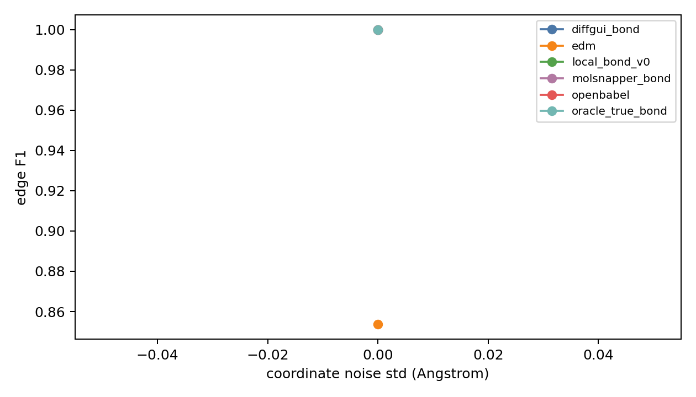
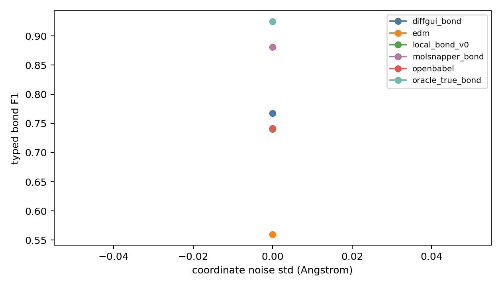
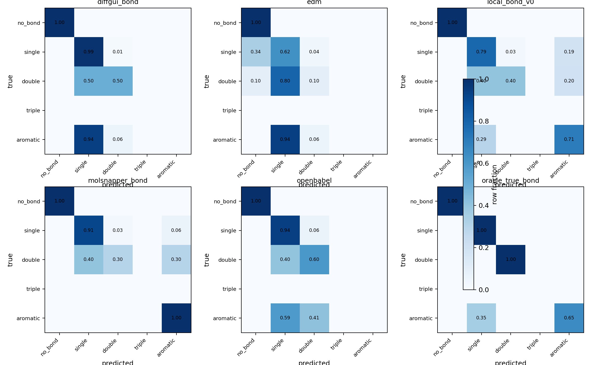
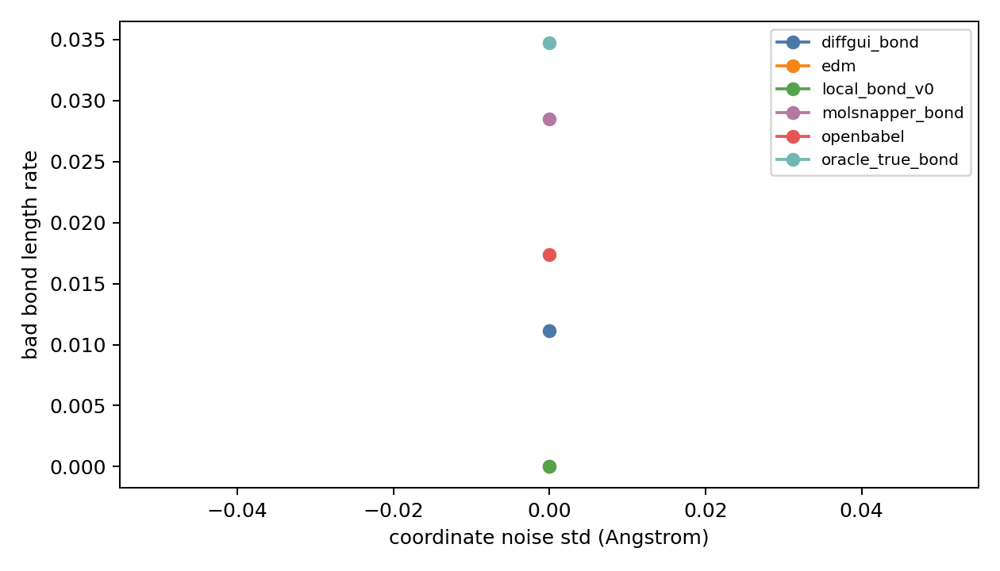
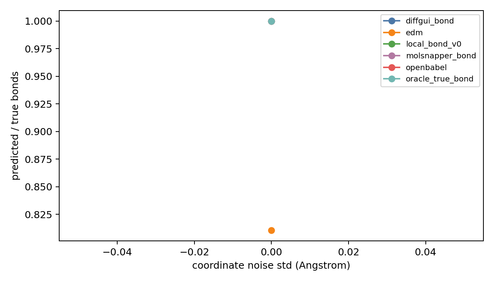
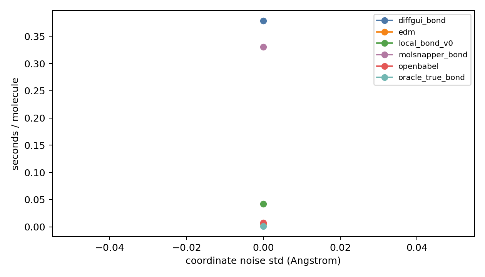

# Bond Predictor Diagnostics Report

## Metadata

- processed_npz: `data/crossdocked_raw/processed_edge_noH_full/test.npz`
- split: `test`
- crossdocked_samples: `5`
- sample_mode: `random`
- seed: `20260602`
- noise_stds: `0.0`
- methods: `oracle_true_bond openbabel edm diffgui_bond molsnapper_bond local_bond_v0`
- generated_samples: `0`
- generated_timesteps: `10`
- generated_reconstruction_methods: `openbabel edm`
- length_tolerance: `0.25`
- clash_threshold: `0.7`
- requested_device: `cuda:0`
- effective_device: `cuda:0`
- external_bond_device: `cuda:0`
- local_bond_device: `cuda:0`
- torch_cuda_available: `True`
- torch_cuda_device_count: `8`

## Clean CrossDocked Predictor Test

| method | sanitize | edge_f1 | typed_f1 | pred/true | bad_len | sec/mol |
| --- | --- | --- | --- | --- | --- | --- |
| diffgui_bond | 0.8000 | 1.0000 | 0.7676 | 1.0000 | 0.0111 | 0.3787 |
| edm | 1.0000 | 0.8536 | 0.5596 | 0.8104 | 0.0000 | 0.0061 |
| local_bond_v0 | 0.0000 | 1.0000 | 0.7404 | 1.0000 | 0.0000 | 0.0421 |
| molsnapper_bond | 0.6000 | 1.0000 | 0.8808 | 1.0000 | 0.0285 | 0.3302 |
| openbabel | 0.8000 | 1.0000 | 0.7415 | 1.0000 | 0.0174 | 0.0077 |
| oracle_true_bond | 0.8000 | 1.0000 | 0.9250 | 1.0000 | 0.0348 | 0.0008 |

## Noise Robustness Sweep

## Files

- [clean_noise_per_molecule.csv](clean_noise_per_molecule.csv)
- [clean_noise_summary.csv](clean_noise_summary.csv)
- [clean_noise_bond_type_confusion.csv](clean_noise_bond_type_confusion.csv)
- [clean_noise_bond_type_metrics.csv](clean_noise_bond_type_metrics.csv)
- [generated_geometry_per_molecule.csv](generated_geometry_per_molecule.csv)
- [generated_geometry_summary.csv](generated_geometry_summary.csv)
- [generated_reconstruction_per_molecule.csv](generated_reconstruction_per_molecule.csv)
- [generated_reconstruction_summary.csv](generated_reconstruction_summary.csv)
