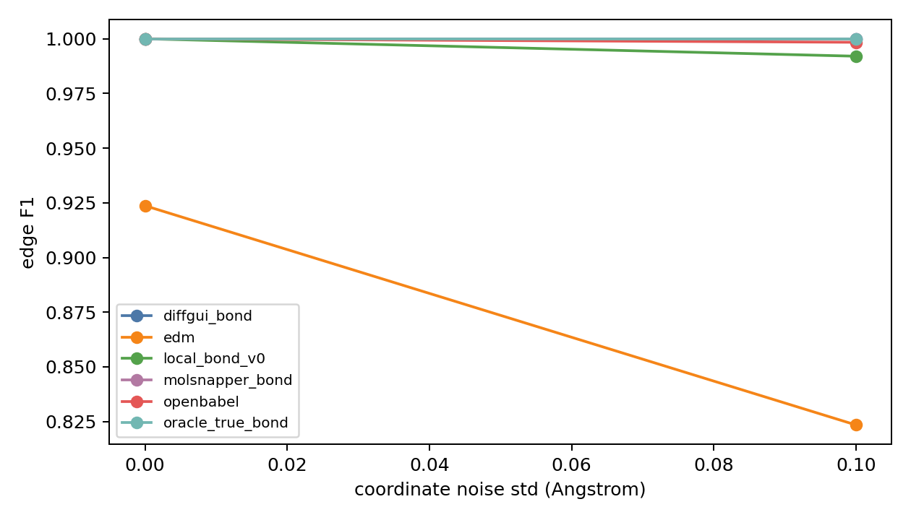
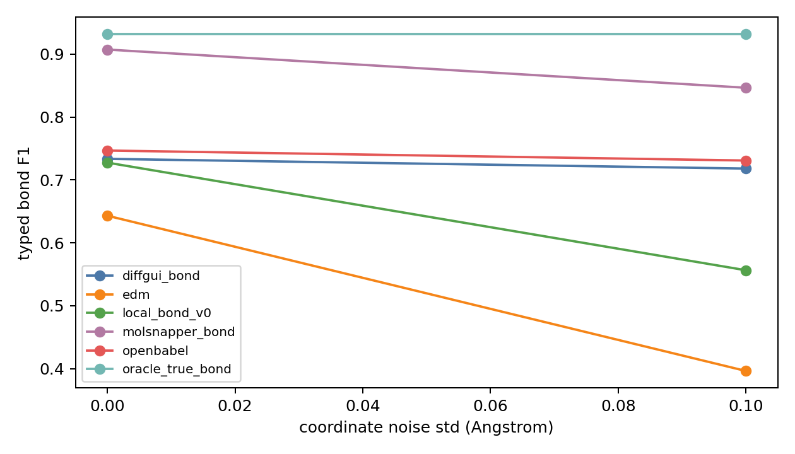
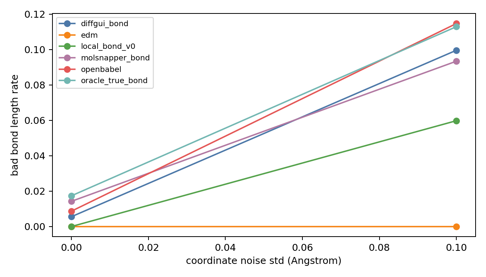
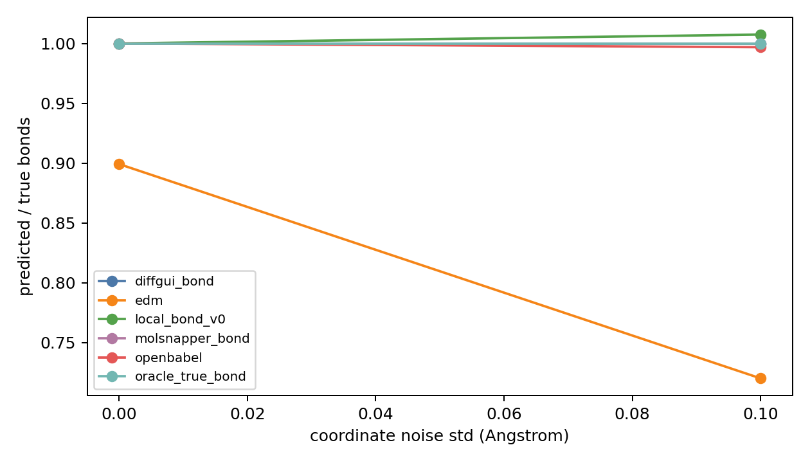
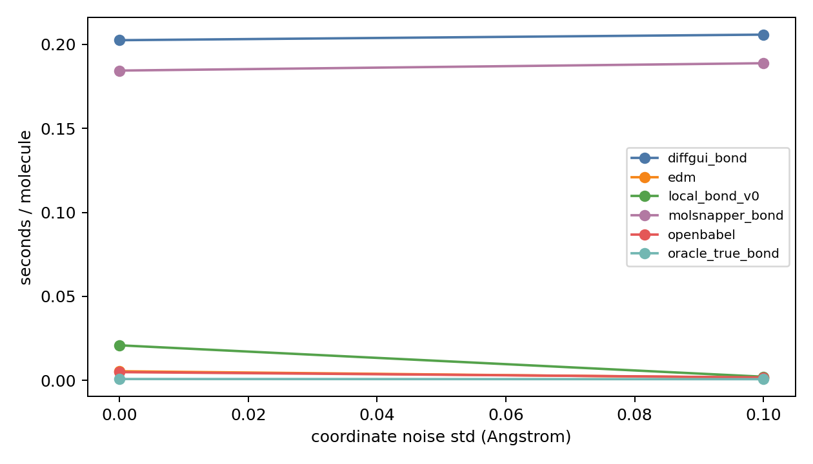
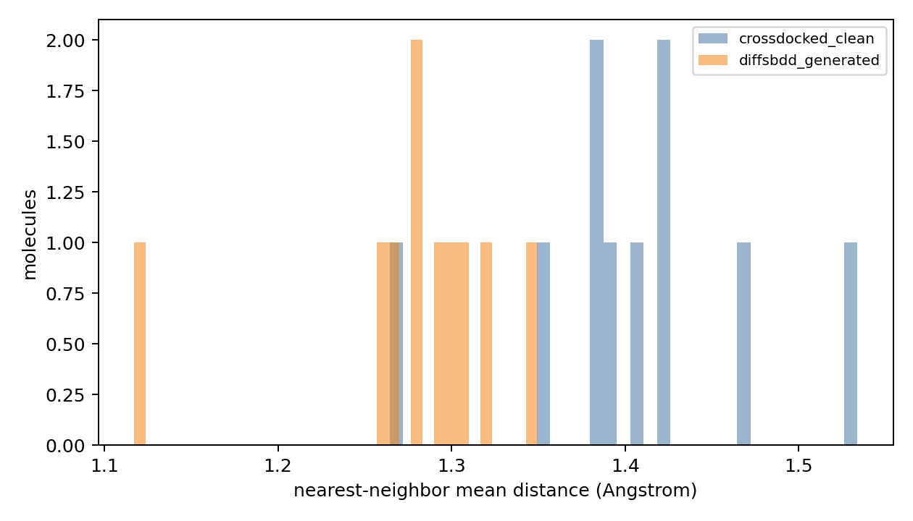
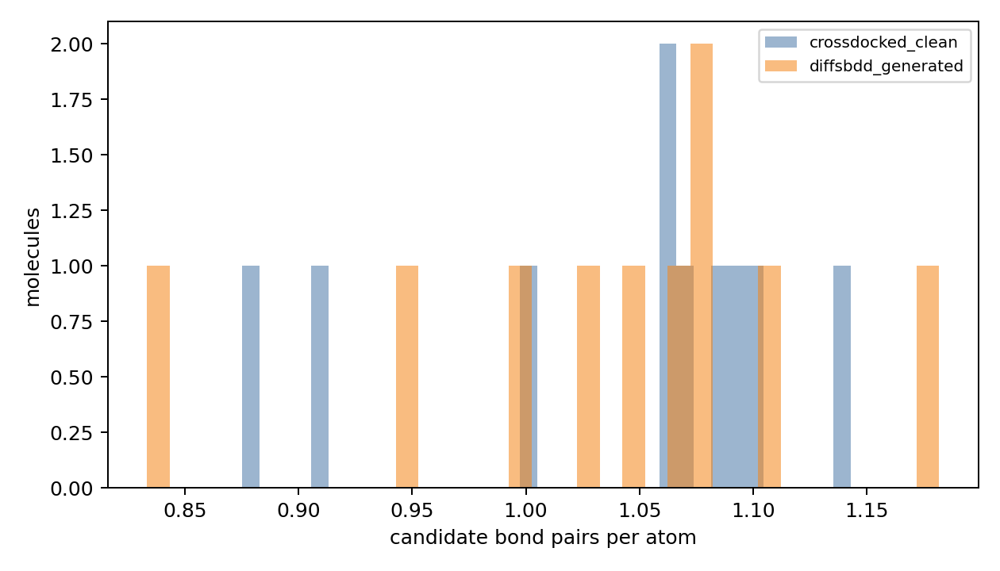
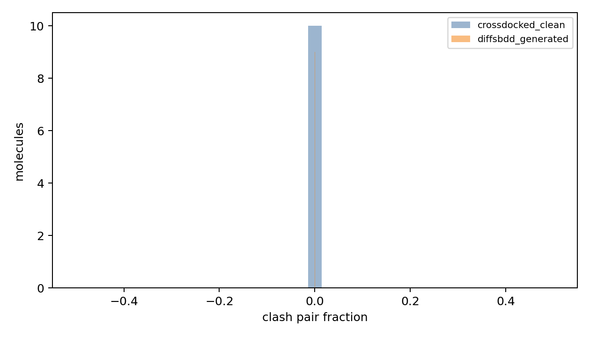
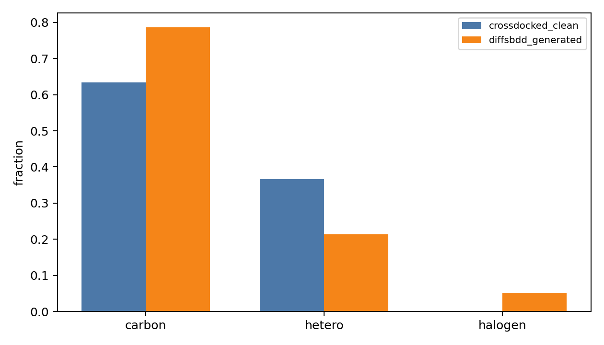
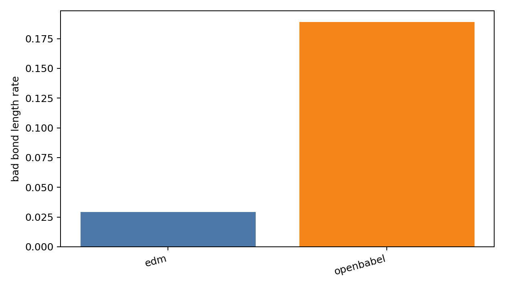

# Bond Predictor Diagnostics Report

## Metadata

- processed_npz: `data/crossdocked_raw/processed_edge_noH_full/test.npz`
- split: `test`
- crossdocked_samples: `10`
- sample_mode: `random`
- seed: `20260602`
- noise_stds: `0.0 0.1`
- methods: `oracle_true_bond openbabel edm diffgui_bond molsnapper_bond local_bond_v0`
- generated_samples: `10`
- generated_timesteps: `10`
- generated_reconstruction_methods: `openbabel edm`
- length_tolerance: `0.25`
- clash_threshold: `0.7`
- requested_device: `cuda:0`
- effective_device: `cuda:0`
- external_bond_device: `cuda:0`
- local_bond_device: `cuda:0`
- torch_cuda_available: `True`
- torch_cuda_device_count: `8`

## Clean CrossDocked Predictor Test

| method | sanitize | edge_f1 | typed_f1 | pred/true | bad_len | sec/mol |
| --- | --- | --- | --- | --- | --- | --- |
| diffgui_bond | 0.8000 | 1.0000 | 0.7335 | 1.0000 | 0.0056 | 0.2025 |
| edm | 1.0000 | 0.9237 | 0.6432 | 0.8991 | 0.0000 | 0.0055 |
| local_bond_v0 | 0.1000 | 1.0000 | 0.7276 | 1.0000 | 0.0000 | 0.0209 |
| molsnapper_bond | 0.7000 | 1.0000 | 0.9073 | 1.0000 | 0.0143 | 0.1844 |
| openbabel | 0.8000 | 1.0000 | 0.7468 | 1.0000 | 0.0087 | 0.0049 |
| oracle_true_bond | 0.8000 | 1.0000 | 0.9322 | 1.0000 | 0.0174 | 0.0008 |

## Noise Robustness Sweep

## Generated Point Cloud Geometry

| source | samples | atoms | C frac | hetero frac | NN mean | clash frac | cand/atom | true recall |
| --- | --- | --- | --- | --- | --- | --- | --- | --- |
| crossdocked_clean | 10 | 19.4000 | 0.6341 | 0.3659 | 1.4033 | 0.0000 | 1.0403 | 1.0000 |
| diffsbdd_generated | 10 | 22.9000 | 0.7867 | 0.2133 | 1.2771 | 0.0007 | 1.0368 | 0.0000 |

## Generated Reconstruction

| method | samples | sanitize | bad_len | fragments | QED | sec/mol |
| --- | --- | --- | --- | --- | --- | --- |
| edm | 10 | 0.0000 | 0.0293 | 3.0000 | 0.0000 | 0.0032 |
| openbabel | 10 | 0.8000 | 0.1890 | 1.4000 | 0.4810 | 0.0034 |

## Files

- [clean_noise_per_molecule.csv](clean_noise_per_molecule.csv)
- [clean_noise_summary.csv](clean_noise_summary.csv)
- [generated_geometry_per_molecule.csv](generated_geometry_per_molecule.csv)
- [generated_geometry_summary.csv](generated_geometry_summary.csv)
- [generated_reconstruction_per_molecule.csv](generated_reconstruction_per_molecule.csv)
- [generated_reconstruction_summary.csv](generated_reconstruction_summary.csv)
