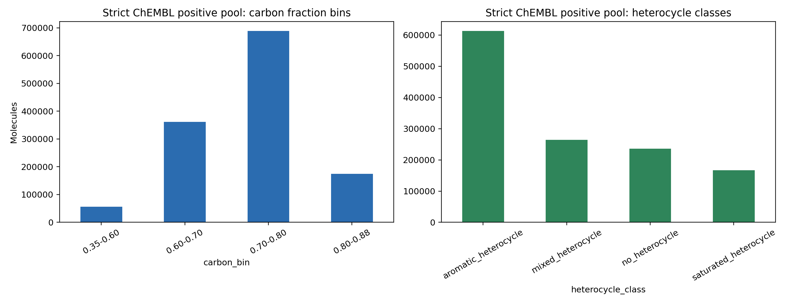
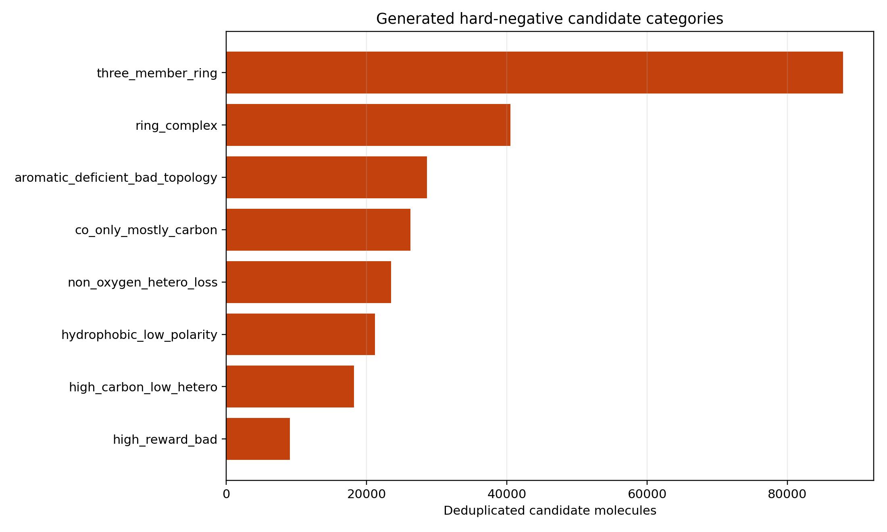

# 正负样本候选池 Dry-run

生成时间：2026-05-27 16:25:31

## 一、原则

本 dry-run 不覆盖现有 `chembl_classifier/data`，只在 analysis 目录中生成候选池和统计。

正样本来自当前版本 cleaned ChEMBL36 的 strict property pool。负样本只来自明确命中
reward loophole 的 OUT generated hard negatives；OUT 生成分子默认不是负样本。

## 二、正样本候选池

- ChEMBL 总量：1,550,090
- strict positive candidates：1,280,455
- strict positive fraction：82.61%
- positive strata：1,045

## 三、负样本候选池

- deduplicated generated hard negatives：105,658

类别计数：

- `three_member_ring`: 87,907
- `ring_complex`: 40,498
- `aromatic_deficient_bad_topology`: 28,612
- `co_only_mostly_carbon`: 26,217
- `non_oxygen_hetero_loss`: 23,468
- `hydrophobic_low_polarity`: 21,208
- `high_carbon_low_hetero`: 18,199
- `high_reward_bad`: 9,068

## 四、建议

下一步不要直接训练，而是先确定目标训练集规模和采样比例。

建议第一版：

- 正样本：从 strict positive pool 中分层抽样 100k。
- 负样本：从 generated hard negatives 中按类别均衡抽样；每个 confirmed loophole 至少几千条。
- 保留 generated-good/gray 分子作为未标注池和外部检查集，不进入负样本。
- 训练后必须报告 per-category recall、high_reward_bad false-negative rate、scaffold split AUC。
