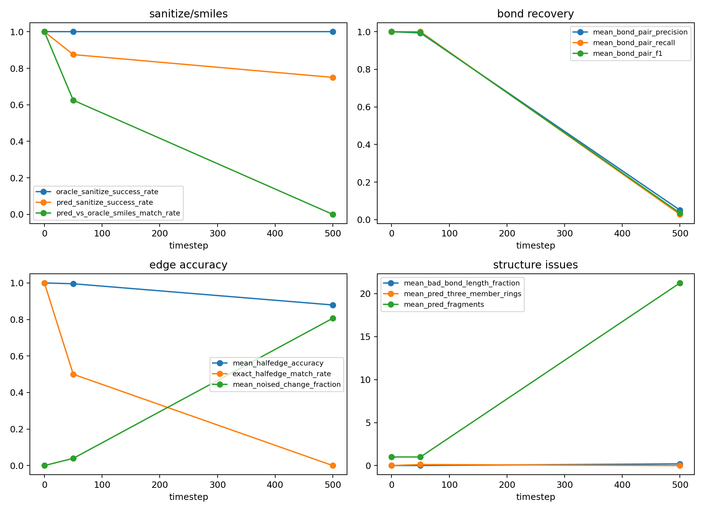

# DiffSBDD-xhe Predicted Edge Reconstruction Smoke

## 目的

本测试验证训练后的 DiffSBDD-xhe edge head 是否能在真实 CrossDocked val 点云与真实 atom type 条件下，把 noised halfedge type 预测回可重建分子。这是 teacher-forced reconstruction smoke，不是完整自由采样，也不接入 RL。

## 配置

- checkpoint: `analysis/diffsbdd_xhe_supervised_20260604_20k_6gpu/lightning/diffsbdd-xhe-20k-6gpu-260604-b4-3ep/checkpoints/last.ckpt`
- config: `analysis/diffsbdd_xhe_supervised_20260604_20k_6gpu/diffsbdd_xhe_20k_6gpu_b4_3ep.yaml`
- split: `val`
- device: `cuda`
- molecules: 8
- timesteps: `[0, 50, 500]`
- elapsed_seconds: 5.518110
- seconds_per_molecule_per_timestep: 0.229921

## 汇总

| timestep | pred_sanitize_success_rate | pred_vs_oracle_smiles_match_rate | mean_bond_pair_f1 | mean_halfedge_accuracy | mean_bad_bond_length_fraction | mean_pred_bond_count | mean_target_bond_count | mean_pred_three_member_rings |
|---:|---:|---:|---:|---:|---:|---:|---:|---:|
| 0 | 1.000000 | 1.000000 | 1.000000 | 1.000000 | 0.000000 | 25.000000 | 25.000000 | 0.000000 |
| 50 | 0.875000 | 0.625000 | 0.996795 | 0.995566 | 0.006250 | 25.125000 | 25.000000 | 0.125000 |
| 500 | 0.750000 | 0.000000 | 0.035406 | 0.879420 | 0.199405 | 2.875000 | 25.000000 | 0.000000 |

## 解释边界

- 如果这里 sanitize/键恢复差，说明 edge head 或 x/h/e 训练还不够；不能直接进入完整 sampler/RL。
- 如果这里表现好，也只证明真实点云上的 edge denoising/reconstruction 可行；还需要完整 e sampler 与生成点云测试，才能判断真实生成质量提升。

## 文件

- [predicted_edge_reconstruction_rows.csv](predicted_edge_reconstruction_rows.csv)
- [predicted_edge_reconstruction_summary.csv](predicted_edge_reconstruction_summary.csv)
- [predicted_edge_reconstruction_summary.json](predicted_edge_reconstruction_summary.json)
- [predicted_edge_reconstruction_confusion.csv](predicted_edge_reconstruction_confusion.csv)
- [predicted_edge_reconstruction_metrics.png](predicted_edge_reconstruction_metrics.png)
- [oracle_edges_t0.sdf](oracle_edges_t0.sdf)
- [predicted_edges_t0.sdf](predicted_edges_t0.sdf)
- [oracle_edges_t50.sdf](oracle_edges_t50.sdf)
- [predicted_edges_t50.sdf](predicted_edges_t50.sdf)
- [oracle_edges_t500.sdf](oracle_edges_t500.sdf)
- [predicted_edges_t500.sdf](predicted_edges_t500.sdf)

