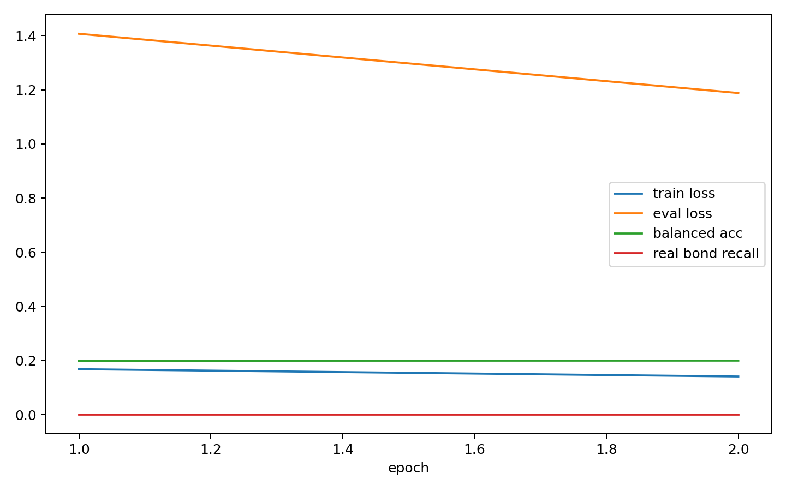

# Edge Denoiser Overfit Report

- edge_npz: `analysis/edge_data_chain_20260602_n1000/train_edge.npz`
- semantic_npz: `analysis/edge_semantic_bundle_20260602_n1000/train_edge_semantic.npz`
- device: `cpu`
- max_molecules: 8
- epochs: 2
- batch_size: 4
- model_kind: `node_edge`
- focal_gamma: 1.0

## Class Counts And Weights

| bond type | count | weight |
|---|---:|---:|
| no_bond | 2556 | 0.093524 |
| single | 128 | 0.416383 |
| double | 13 | 1.263932 |
| triple | 2 | 2.730406 |
| aromatic | 90 | 0.495755 |

## Final Metrics

| metric | value |
|---|---:|
| train_loss | 0.141375 |
| eval_loss | 1.188274 |
| accuracy | 0.916458 |
| balanced_accuracy | 0.200000 |
| real_bond_recall | 0.000000 |
| no_bond_recall | 1.000000 |
| recall_single | 0.000000 |
| recall_double | 0.000000 |
| recall_triple | 0.000000 |
| recall_aromatic | 0.000000 |

## Best Balanced Accuracy Epoch

- epoch: 2
- balanced_accuracy: 0.200000
- real_bond_recall: 0.000000

## Files

- [edge_denoiser_overfit_metrics.csv](edge_denoiser_overfit_metrics.csv)
- [edge_denoiser_overfit_summary.json](edge_denoiser_overfit_summary.json)
- [edge_denoiser_overfit.pt](edge_denoiser_overfit.pt)

