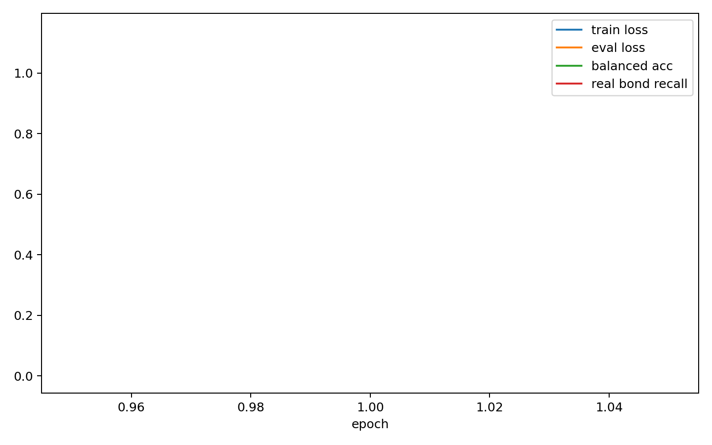

# Edge Denoiser Overfit Report

- edge_npz: `analysis/edge_data_chain_20260602_n1000/train_edge.npz`
- semantic_npz: `analysis/edge_semantic_bundle_20260602_n1000/train_edge_semantic.npz`
- device: `cpu`
- max_molecules: 16
- split_mode: `train_val`
- train_molecules: 12
- eval_molecules: 4
- epochs: 1
- batch_size: 4
- model_kind: `node_edge`
- focal_gamma: 1.0

## Class Counts And Weights

| bond type | count | weight |
|---|---:|---:|
| no_bond | 3526 | 0.084689 |
| single | 164 | 0.391549 |
| double | 17 | 1.185473 |
| triple | 2 | 2.903804 |
| aromatic | 133 | 0.434486 |

## Eval Class Counts

| bond type | count |
|---|---:|
| no_bond | 1483 |
| single | 78 |
| double | 8 |
| triple | 0 |
| aromatic | 43 |

## Final Metrics

| metric | value |
|---|---:|
| train_loss | 0.125715 |
| eval_loss | 1.139762 |
| accuracy | 0.911290 |
| balanced_accuracy | 0.198112 |
| real_bond_recall | 0.000000 |
| no_bond_recall | 0.990560 |
| recall_single | 0.000000 |
| recall_double | 0.000000 |
| recall_triple | 0.000000 |
| recall_aromatic | 0.000000 |

## Best Balanced Accuracy Epoch

- epoch: 1
- balanced_accuracy: 0.198112
- real_bond_recall: 0.000000

## Files

- [edge_denoiser_overfit_metrics.csv](edge_denoiser_overfit_metrics.csv)
- [edge_denoiser_overfit_summary.json](edge_denoiser_overfit_summary.json)
- [edge_denoiser_overfit.pt](edge_denoiser_overfit.pt)

