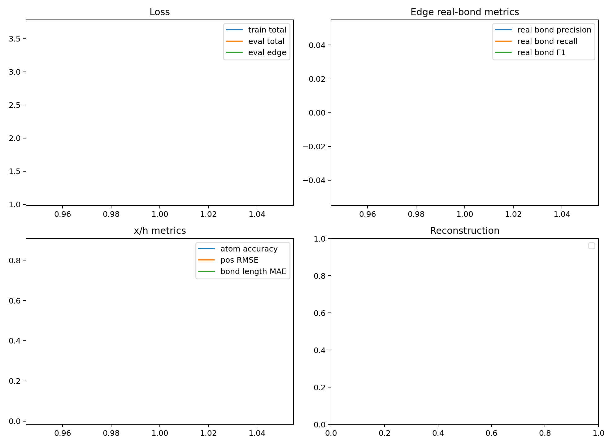

# Edge Diffusion DDP Training Report

## Scope

Standalone x/h/e edge diffusion supervised training. This path is intentionally decoupled from DDPO/RL and does not import `ddpo`.

## Configuration

- edge_npz: `analysis/edge_data_chain_20260602_repair_n1000/train_edge.npz`
- semantic_npz: `analysis/edge_semantic_bundle_20260602_n1000/train_edge_semantic.npz`
- device: `cuda:0`
- distributed: `True`
- world_size: 2
- max_molecules: 64
- train_molecules: 48
- eval_molecules: 16
- epochs: 1
- batch_size_per_rank: 4
- global_batch_size: 8
- elapsed_seconds: 1.06
- seconds_per_epoch: 1.0645

## Final Metrics

| metric | value |
|---|---:|
| train_total | 3.659447 |
| train_pos | 0.000821 |
| train_atom | 2.218066 |
| train_edge | 1.440161 |
| train_bond_length | 0.000797 |
| eval_total | 3.040327 |
| eval_pos | 0.000659 |
| eval_atom | 1.930427 |
| eval_edge | 1.108922 |
| eval_bond_length | 0.000639 |
| eval_edge_accuracy | 0.907011 |
| eval_edge_balanced_accuracy | 0.200000 |
| eval_edge_real_bond_precision | 0.000000 |
| eval_edge_real_bond_recall | 0.000000 |
| eval_edge_real_bond_f1 | 0.000000 |
| eval_atom_accuracy | 0.865889 |
| eval_pos_rmse | 0.025604 |
| eval_bond_length_mae | 0.028694 |

## Best Real-Bond F1 Epoch

- epoch: 1
- eval_edge_real_bond_f1: 0.000000
- eval_edge_real_bond_recall: 0.000000

## Files

- [edge_diffusion_ddp_metrics.csv](edge_diffusion_ddp_metrics.csv)
- [edge_diffusion_ddp_summary.json](edge_diffusion_ddp_summary.json)
- [edge_diffusion_ddp_latest.pt](edge_diffusion_ddp_latest.pt)
- [edge_diffusion_ddp_curves.png](edge_diffusion_ddp_curves.png)

