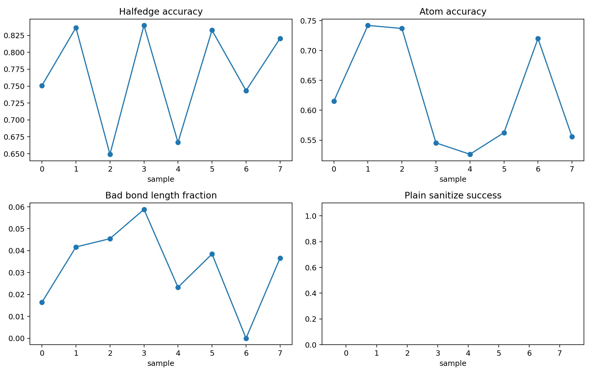

# Edge Diffusion Sampler Smoke

## Scope

This is an isolated x/h/e edge-diffusion sampler smoke test. It does not import or modify DDPO/RL modules, rewards, launch configs, or the normal DiffSBDD reinforcement-learning path.

## Configuration

- mode: `prior`
- checkpoint: `analysis/edge_diffusion_xhe_overfit_20260603_n128_uniform_gpu/edge_diffusion_overfit.pt`
- edge_npz: `analysis/edge_data_chain_20260602_repair_n1000/train_edge.npz`
- semantic_npz: `analysis/edge_semantic_bundle_20260602_n1000/train_edge_semantic.npz`
- device: `cuda`
- molecules: 8
- start_timestep: 50
- reverse_steps: 51
- edge_prior: `uniform`
- pos_noise_std: 0.05
- pos_noise_mode: `t_scaled`
- atom_corruption_prob: 0.05

> `prior` mode preserves atom counts/halfedge topology from the input batch for smoke testing. It is not a production de novo molecule generator.

## Metrics

| metric | value |
|---|---:|
| elapsed_seconds | 10.184598 |
| seconds_per_molecule | 1.273075 |
| mean_sampling_seconds | 0.395916 |
| p95_sampling_seconds | 0.541991 |
| atom_accuracy_mean | 0.625499 |
| position_rmse_mean | 2.737642 |
| exact_halfedge_match_rate | 0.000000 |
| bond_pair_set_match_rate | 0.000000 |
| bond_type_map_match_rate | 0.000000 |
| mean_halfedge_accuracy | 0.767447 |
| mean_bond_pair_precision | 0.099419 |
| mean_bond_pair_recall | 0.160187 |
| plain_sanitize_success_rate | 0.000000 |
| semantic_sanitize_success_rate | 0.000000 |
| mean_bad_bond_length_fraction | 0.032580 |
| total_bad_bond_length_count | 12.000000 |

## Edge Class Names

| id | type |
|---:|---|
| 0 | no_bond |
| 1 | single |
| 2 | double |
| 3 | triple |
| 4 | aromatic |

## Files

- [prior_sampler_rows.csv](prior_sampler_rows.csv)
- [prior_sampler_summary.json](prior_sampler_summary.json)
- [prior_predicted_edge_plain.sdf](prior_predicted_edge_plain.sdf)
- [prior_predicted_edge_semantic.sdf](prior_predicted_edge_semantic.sdf)
- [prior_sampler_metrics.png](prior_sampler_metrics.png)

