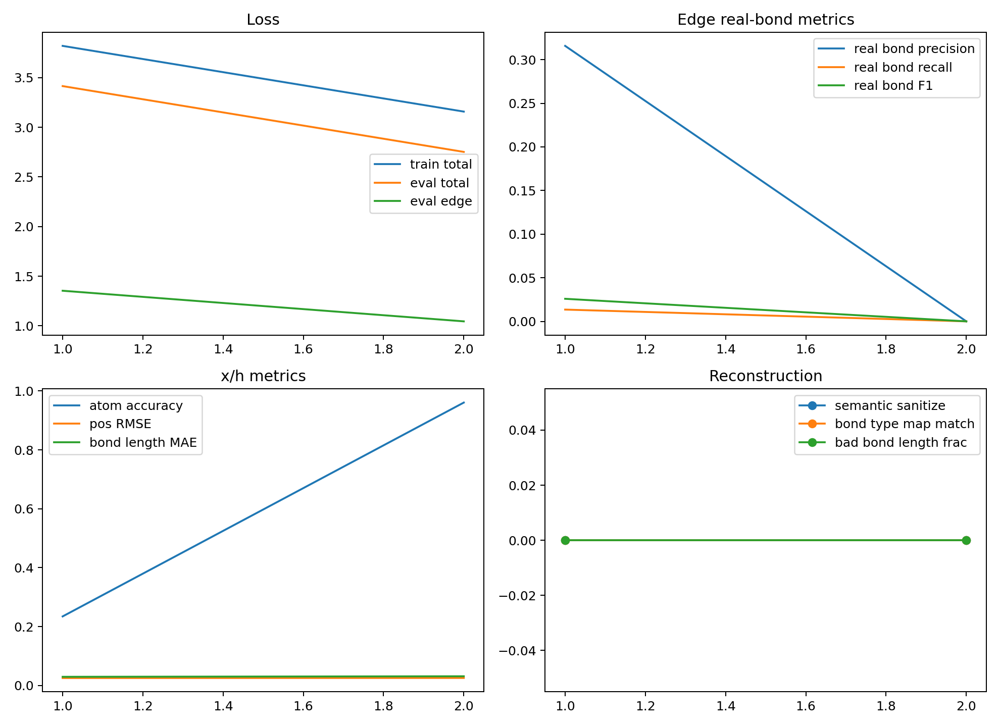

# Edge Diffusion x/h/e Overfit Report

- edge_npz: `analysis/edge_data_chain_20260602_repair_n1000/train_edge.npz`
- semantic_npz: `analysis/edge_semantic_bundle_20260602_n1000/train_edge_semantic.npz`
- device: `cpu`
- max_molecules: 16
- split_mode: `overfit`
- train_molecules: 16
- eval_molecules: 16
- epochs: 2
- batch_size: 4
- elapsed_seconds: 1.05
- seconds_per_epoch: 0.5229
- eval_timestep: 500
- pos_noise_std: 0.05
- pos_noise_mode: `t_scaled`
- atom_corruption_prob: 0.05
- edge_prior: `absorb`
- edge_class_weight_mode: `inverse_sqrt`
- reconstruction_validation: `True`

## Edge Class Counts And Weights

| bond type | train count | eval count | weight |
|---|---:|---:|---:|
| no_bond | 5009 | 5009 | 0.076210 |
| single | 242 | 242 | 0.346043 |
| double | 25 | 25 | 1.057904 |
| triple | 2 | 2 | 3.114385 |
| aromatic | 176 | 176 | 0.405458 |

## Final Metrics

| metric | value |
|---|---:|
| train_total | 3.158077 |
| train_pos | 0.000913 |
| train_atom | 1.923868 |
| train_edge | 1.232782 |
| train_bond_length | 0.001028 |
| eval_total | 2.751978 |
| eval_pos | 0.000653 |
| eval_atom | 1.706293 |
| eval_edge | 1.044659 |
| eval_bond_length | 0.000747 |
| eval_edge_accuracy | 0.918409 |
| eval_edge_balanced_accuracy | 0.200000 |
| eval_edge_real_bond_precision | 0.000000 |
| eval_edge_real_bond_recall | 0.000000 |
| eval_edge_real_bond_f1 | 0.000000 |
| eval_atom_accuracy | 0.960494 |
| eval_pos_rmse | 0.025592 |
| eval_bond_length_mae | 0.031345 |
| eval_edge_recall_single | 0.000000 |
| eval_edge_recall_double | 0.000000 |
| eval_edge_recall_triple | 0.000000 |
| eval_edge_recall_aromatic | 0.000000 |

## Final Reconstruction Metrics

| metric | value |
|---|---:|
| recon_molecules | 4.000000 |
| recon_exact_halfedge_match_rate | 0.000000 |
| recon_bond_pair_set_match_rate | 0.000000 |
| recon_bond_type_map_match_rate | 0.000000 |
| recon_plain_sanitize_success_rate | 1.000000 |
| recon_semantic_sanitize_success_rate | 0.000000 |
| recon_plain_smiles_no_stereo_match_rate | 0.000000 |
| recon_semantic_smiles_no_stereo_match_rate | 0.000000 |
| recon_mean_bad_bond_length_fraction | 0.000000 |

## Best Real-Bond F1 Epoch

- epoch: 1
- eval_edge_real_bond_f1: 0.025862
- eval_edge_real_bond_recall: 0.013483

## Files

- [edge_diffusion_overfit_metrics.csv](edge_diffusion_overfit_metrics.csv)
- [edge_diffusion_overfit_summary.json](edge_diffusion_overfit_summary.json)
- [edge_diffusion_overfit.pt](edge_diffusion_overfit.pt)
- [edge_diffusion_reconstruction_rows.csv](edge_diffusion_reconstruction_rows.csv)

