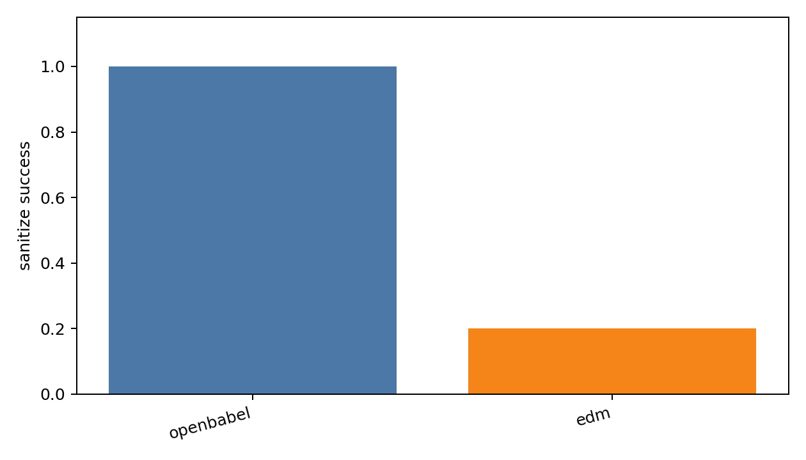
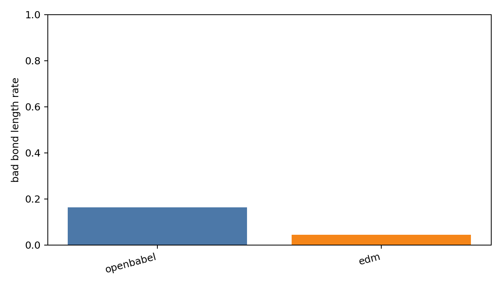
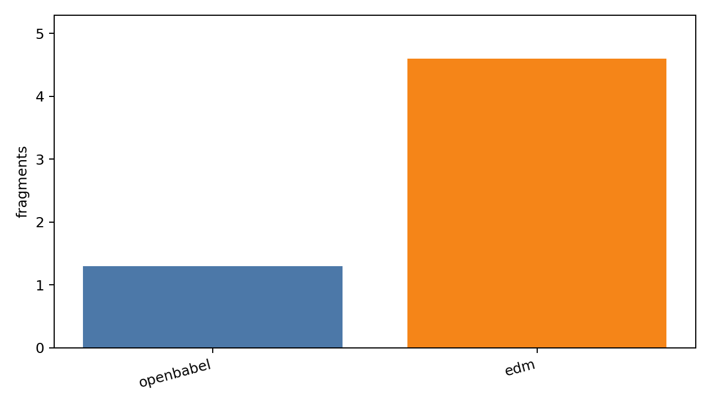
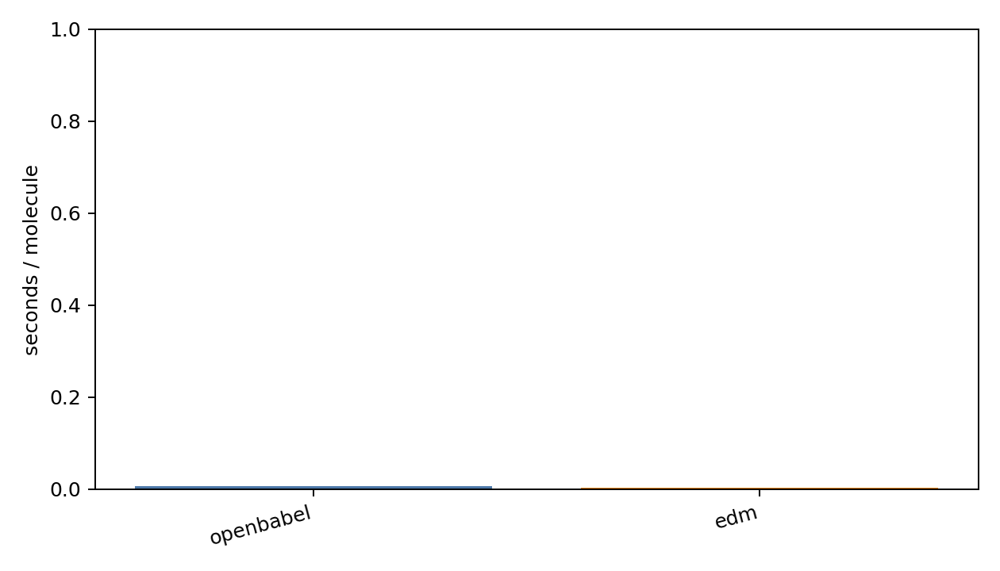

# Generated Reconstruction Ablation Report

- checkpoint: `DiffSBDD/checkpoints/crossdocked_fullatom_cond.ckpt`
- pdbfile: `data/8GJL.pdb`
- ref_ligand: `C:1101`
- resi_list: `None`
- samples: 10
- timesteps: 10
- length_tolerance: 0.25

| method | sanitize | bad_bond_length | fragments | aromatic_rings | seconds/mol |
|---|---:|---:|---:|---:|---:|
| openbabel | 1.000 | 0.163 | 1.300 | 0.200 | 0.0066 |
| edm | 0.200 | 0.045 | 4.600 | 0.000 | 0.0029 |

