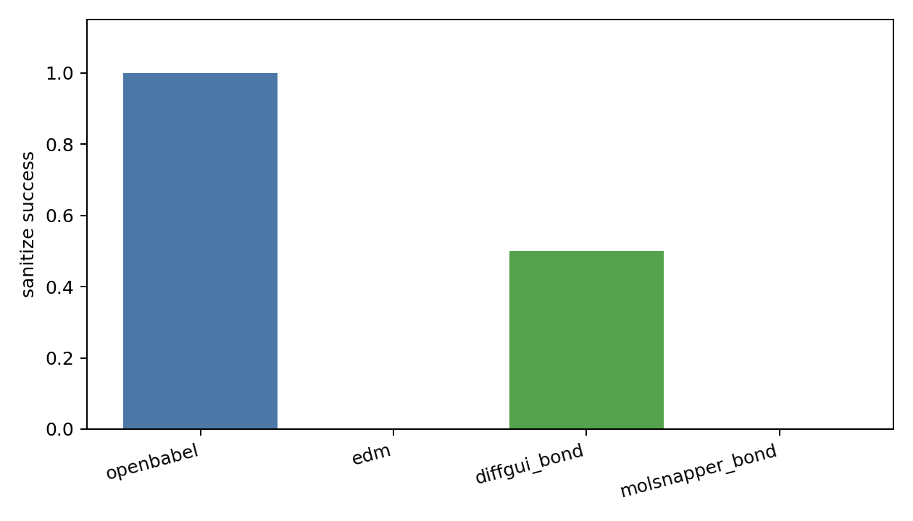
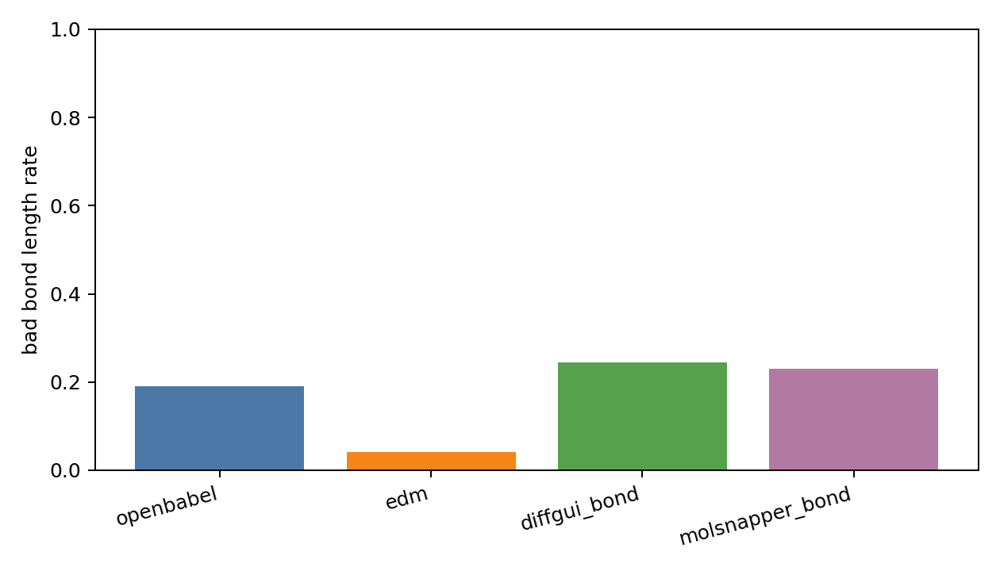
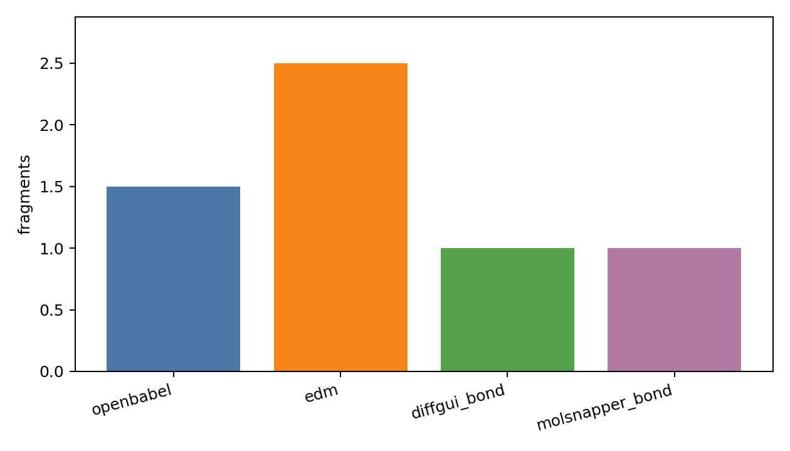
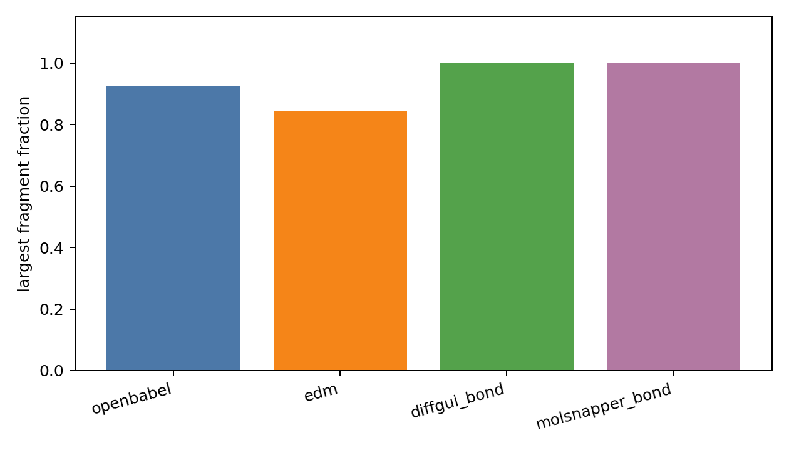
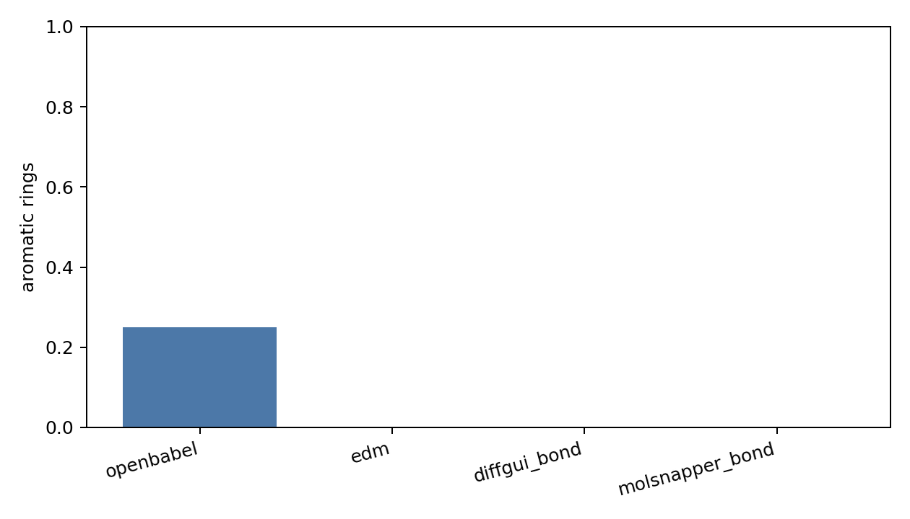
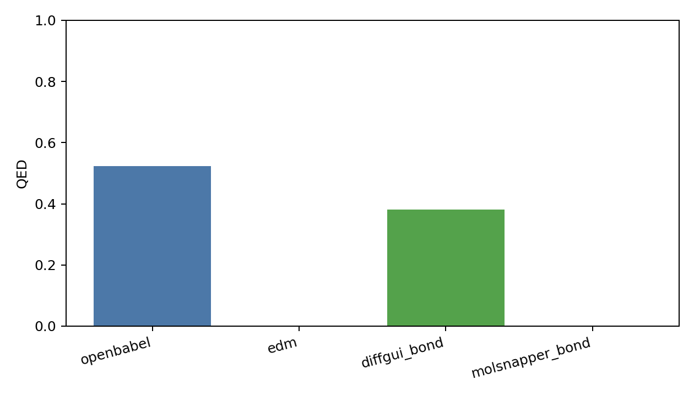
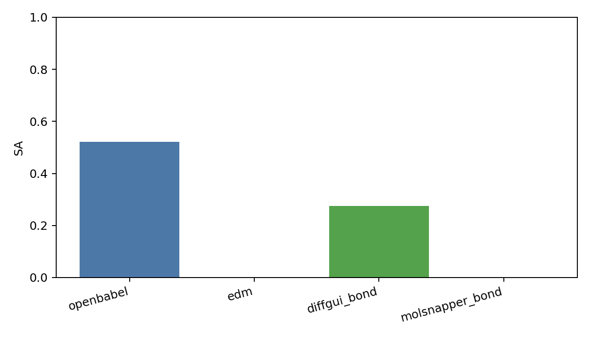
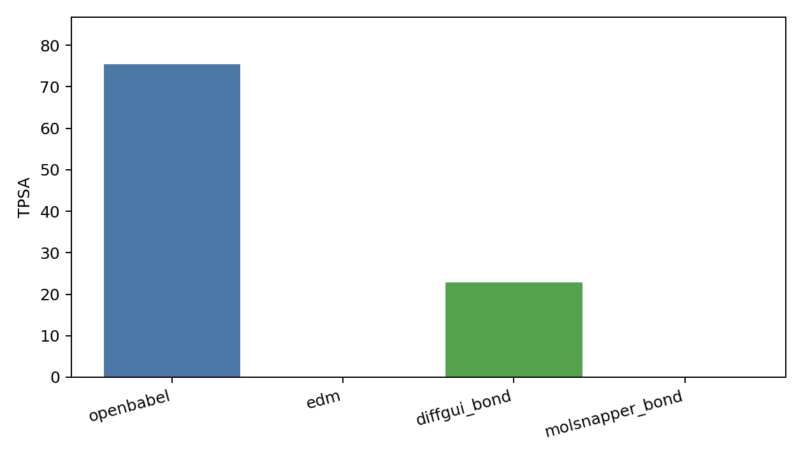
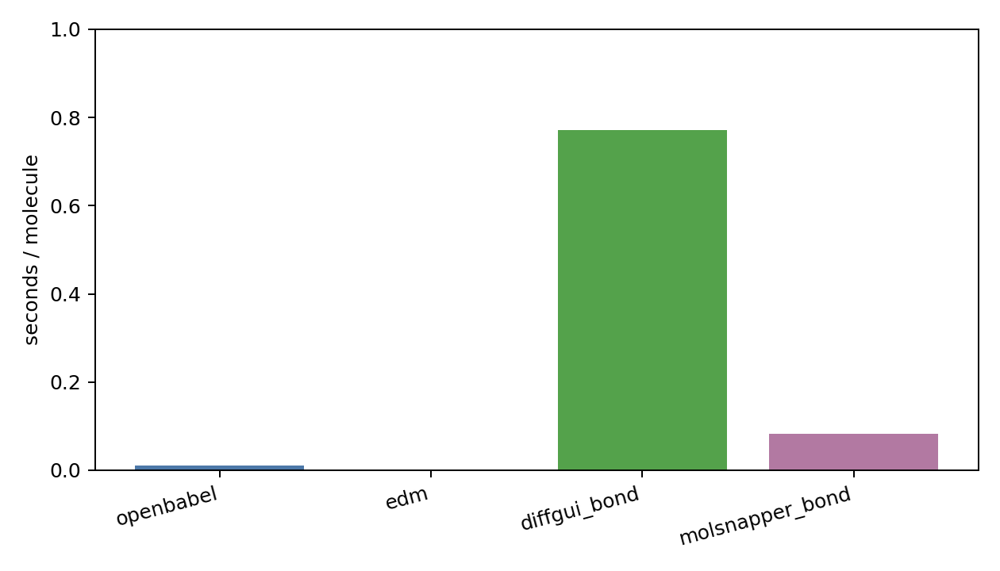

# Generated Reconstruction Benchmark Report

- checkpoint: `DiffSBDD/checkpoints/crossdocked_fullatom_cond.ckpt`
- pdbfile: `data/8GJL.pdb`
- ref_ligand: `C:1101`
- resi_list: `None`
- samples: `4`
- timesteps: `10`
- length_tolerance: `0.25`
- methods: `openbabel edm diffgui_bond molsnapper_bond`

| method | sanitize | bad_bond_length | fragments | largest_frag | aromatic | QED | SA | TPSA | sec/mol |
|---|---:|---:|---:|---:|---:|---:|---:|---:|---:|
| openbabel | 1.000 | 0.191 | 1.500 | 0.925 | 0.250 | 0.523 | 0.522 | 75.453 | 0.0109 |
| edm | 0.000 | 0.042 | 2.500 | 0.846 | 0.000 | 0.000 | 0.000 | 0.000 | 0.0023 |
| diffgui_bond | 0.500 | 0.244 | 1.000 | 1.000 | 0.000 | 0.381 | 0.275 | 22.905 | 0.7718 |
| molsnapper_bond | 0.000 | 0.231 | 1.000 | 1.000 | 0.000 | 0.000 | 0.000 | 0.000 | 0.0820 |

## External Bond Resources

| name | checkpoint | config | source | status |
|---|---:|---:|---:|---|
| diffgui_pretrained_bond_predictor | 1 | 1 | 1 | resource_found_adapter_available |
| molsnapper_pretrained_bond_predictor | 1 | 0 | 1 | resource_found_adapter_available |
| decompopt_generated_with_bond_reconstruct | 0 | 0 | 1 | source_found_no_checkpoint |

