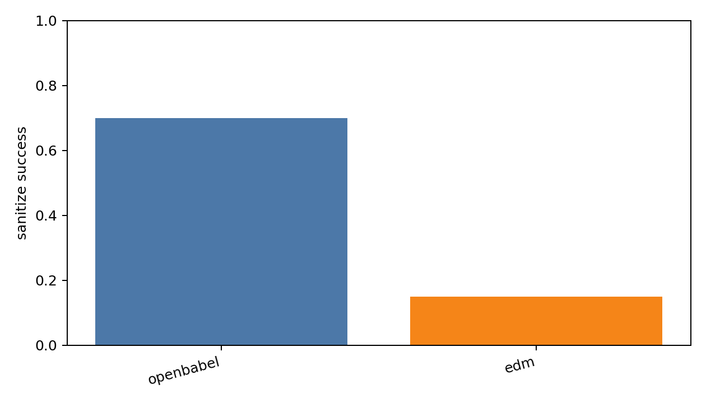
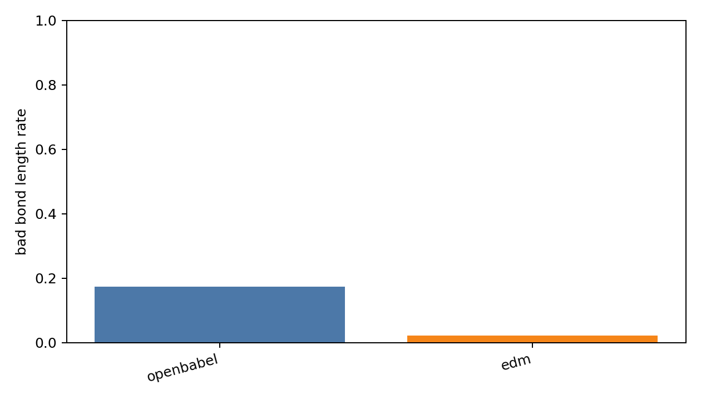
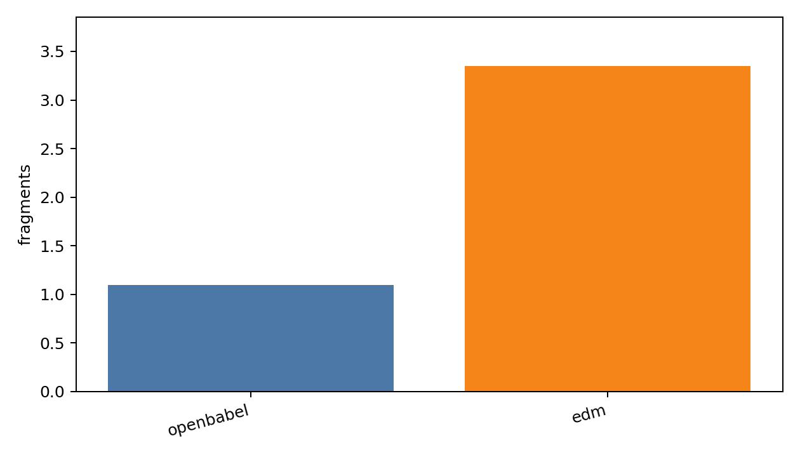
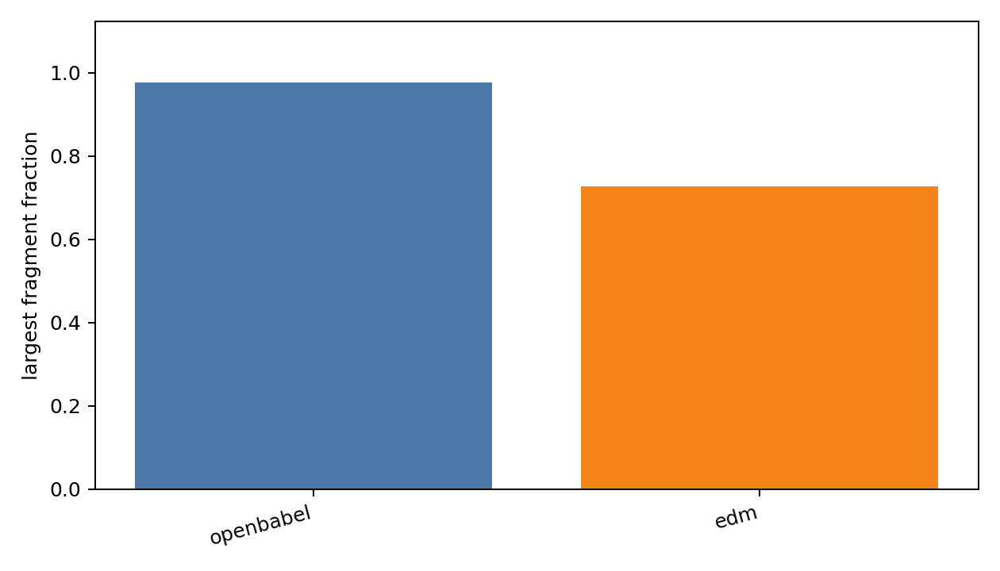
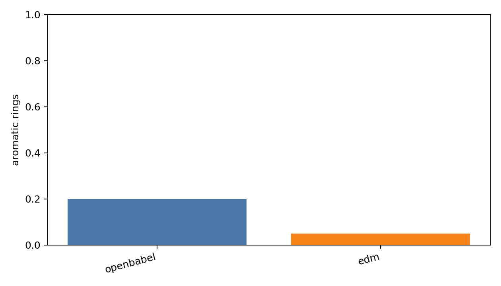
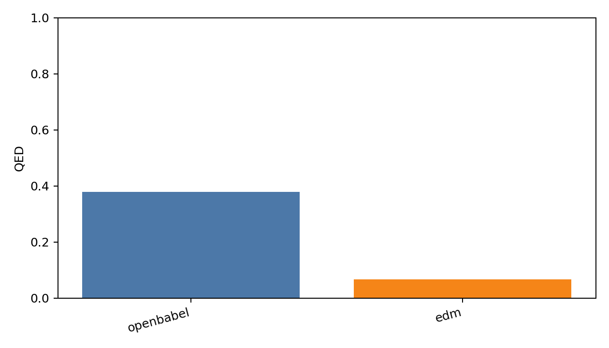
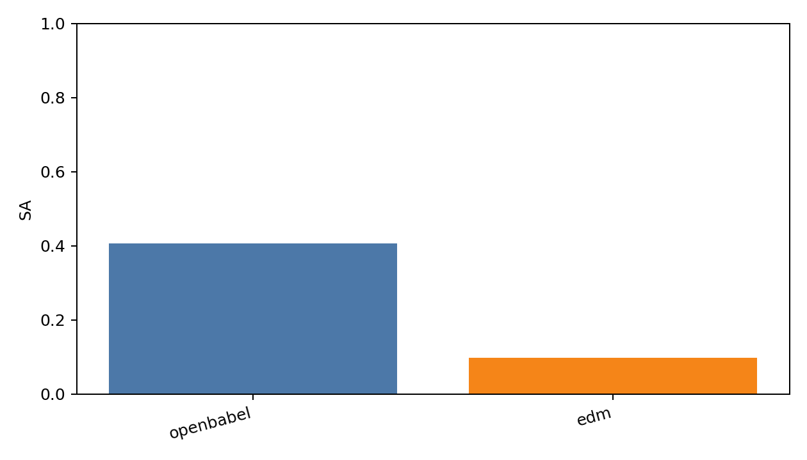
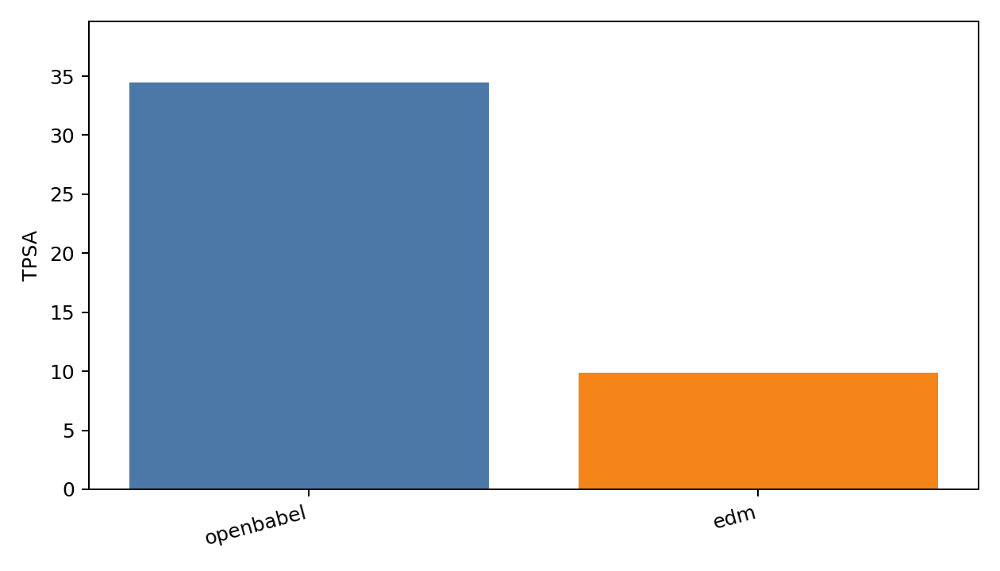
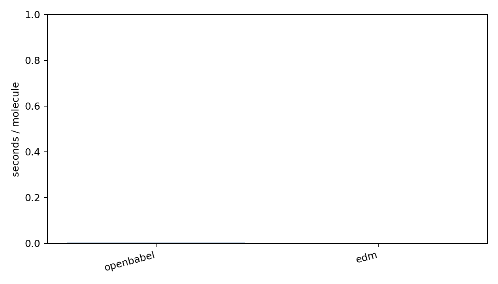

# Generated Reconstruction Benchmark Report

- checkpoint: `DiffSBDD/checkpoints/crossdocked_fullatom_cond.ckpt`
- pdbfile: `data/8GJL.pdb`
- ref_ligand: `C:1101`
- resi_list: `None`
- samples: `20`
- timesteps: `10`
- length_tolerance: `0.25`
- methods: `openbabel edm`

| method | sanitize | bad_bond_length | fragments | largest_frag | aromatic | QED | SA | TPSA | sec/mol |
|---|---:|---:|---:|---:|---:|---:|---:|---:|---:|
| openbabel | 0.700 | 0.173 | 1.100 | 0.977 | 0.200 | 0.380 | 0.407 | 34.469 | 0.0040 |
| edm | 0.150 | 0.022 | 3.350 | 0.728 | 0.050 | 0.067 | 0.098 | 9.886 | 0.0016 |

## External Bond Resources

| name | checkpoint | config | source | status |
|---|---:|---:|---:|---|
| diffgui_pretrained_bond_predictor | 1 | 1 | 1 | resource_found_adapter_pending |
| molsnapper_pretrained_bond_predictor | 1 | 0 | 1 | resource_found_adapter_pending |
| decompopt_generated_with_bond_reconstruct | 0 | 0 | 1 | source_found_no_checkpoint |

