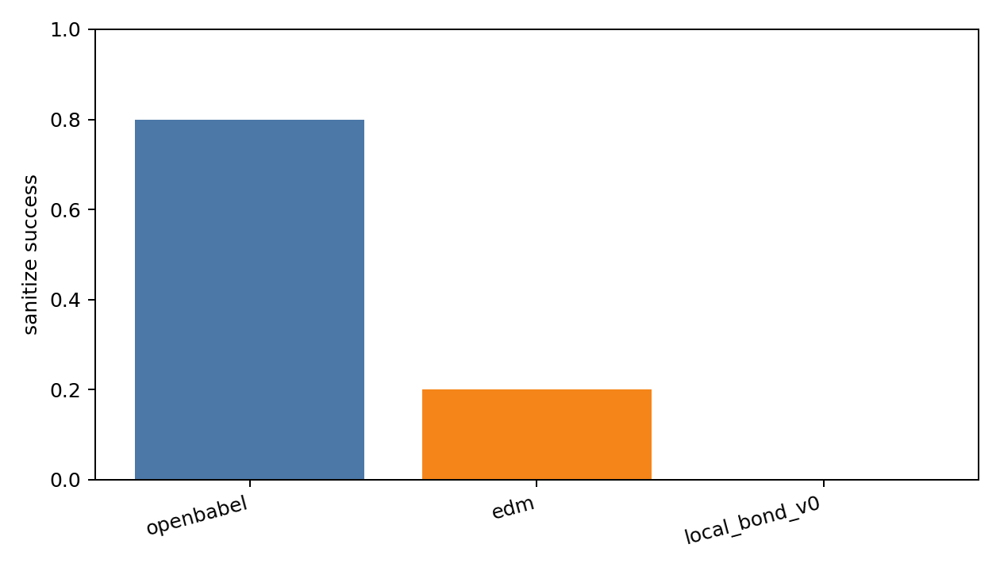
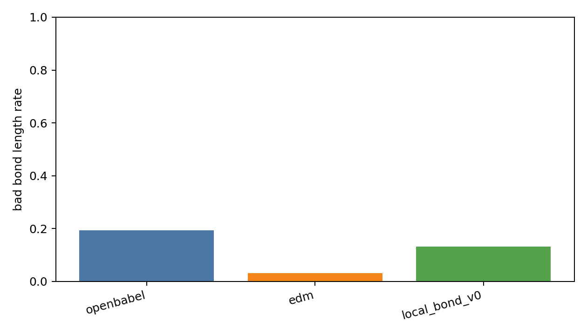
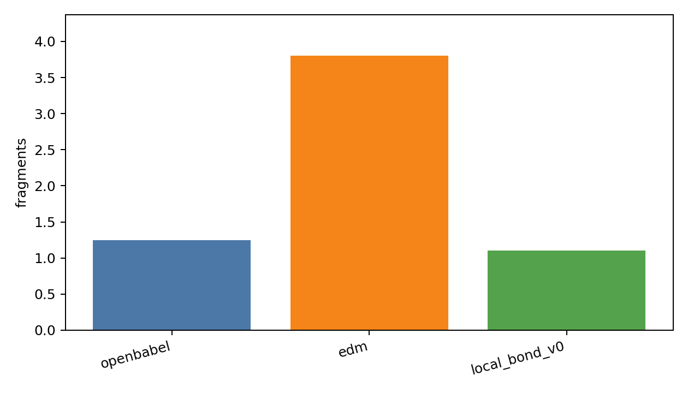
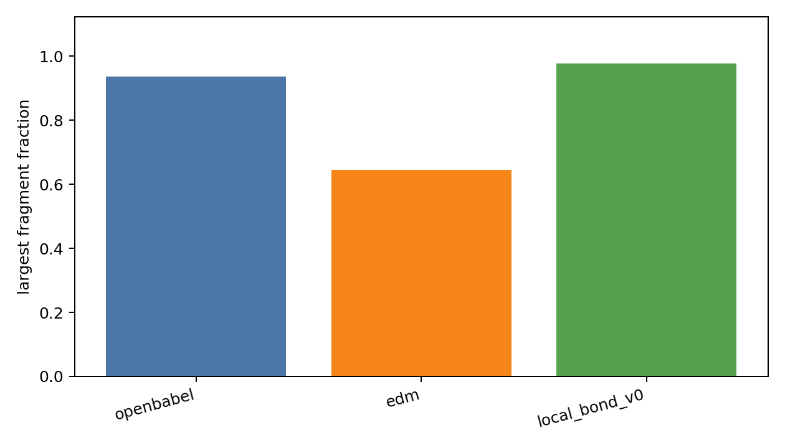
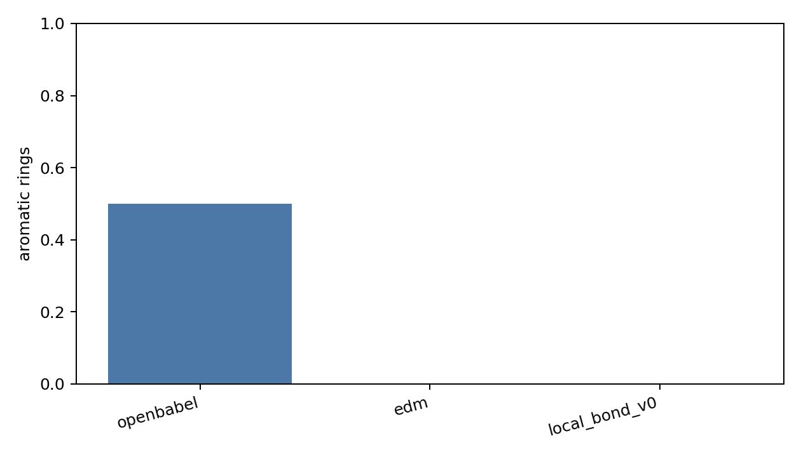
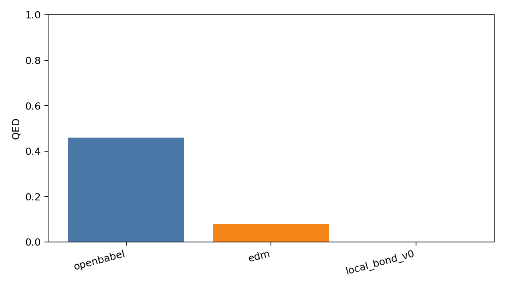
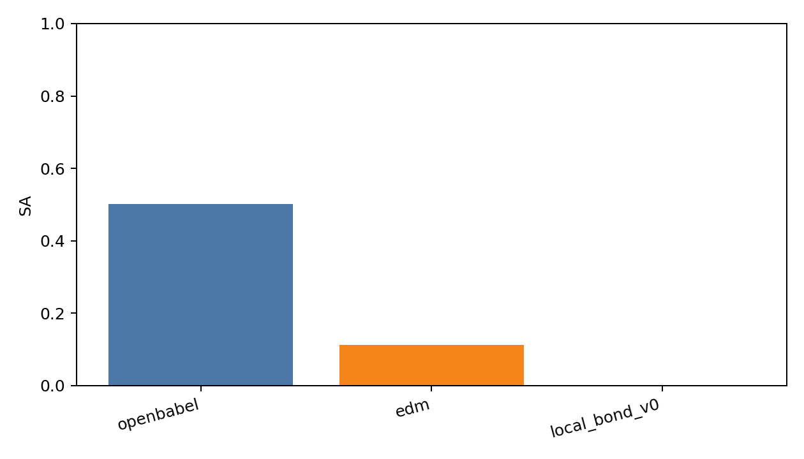
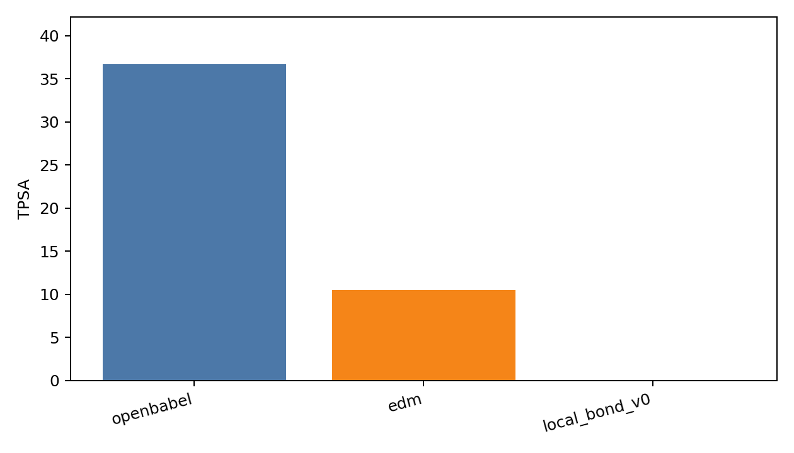
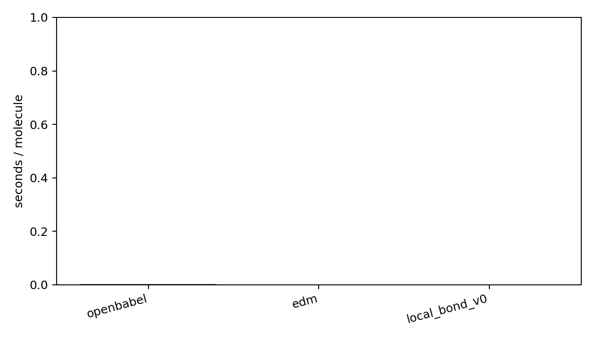

# Generated Reconstruction Benchmark Report

- checkpoint: `DiffSBDD/checkpoints/crossdocked_fullatom_cond.ckpt`
- pdbfile: `data/8GJL.pdb`
- ref_ligand: `C:1101`
- resi_list: `None`
- samples: `20`
- timesteps: `10`
- length_tolerance: `0.25`
- methods: `openbabel edm local_bond_v0`
- local_bond_checkpoint: `analysis/local_bond_predictor_v0_20260602_small/best_model.pt`
- local_bond_device: `cpu`

| method | sanitize | bad_bond_length | fragments | largest_frag | aromatic | QED | SA | TPSA | sec/mol |
|---|---:|---:|---:|---:|---:|---:|---:|---:|---:|
| openbabel | 0.800 | 0.194 | 1.250 | 0.937 | 0.500 | 0.460 | 0.502 | 36.667 | 0.0038 |
| edm | 0.200 | 0.032 | 3.800 | 0.646 | 0.000 | 0.079 | 0.112 | 10.529 | 0.0020 |
| local_bond_v0 | 0.000 | 0.132 | 1.100 | 0.976 | 0.000 | 0.000 | 0.000 | 0.000 | 0.0023 |

