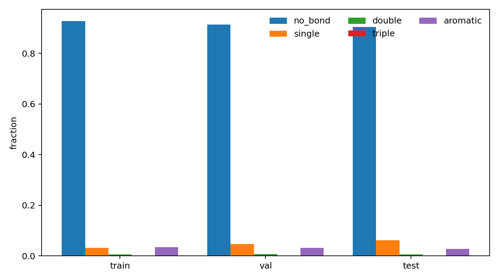
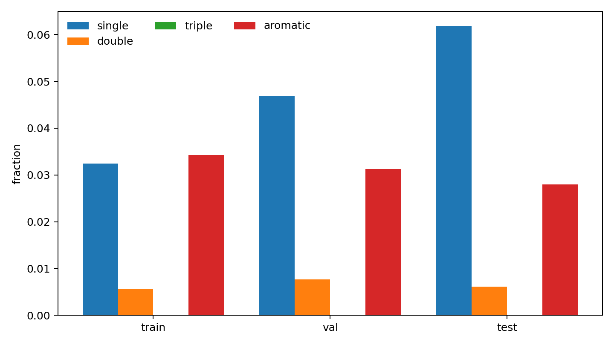
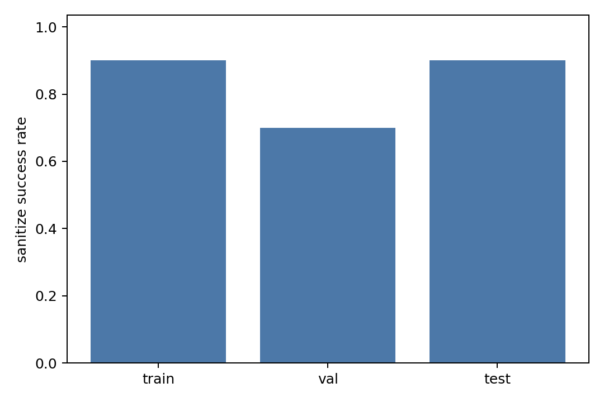
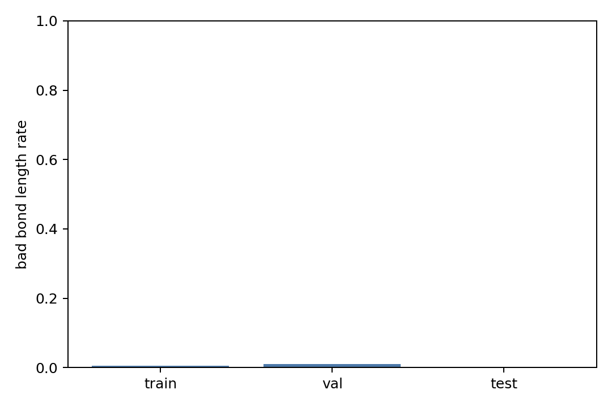
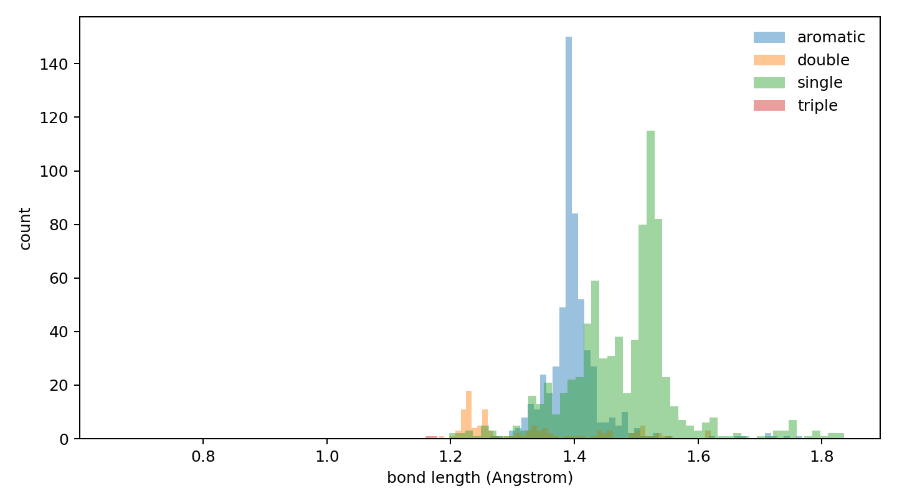

# Local Bond Predictor Data Report

## Purpose

Validate that CrossDocked processed edge labels can provide a stable `ligand_halfedge_index / ligand_halfedge_type` data chain for a local bond predictor baseline.

## Inputs

- processed_dir: `data/crossdocked_raw/processed_edge_noH_full`
- dataset: `crossdock_full`
- train_max_samples: `20`
- val_max_samples: `20`
- test_max_samples: `20`
- length_tolerance: `0.25` Angstrom
- sample_seed: `42`

## Split Summary

| split | dataset | analyzed | sanitize | bad length | no-bond | halfedge mismatch | bond mismatch | samples/s |
|---|---:|---:|---:|---:|---:|---:|---:|---:|
| train | 99929 | 20 | 0.90000000 | 0.00542495 | 0.92746854 | 0 | 0 | 306.575 |
| val | 300 | 20 | 0.70000000 | 0.01016260 | 0.91434021 | 0 | 0 | 444.767 |
| test | 100 | 20 | 0.90000000 | 0.00000000 | 0.90404908 | 0 | 0 | 552.937 |

## Real Bond Type Fractions

| split | single | double | triple | aromatic |
|---|---:|---:|---:|---:|
| train | 0.44722719 | 0.07871199 | 0.00178891 | 0.47227191 |
| val | 0.54655870 | 0.08906883 | 0.00000000 | 0.36437247 |
| test | 0.64450128 | 0.06393862 | 0.00000000 | 0.29156010 |

## Sanitize Errors

| split | error | count |
|---|---|---:|
| train | KekulizeException | 2 |
| val | KekulizeException | 6 |
| test | AtomValenceException | 2 |

## Files

- [split_summary.csv](split_summary.csv)
- [bond_type_counts_by_split.csv](bond_type_counts_by_split.csv)
- [bond_length_by_split.csv](bond_length_by_split.csv)
- [bond_pair_length_summary.csv](bond_pair_length_summary.csv)
- [oracle_reconstruction_by_split.csv](oracle_reconstruction_by_split.csv)
- [sanitize_errors_by_split.csv](sanitize_errors_by_split.csv)
- [local_bond_predictor_manifest.json](local_bond_predictor_manifest.json)

## Plots

