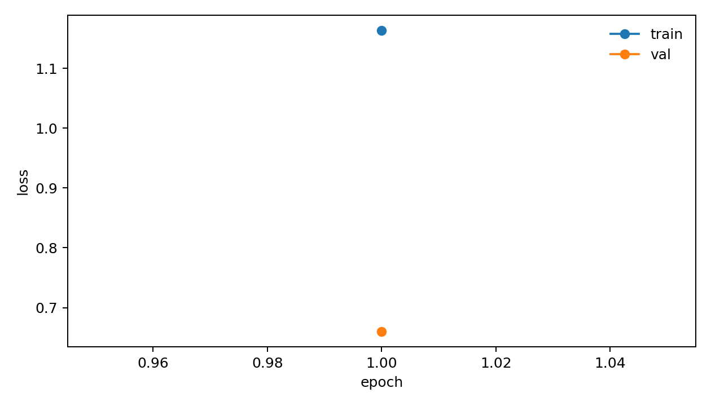
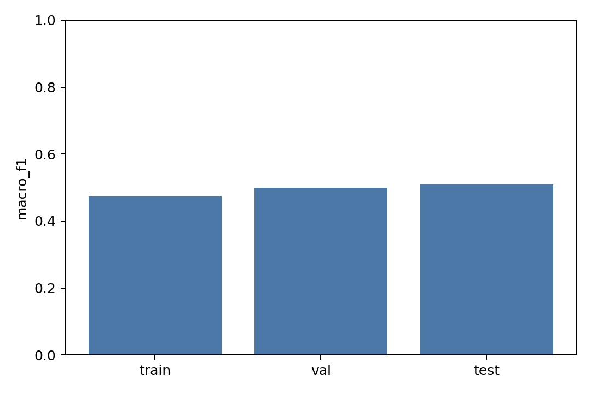
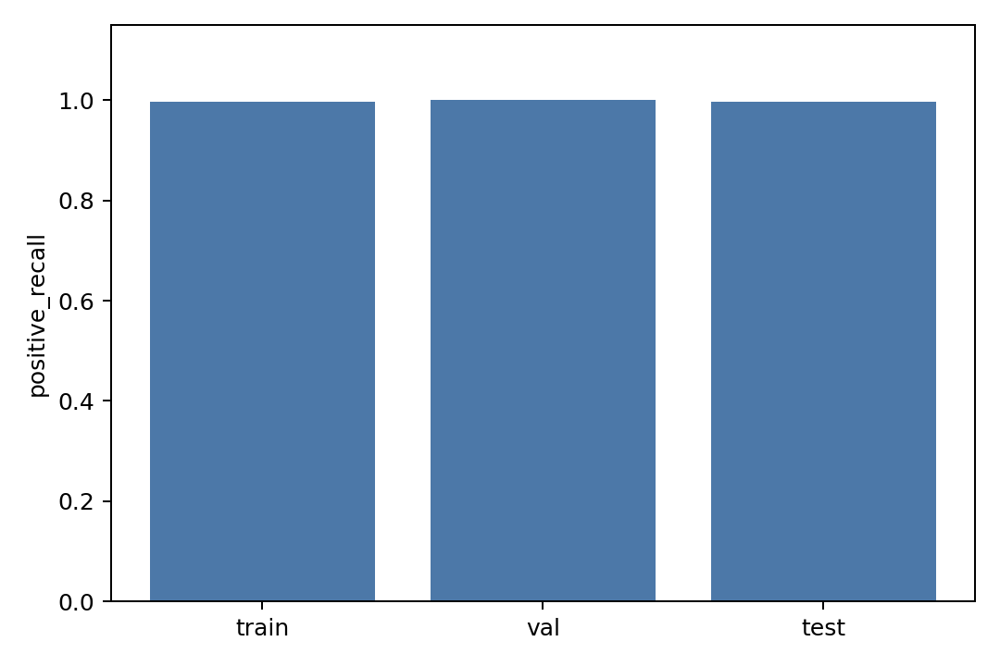

# Local Bond Predictor V0 Report

## Purpose

Train a decoupled pair-MLP bond predictor on CrossDocked true halfedge labels before integrating any reconstruction backend.

## Inputs

- processed_dir: `data/crossdocked_raw/processed_edge_noH_full`
- train_max_samples: `200`
- val_max_samples: `50`
- test_max_samples: `50`
- train_negative_ratio: `4.0`
- pos_noise_std: `0.05`
- epochs: `1`
- elapsed_sec: `11.005`

## Metrics

| split | loss | accuracy | macro_f1 | positive_precision | positive_recall | positive_f1 | no_bond_recall | aromatic_recall |
|---|---:|---:|---:|---:|---:|---:|---:|---:|
| train | 0.78865258 | 0.93228903 | 0.47412812 | 1.00000000 | 0.99767307 | 0.99883518 | 1.00000000 | 0.69839015 |
| val | 0.65957818 | 0.97598639 | 0.49968118 | 1.00000000 | 1.00000000 | 1.00000000 | 1.00000000 | 0.82736842 |
| test | 0.65696884 | 0.97858399 | 0.50985406 | 1.00000000 | 0.99734278 | 0.99866962 | 1.00000000 | 0.81846154 |

## Training History

| epoch | train_loss | val_loss | val_macro_f1 | val_positive_recall |
|---:|---:|---:|---:|---:|
| 1 | 1.16378180 | 0.65957818 | 0.49968118 | 1.00000000 |

## Files

- [metrics.csv](metrics.csv)
- [training_history.csv](training_history.csv)
- [confusion_train.csv](confusion_train.csv)
- [confusion_val.csv](confusion_val.csv)
- [confusion_test.csv](confusion_test.csv)
- [manifest.json](manifest.json)
- [best_model.pt](best_model.pt)
- [last_model.pt](last_model.pt)

## Plots

