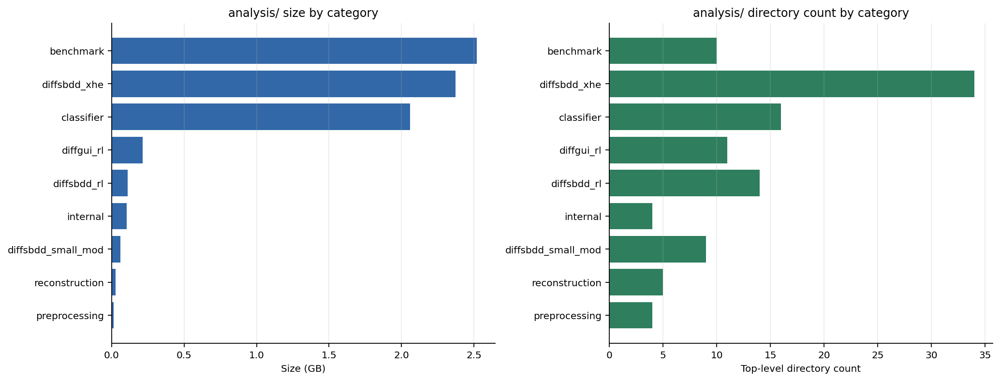
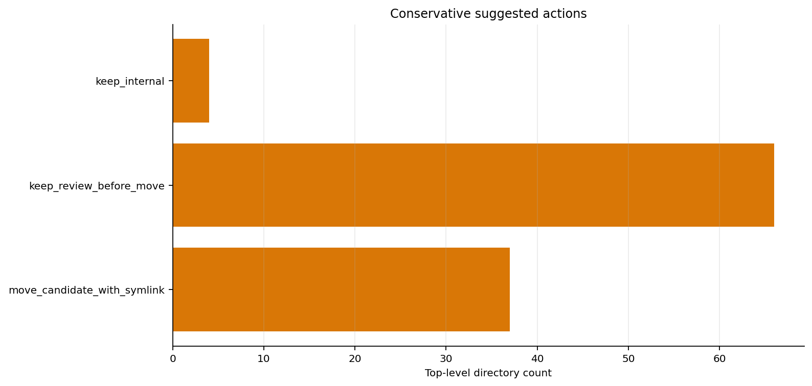

# analysis 目录索引

- 生成时间：2026-06-15T09:56:17
- 分类后真实结果目录数：107
- 顶层散文件数：0
- 估算总大小：7.5G
- 整理原则：按模型线和任务线分类，旧顶层路径保留软链接，避免历史 Markdown / PPT / 命令记录断链。
- 当前主目录：`classifier/`、`diffsbdd_rl/`、`diffsbdd_xhe/`、`diffsbdd_small_mod/`、`diffgui_rl/`、`benchmark/`、`preprocessing/`、`reconstruction/`。

## 输出文件

- `analysis_catalog.csv`：分类后真实结果目录完整索引
- `top_level_files.csv`：顶层散文件索引
- `category_summary.csv`：按类别汇总
- `category_overview.png`：类别大小和数量概览
- `largest_directories.png`：最大目录清单
- `suggested_action_counts.png`：建议操作数量

## 类别汇总

| 类别 | 目录数 | 大小 | 有报告/README的目录 | PNG | SDF | CSV |
|---|---:|---:|---:|---:|---:|---:|
| benchmark | 10 | 2.5G | 8 | 73 | 13353 | 93 |
| diffsbdd_xhe | 34 | 2.4G | 26 | 92 | 51 | 99 |
| classifier | 16 | 2.1G | 7 | 67 | 108 | 52 |
| diffgui_rl | 11 | 220.5M | 2 | 24 | 3080 | 108 |
| diffsbdd_rl | 14 | 113.6M | 8 | 39 | 17197 | 49 |
| internal | 4 | 106.7M | 2 | 144 | 59 | 107 |
| diffsbdd_small_mod | 9 | 60.3M | 5 | 98 | 20 | 58 |
| reconstruction | 5 | 27.7M | 5 | 24 | 7 | 21 |
| preprocessing | 4 | 14.7M | 1 | 4 | 0 | 3 |



## 建议操作统计

| 建议操作 | 目录数 | 说明 |
|---|---:|---|
| keep_internal | 4 | 索引目录或内部缓存，不作为实验结果移动。 |
| keep_review_before_move | 66 | 较大或已有报告，先保留原路径，移动时建议建软链接。 |
| move_candidate_with_symlink | 37 | 可按主题搬迁，但为避免断链建议保留旧路径软链接。 |



## 最大目录 Top 20

| 目录 | 类别 | 大小 | 建议 | 报告/README |
|---|---|---:|---|---|
| `analysis/classifier/classifier_v0_3_scaffold_curation_20260610` | classifier | 1.9G | keep_review_before_move | 是 |
| `analysis/benchmark/modern_sbdd_20260531` | benchmark | 1.8G | keep_review_before_move | 是 |
| `analysis/diffsbdd_xhe/diffsbdd_xhe_supervised_20260604_20k_6gpu` | diffsbdd_xhe | 915.8M | keep_review_before_move | 否 |
| `analysis/diffsbdd_xhe/diffsbdd_xhe_diffgui_scratch_20260606_longtest` | diffsbdd_xhe | 866.8M | keep_review_before_move | 否 |
| `analysis/benchmark/reference_project_generation_20260530_173617` | benchmark | 539.0M | keep_review_before_move | 是 |
| `analysis/diffsbdd_xhe/formal_xh_xhe_comparison_20260605_full_8gpu` | diffsbdd_xhe | 457.6M | keep_review_before_move | 否 |
| `analysis/diffgui_rl/diffgui_ring_last3_lr3e5_training_plots_20260611` | diffgui_rl | 170.5M | keep_review_before_move | 是 |
| `analysis/_archive` | internal | 100.0M | keep_internal | 是 |
| `analysis/diffsbdd_xhe/edge_data_chain_20260604_repair_n10000` | diffsbdd_xhe | 75.8M | keep_review_before_move | 是 |
| `analysis/benchmark/5xzr_8j6_benchmark_20260611` | benchmark | 70.8M | keep_review_before_move | 是 |
| `analysis/benchmark/8gjl_c1101_benchmark_20260603_500mol_500steps` | benchmark | 60.7M | keep_review_before_move | 否 |
| `analysis/diffsbdd_rl/diffsbdd_8gpu_5000_score_20260608` | diffsbdd_rl | 46.4M | move_candidate_with_symlink | 否 |
| `analysis/diffsbdd_rl/diffsbdd_single_reward_matrix_20260613` | diffsbdd_rl | 45.9M | keep_review_before_move | 是 |
| `analysis/diffgui_rl/diffgui_6gpu_500x3_20260531_085146` | diffgui_rl | 43.2M | move_candidate_with_symlink | 否 |
| `analysis/diffsbdd_xhe/diffsbdd_xhe_joint_20260605_20k_6gpu` | diffsbdd_xhe | 41.3M | move_candidate_with_symlink | 否 |
| `analysis/benchmark/reference_project_generation_10mol_20260530_224503` | benchmark | 34.4M | keep_review_before_move | 是 |
| `analysis/classifier/classifier_v0_2_1_weighted_20260608` | classifier | 32.5M | keep_review_before_move | 是 |
| `analysis/classifier/final_classifier_dataset_selection_20260527` | classifier | 32.2M | keep_review_before_move | 是 |
| `analysis/classifier/classifier_v0_2_hardneg_20260608` | classifier | 32.1M | keep_review_before_move | 是 |
| `analysis/classifier/good_bad_classifier_curation_20260608` | classifier | 26.0M | keep_review_before_move | 是 |


## 优先可归档 smoke/debug 目录

- 暂无。

## 顶层散脚本

- 暂无。

## 需要人工判断的未分类目录

- 暂无。

## 当前目录结构

```text
analysis/
  _index/
  classifier/
  diffsbdd_rl/
  diffgui_rl/
  diffsbdd_xhe/
  diffsbdd_small_mod/
  benchmark/
  preprocessing/
  reconstruction/
  _archive/smoke/
  _compat_links/top_level/
  _loose/
tools/analysis_scripts/legacy_top_level/
```

说明：`analysis/` 顶层只保留分类目录、索引目录和归档目录；旧路径软链接已集中移动到 `analysis/_compat_links/top_level/`。

如果后续某个旧 Markdown / PPT 仍依赖旧路径，可从 `_compat_links/top_level/` 中把对应软链接临时移回 `analysis/` 顶层。

## 类别计数快照

```json
{
  "benchmark": 10,
  "classifier": 16,
  "diffgui_rl": 11,
  "diffsbdd_rl": 14,
  "diffsbdd_small_mod": 9,
  "diffsbdd_xhe": 34,
  "internal": 4,
  "preprocessing": 4,
  "reconstruction": 5
}
```
