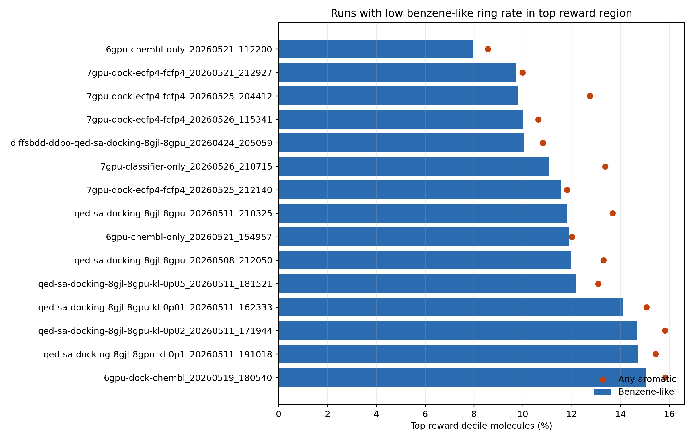

# 苯环与芳香环分布专项诊断

生成时间：2026-05-27 16:21:23

## 一、问题

本分析检查生成分子是否缺少苯环/芳香碳环。这里区分：

- `has_aromatic_ring`：任意芳香环。
- `has_benzene_like_ring`：六元芳香碳环，近似苯环/苯并环。
- `has_aromatic_heterocycle`：芳香杂环。

ChEMBL 的 benzene-like 指标使用 `num_aromatic_rings - num_aromatic_heterocycles`
近似；OUT 生成分子用 RDKit ring atoms 精确判断六元芳香碳环。

## 二、全局对比

| 指标 | ChEMBL36 cleaned | strict ChEMBL property pool | OUT valid generated |
|---|---:|---:|---:|
| has aromatic ring | 95.69% | 96.88% | 5.51% |
| has benzene-like ring | 81.56% | 82.26% | 4.97% |
| has aromatic heterocycle | 66.97% | 68.51% | 0.58% |

## 三、Top reward 区域中苯环更少的 run

- 6gpu-chembl-only_20260521_112200: top reward benzene-like=7.98%, any aromatic=8.56%, aromatic heterocycle=0.58%
- 7gpu-dock-ecfp4-fcfp4_20260521_212927: top reward benzene-like=9.70%, any aromatic=9.99%, aromatic heterocycle=0.35%
- 7gpu-dock-ecfp4-fcfp4_20260525_204412: top reward benzene-like=9.80%, any aromatic=12.75%, aromatic heterocycle=2.94%
- 7gpu-dock-ecfp4-fcfp4_20260526_115341: top reward benzene-like=9.99%, any aromatic=10.63%, aromatic heterocycle=0.64%
- diffsbdd-ddpo-qed-sa-docking-8gjl-8gpu_20260424_205059: top reward benzene-like=10.03%, any aromatic=10.82%, aromatic heterocycle=0.79%
- 7gpu-classifier-only_20260526_210715: top reward benzene-like=11.09%, any aromatic=13.36%, aromatic heterocycle=2.65%
- 7gpu-dock-ecfp4-fcfp4_20260525_212140: top reward benzene-like=11.57%, any aromatic=11.81%, aromatic heterocycle=0.29%
- qed-sa-docking-8gjl-8gpu_20260511_210325: top reward benzene-like=11.79%, any aromatic=13.68%, aromatic heterocycle=1.89%

## 四、解释

如果 OUT 的 benzene-like rate 明显低于 strict ChEMBL pool，说明模型偏向脂肪环、
复杂饱和环、三元环或非芳香稠环，而不是 ChEMBL 常见的芳香碳环/芳香杂环分布。

这不应该作为“无苯环就是负样本”的硬规则，因为很多药物可以无苯环。更合理的做法是：

1. 正样本抽样加入 aromatic/benzene/heteroaromatic strata。
2. RL 监控每轮生成分子的 aromatic-ring distribution。
3. 对“无芳香环 + 高碳 + 复杂饱和环/三元环”的组合模式作为 hard negative 候选。
