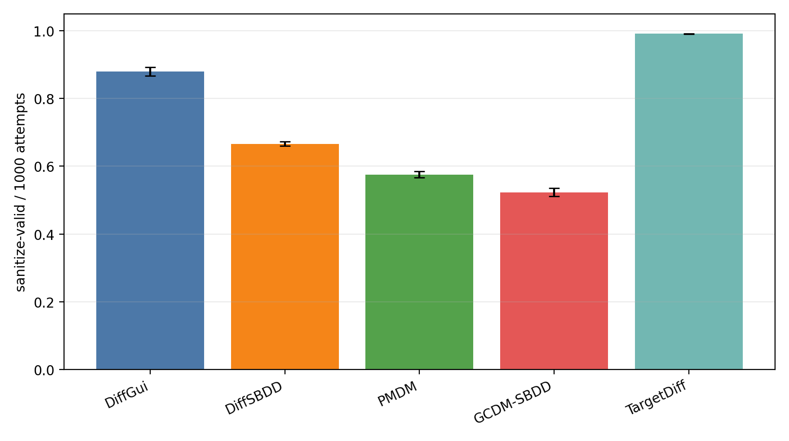
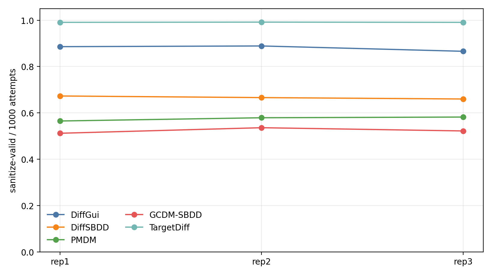
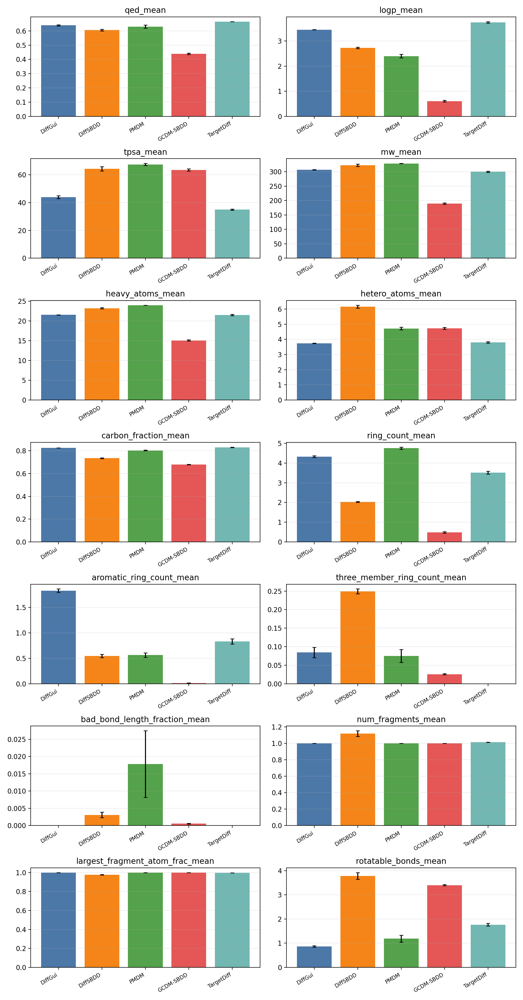
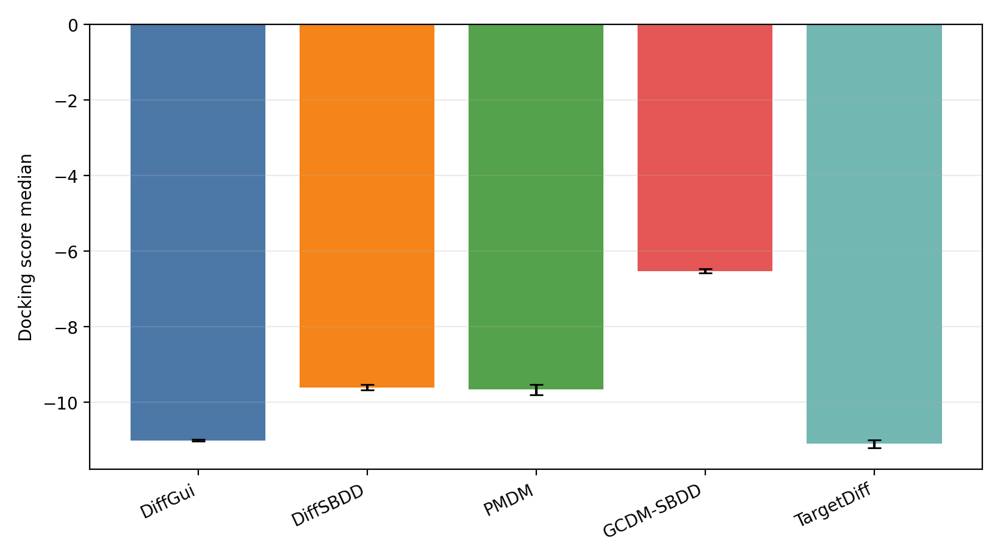
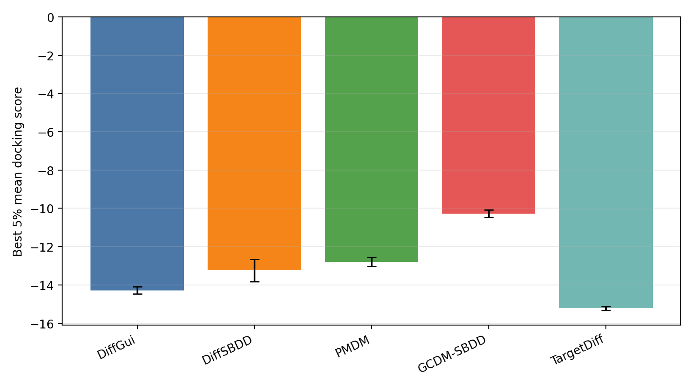

# 8GJL/C1101 1000-step 3-repeat formal summary

Protocol: 1000 diffusion steps, 1000 attempts per model per repeat. DiffGui rep1 is replaced by the explicit 1000-step rerun from `8gjl_c1101_benchmark_20260701_diffgui_rep1_1000steps_seed1_7`.

## Mean over repeats

| model | sdf_written_mean | sanitize_valid_mean | unique_smiles_mean | sanitize_valid_per_attempt_mean | sanitize_valid_per_attempt_std |
| --- | --- | --- | --- | --- | --- |
| DiffGui | 880.333 | 880.333 | 870.000 | 0.880333 | 0.012503 |
| DiffSBDD | 1000.000 | 666.333 | 666.333 | 0.666333 | 0.006506 |
| PMDM | 575.333 | 575.333 | 575.333 | 0.575333 | 0.009074 |
| GCDM-SBDD | 1000.000 | 523.333 | 519.000 | 0.523333 | 0.012055 |
| TargetDiff | 991.333 | 991.333 | 990.667 | 0.991333 | 0.000577 |

## Per-repeat counts

| repeat | model | sdf_written | sanitize_valid | unique_smiles | sanitize_valid_per_attempt |
| --- | --- | --- | --- | --- | --- |
| rep1 | DiffGui | 886 | 886 | 871 | 0.886000 |
| rep1 | DiffSBDD | 1000 | 673 | 673 | 0.673000 |
| rep1 | PMDM | 565 | 565 | 565 | 0.565000 |
| rep1 | GCDM-SBDD | 1000 | 512 | 511 | 0.512000 |
| rep1 | TargetDiff | 991 | 991 | 990 | 0.991000 |
| rep2 | DiffGui | 889 | 889 | 883 | 0.889000 |
| rep2 | DiffSBDD | 1000 | 666 | 666 | 0.666000 |
| rep2 | PMDM | 579 | 579 | 579 | 0.579000 |
| rep2 | GCDM-SBDD | 1000 | 536 | 530 | 0.536000 |
| rep2 | TargetDiff | 992 | 992 | 991 | 0.992000 |
| rep3 | DiffGui | 866 | 866 | 856 | 0.866000 |
| rep3 | DiffSBDD | 1000 | 660 | 660 | 0.660000 |
| rep3 | PMDM | 582 | 582 | 582 | 0.582000 |
| rep3 | GCDM-SBDD | 1000 | 522 | 516 | 0.522000 |
| rep3 | TargetDiff | 991 | 991 | 991 | 0.991000 |

## Docking

Docking was run separately for every repeat/model sanitize-valid SDF with the existing UniDock fast protocol.

### Docking mean over repeats

| model | success_count_mean | score_mean_mean | score_median_mean | best_5pct_mean_mean | rate_le_-10_mean |
| --- | --- | --- | --- | --- | --- |
| DiffGui | 880.333 | -10.873378 | -11.009000 | -14.283291 | 0.713007 |
| DiffSBDD | 666.333 | -9.509816 | -9.606333 | -13.242091 | 0.405235 |
| PMDM | 575.333 | -9.760693 | -9.662667 | -12.795233 | 0.410646 |
| GCDM-SBDD | 523.333 | -6.470530 | -6.526167 | -10.268774 | 0.024808 |
| TargetDiff | 991.333 | -11.099939 | -11.099833 | -15.225912 | 0.705105 |

### Per-repeat docking

| repeat | model | total_ligands | success_count | score_mean | score_median | best_5pct_mean | rate_le_-10 |
| --- | --- | --- | --- | --- | --- | --- | --- |
| rep1 | DiffGui | 886 | 886 | -10.874891 | -10.996000 | -14.216273 | 0.716704 |
| rep1 | DiffSBDD | 673 | 673 | -9.427557 | -9.522000 | -12.809091 | 0.396731 |
| rep1 | PMDM | 565 | 565 | -9.644423 | -9.569000 | -12.903179 | 0.389381 |
| rep1 | GCDM-SBDD | 512 | 512 | -6.402334 | -6.501000 | -10.037360 | 0.021484 |
| rep1 | TargetDiff | 991 | 991 | -11.127759 | -11.156000 | -15.120327 | 0.709384 |
| rep2 | DiffGui | 889 | 889 | -10.880818 | -10.994000 | -14.490250 | 0.707537 |
| rep2 | DiffSBDD | 666 | 666 | -9.595584 | -9.651500 | -13.906636 | 0.412913 |
| rep2 | PMDM | 579 | 579 | -9.928506 | -9.817000 | -12.971071 | 0.455959 |
| rep2 | GCDM-SBDD | 536 | 536 | -6.534108 | -6.594000 | -10.399615 | 0.026119 |
| rep2 | TargetDiff | 992 | 992 | -11.156626 | -11.165500 | -15.322980 | 0.720766 |
| rep3 | DiffGui | 866 | 866 | -10.864424 | -11.037000 | -14.143349 | 0.714781 |
| rep3 | DiffSBDD | 660 | 660 | -9.506306 | -9.645500 | -13.010545 | 0.406061 |
| rep3 | PMDM | 582 | 582 | -9.709151 | -9.602000 | -12.511448 | 0.386598 |
| rep3 | GCDM-SBDD | 522 | 522 | -6.475149 | -6.483500 | -10.369346 | 0.026820 |
| rep3 | TargetDiff | 991 | 991 | -11.015431 | -10.978000 | -15.234429 | 0.685166 |

## Files

- `formal_3rep_per_repeat_counts.csv`
- `formal_3rep_model_summary.csv`
- `formal_3rep_property_per_repeat_long.csv`
- `formal_3rep_property_summary_long.csv`
- `formal_3rep_docking_per_repeat.csv`
- `formal_3rep_docking_model_summary.csv`
- `docking_summary.md`
- `formal_3rep_sources.csv`
