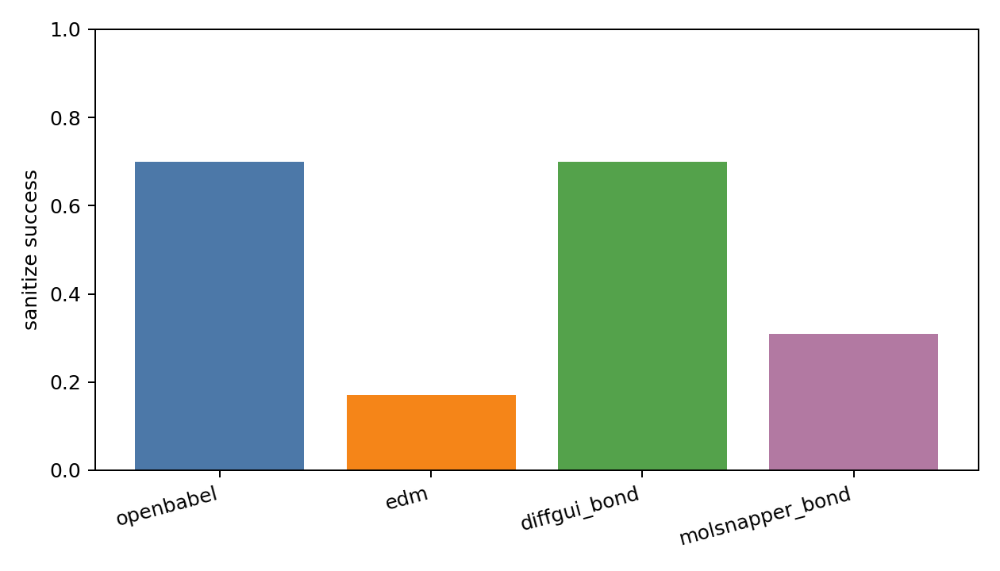
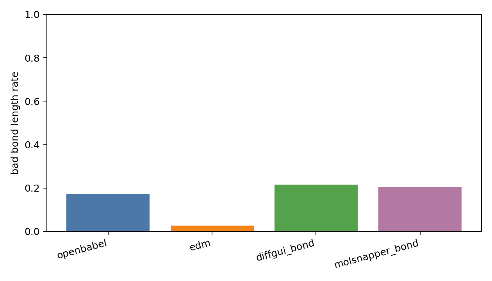
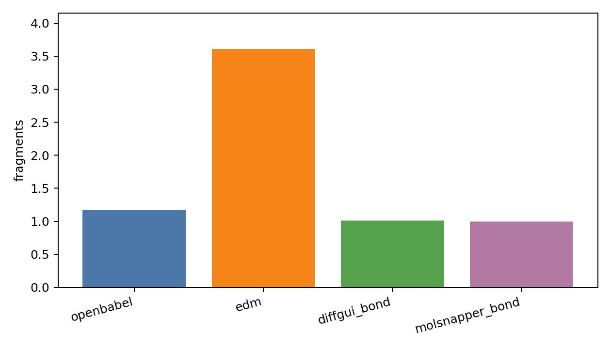
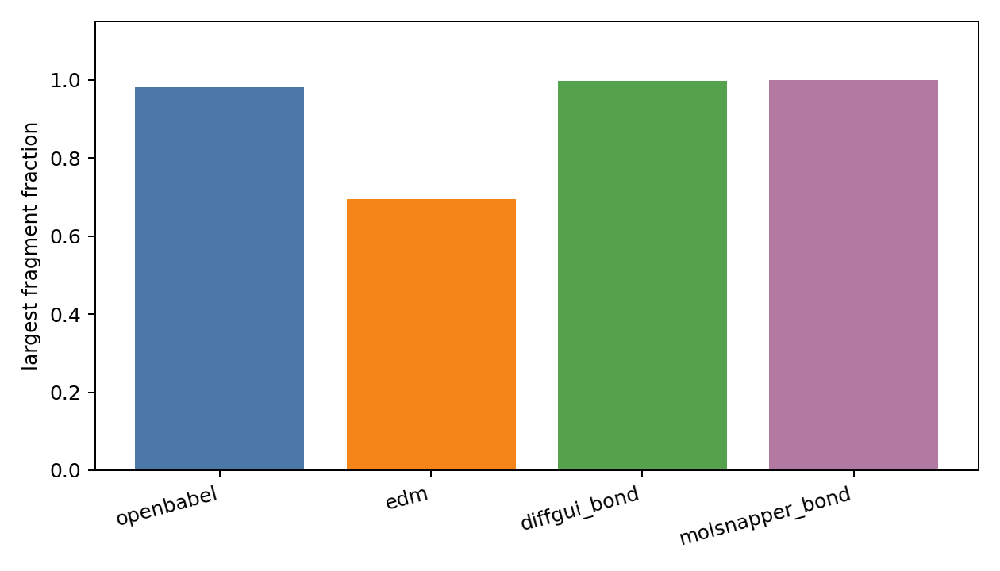
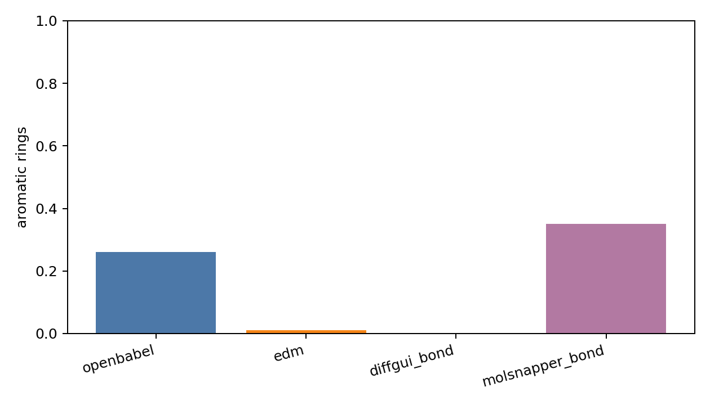
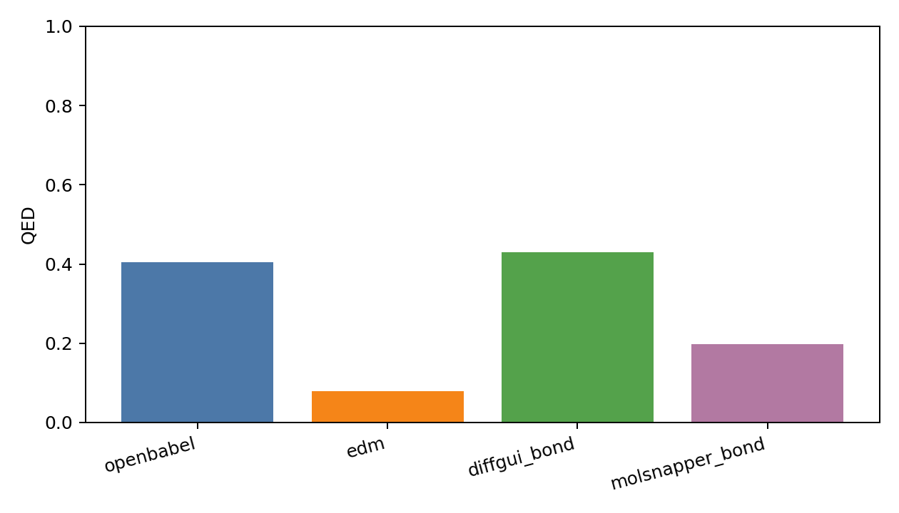
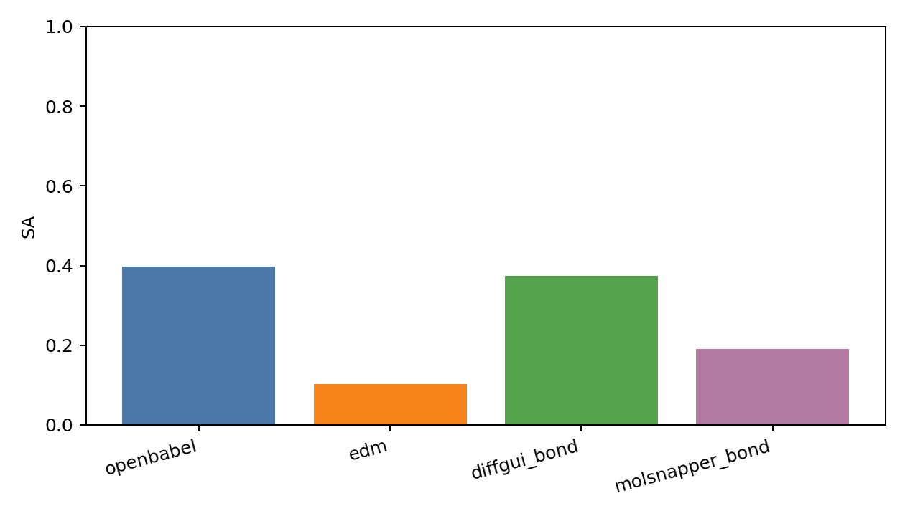
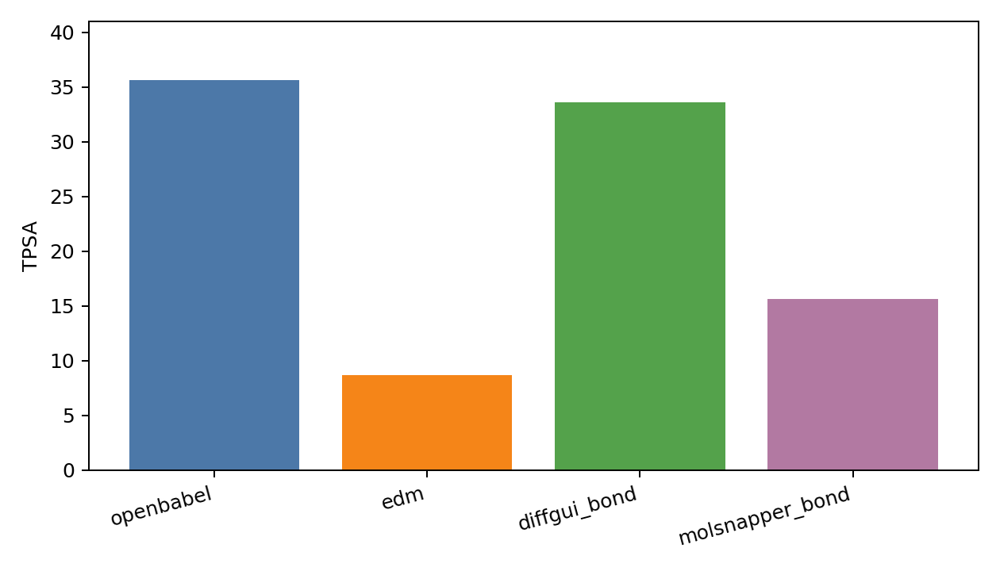
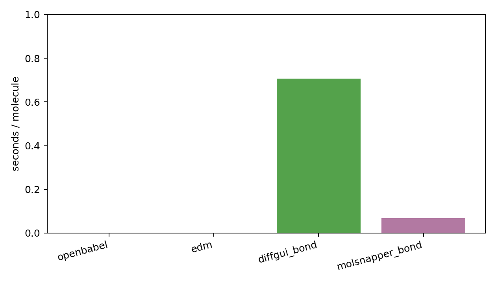

# Generated Reconstruction Benchmark Report

- checkpoint: `DiffSBDD/checkpoints/crossdocked_fullatom_cond.ckpt`
- pdbfile: `data/8GJL.pdb`
- ref_ligand: `C:1101`
- resi_list: `None`
- samples: `100`
- timesteps: `10`
- length_tolerance: `0.25`
- methods: `openbabel edm diffgui_bond molsnapper_bond`

| method | sanitize | bad_bond_length | fragments | largest_frag | aromatic | QED | SA | TPSA | sec/mol |
|---|---:|---:|---:|---:|---:|---:|---:|---:|---:|
| openbabel | 0.700 | 0.173 | 1.170 | 0.982 | 0.260 | 0.405 | 0.398 | 35.639 | 0.0025 |
| edm | 0.170 | 0.027 | 3.610 | 0.696 | 0.010 | 0.079 | 0.102 | 8.710 | 0.0019 |
| diffgui_bond | 0.700 | 0.216 | 1.010 | 0.998 | 0.000 | 0.430 | 0.373 | 33.565 | 0.7060 |
| molsnapper_bond | 0.310 | 0.204 | 1.000 | 1.000 | 0.350 | 0.198 | 0.191 | 15.609 | 0.0690 |

## External Bond Resources

| name | checkpoint | config | source | status |
|---|---:|---:|---:|---|
| diffgui_pretrained_bond_predictor | 1 | 1 | 1 | resource_found_adapter_available |
| molsnapper_pretrained_bond_predictor | 1 | 0 | 1 | resource_found_adapter_available |
| decompopt_generated_with_bond_reconstruct | 0 | 0 | 1 | source_found_no_checkpoint |

