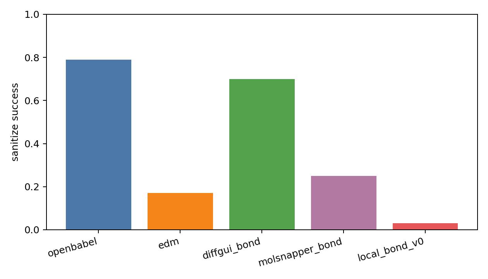
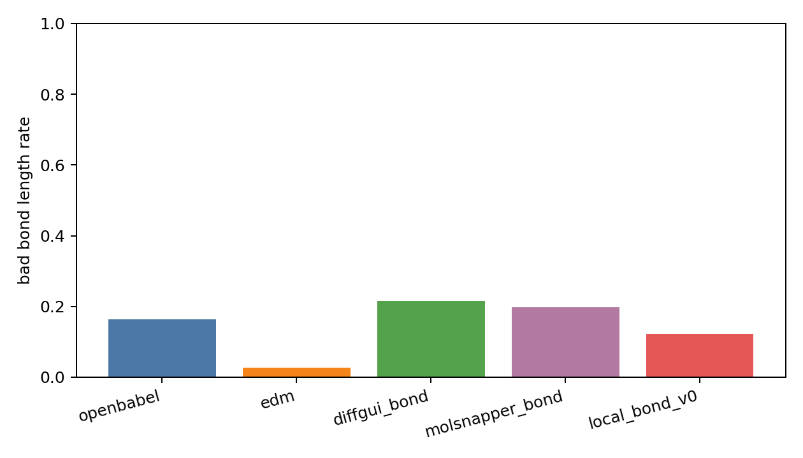
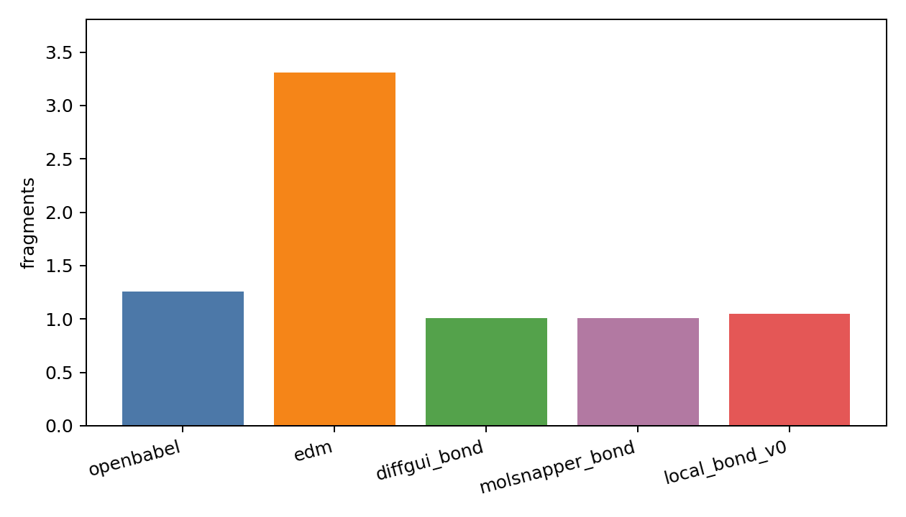
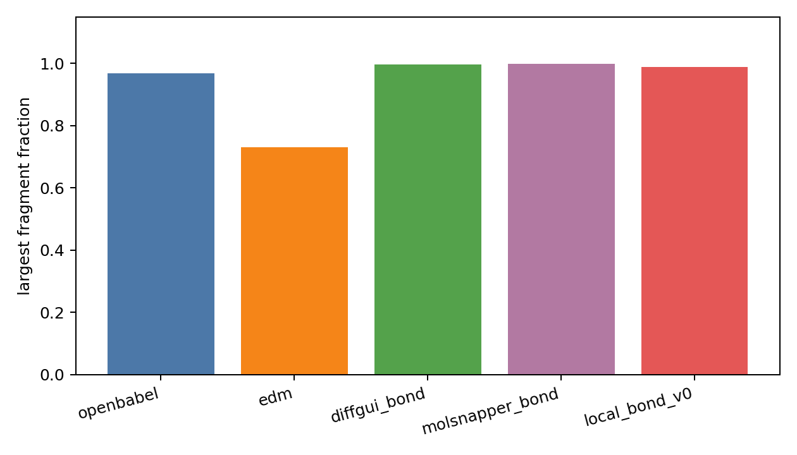
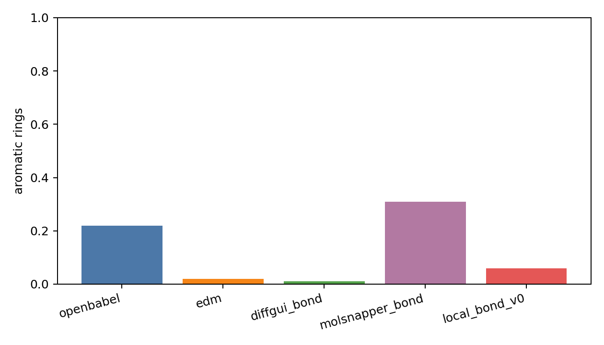
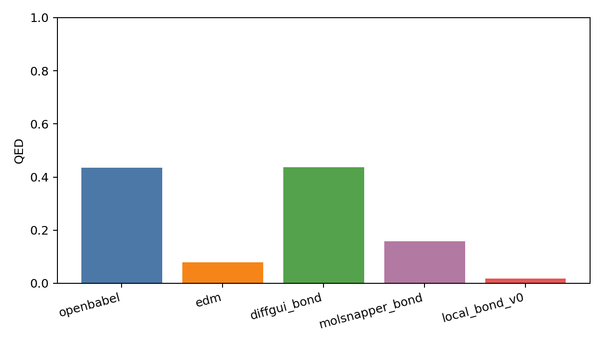
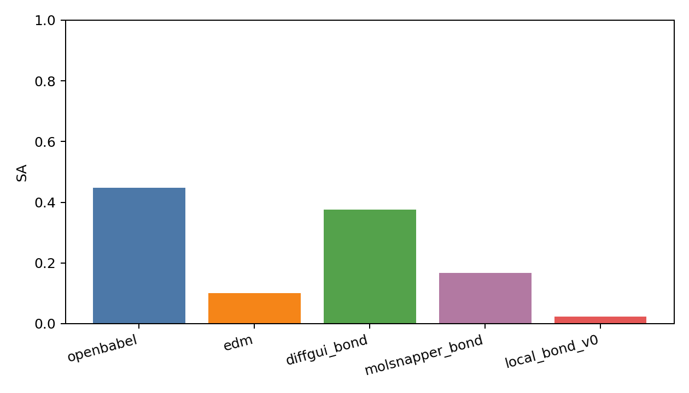
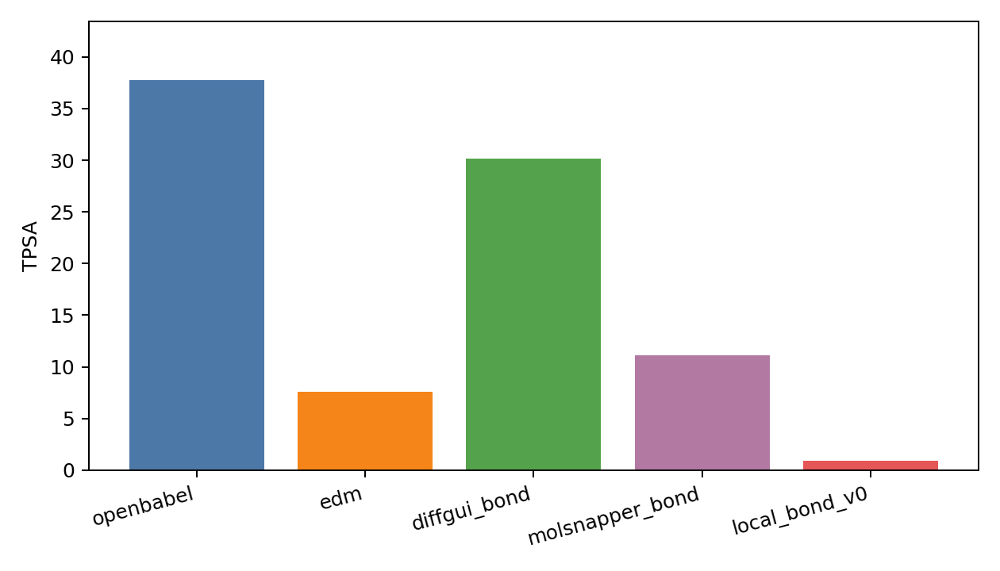
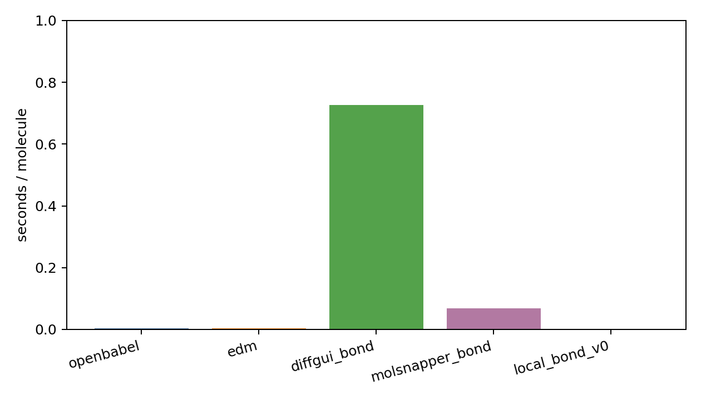

# Generated Reconstruction Benchmark Report

- checkpoint: `DiffSBDD/checkpoints/crossdocked_fullatom_cond.ckpt`
- pdbfile: `data/8GJL.pdb`
- ref_ligand: `C:1101`
- resi_list: `None`
- samples: `100`
- timesteps: `10`
- length_tolerance: `0.25`
- methods: `openbabel edm diffgui_bond molsnapper_bond local_bond_v0`
- local_bond_checkpoint: `analysis/local_bond_predictor_v0_20260602_small/best_model.pt`
- local_bond_device: `cpu`

| method | sanitize | bad_bond_length | fragments | largest_frag | aromatic | QED | SA | TPSA | sec/mol |
|---|---:|---:|---:|---:|---:|---:|---:|---:|---:|
| openbabel | 0.790 | 0.164 | 1.260 | 0.969 | 0.220 | 0.434 | 0.448 | 37.764 | 0.0026 |
| edm | 0.170 | 0.027 | 3.310 | 0.731 | 0.020 | 0.080 | 0.100 | 7.584 | 0.0030 |
| diffgui_bond | 0.700 | 0.216 | 1.010 | 0.996 | 0.010 | 0.437 | 0.376 | 30.145 | 0.7257 |
| molsnapper_bond | 0.250 | 0.197 | 1.010 | 0.999 | 0.310 | 0.158 | 0.168 | 11.101 | 0.0675 |
| local_bond_v0 | 0.030 | 0.122 | 1.050 | 0.989 | 0.060 | 0.018 | 0.024 | 0.909 | 0.0022 |

## External Bond Resources

| name | checkpoint | config | source | status |
|---|---:|---:|---:|---|
| diffgui_pretrained_bond_predictor | 1 | 1 | 1 | resource_found_adapter_available |
| molsnapper_pretrained_bond_predictor | 1 | 0 | 1 | resource_found_adapter_available |
| decompopt_generated_with_bond_reconstruct | 0 | 0 | 1 | source_found_no_checkpoint |

