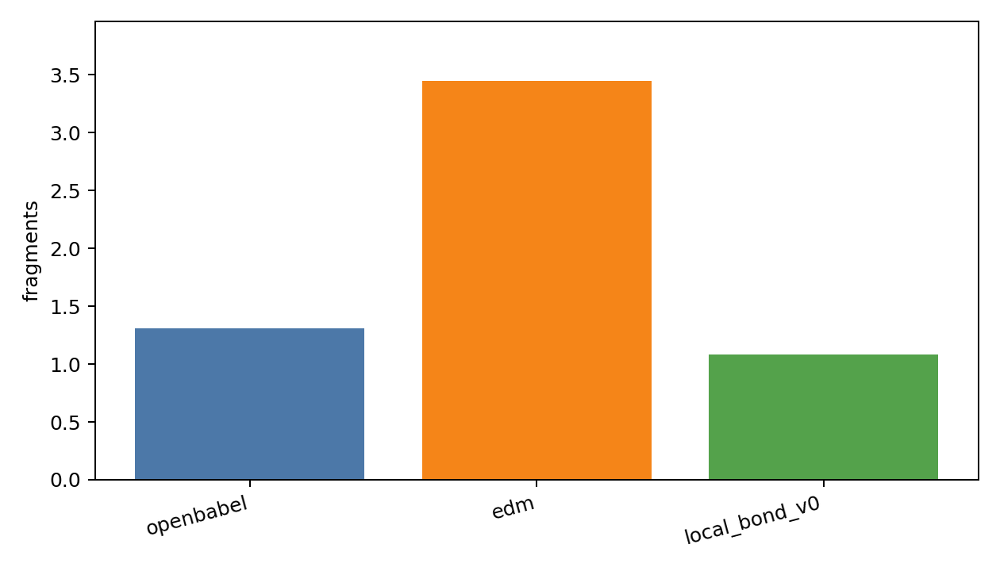
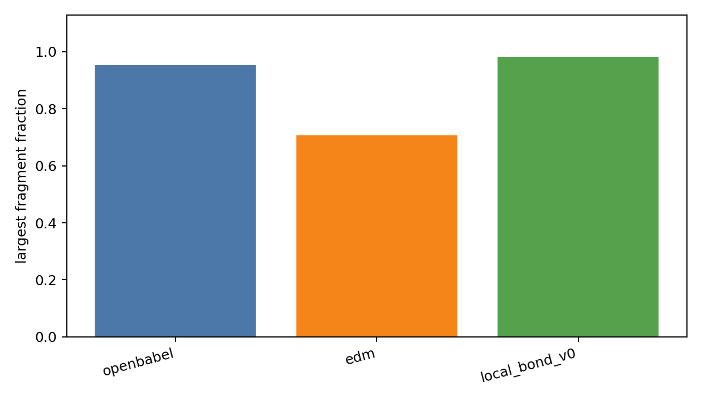
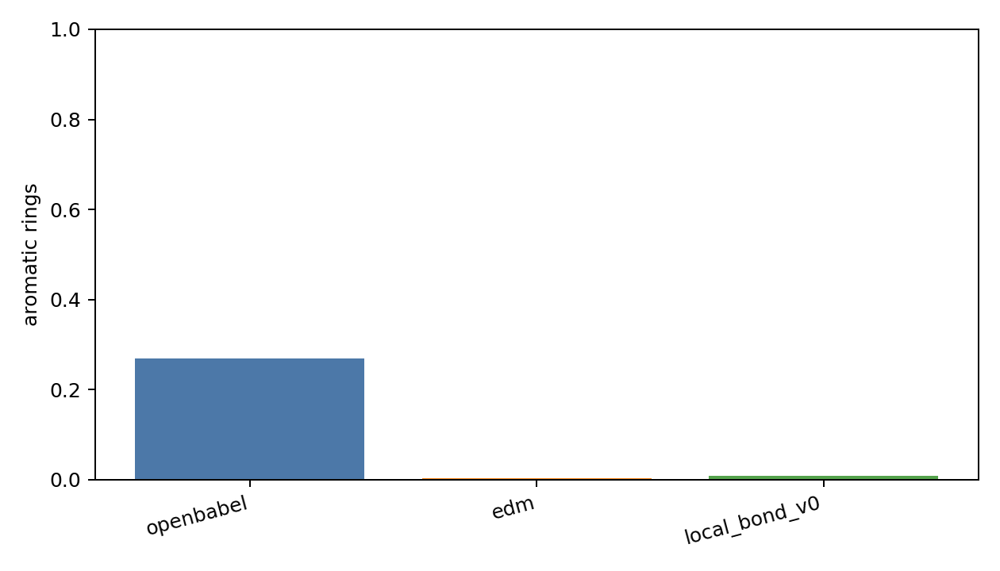
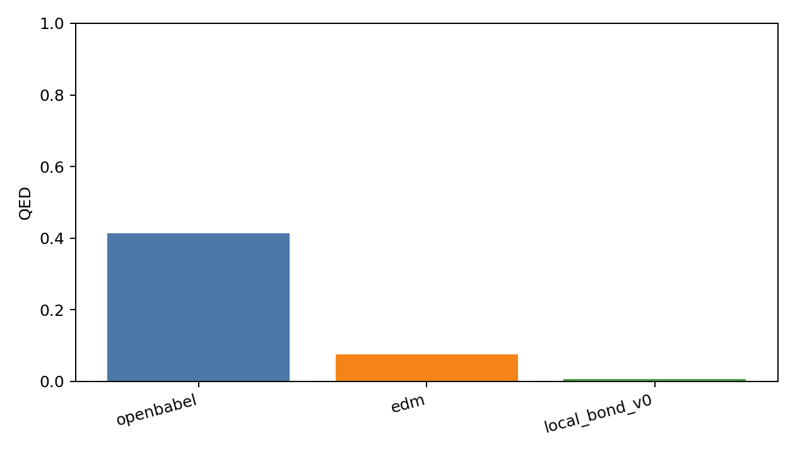
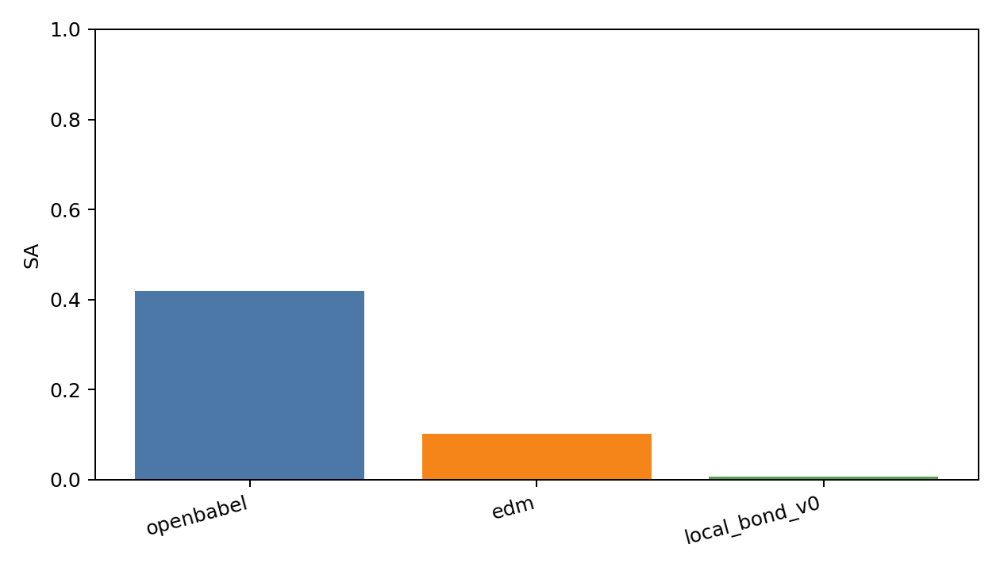
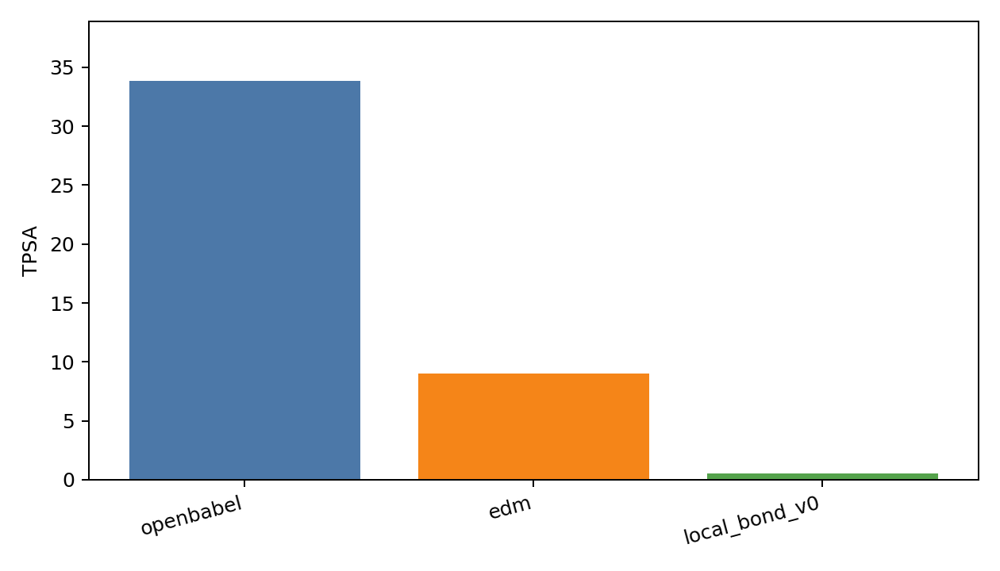

# Generated Reconstruction Benchmark Report

- checkpoint: `DiffSBDD/checkpoints/crossdocked_fullatom_cond.ckpt`
- pdbfile: `data/8GJL.pdb`
- ref_ligand: `C:1101`
- resi_list: `None`
- samples: `500`
- timesteps: `10`
- length_tolerance: `0.25`
- methods: `openbabel edm local_bond_v0`
- local_bond_checkpoint: `analysis/local_bond_predictor_v0_20260602_small/best_model.pt`
- local_bond_device: `cpu`

| method | sanitize | bad_bond_length | fragments | largest_frag | aromatic | QED | SA | TPSA | sec/mol |
|---|---:|---:|---:|---:|---:|---:|---:|---:|---:|
| openbabel | 0.738 | 0.179 | 1.306 | 0.952 | 0.270 | 0.413 | 0.419 | 33.813 | 0.0020 |
| edm | 0.172 | 0.033 | 3.444 | 0.707 | 0.004 | 0.076 | 0.103 | 9.028 | 0.0015 |
| local_bond_v0 | 0.012 | 0.130 | 1.084 | 0.981 | 0.008 | 0.008 | 0.008 | 0.546 | 0.0020 |

