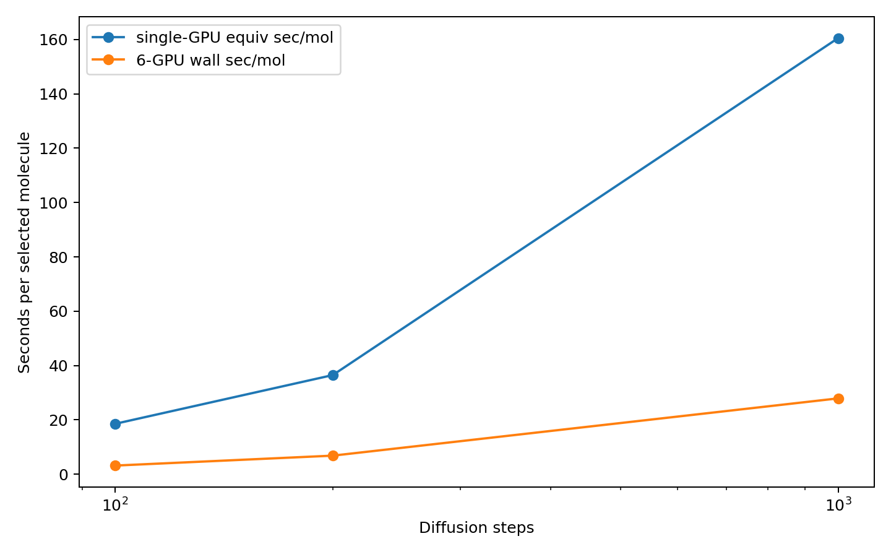

# Model Strategy Evidence Pack 2026-05-31

本报告只统计已有输出，不修改源码，不重新运行 GPU 生成。

## 统一生成质量摘要

| source | raw_entries | rdkit_valid | valid_ratio | unique_rate_vs_valid | mw_mean | logp_mean | tpsa_mean | qed_mean | sa_score_mean | carbon_fraction_mean | hetero_atoms_mean | has_aromatic_ring_frac | three_member_ring_frac | bond_len_bad_frac_mean |
| --- | --- | --- | --- | --- | --- | --- | --- | --- | --- | --- | --- | --- | --- | --- |
| DiffGui_100steps_500mol | 500 | 500 | 1 | 1 | 326.5 | 2.026 | 71.23 | 0.5832 | 4.187 | 0.7819 | 5.252 | 0.596 | 0.146 | 0.0006531 |
| DiffGui_200steps_500mol | 500 | 500 | 1 | 0.998 | 329.3 | 2.12 | 74.67 | 0.5873 | 3.928 | 0.7764 | 5.432 | 0.688 | 0.104 | 0.0008285 |
| DiffGui_1000steps_500mol | 500 | 500 | 1 | 0.988 | 330.6 | 2.205 | 78.54 | 0.5923 | 3.563 | 0.7631 | 5.78 | 0.81 | 0.024 | 0.0002839 |
| DePPA_10mol | 10 | 10 | 1 | 1 | 161.6 | -0.01432 | 59.71 | 0.483 | 3.946 | 0.5915 | 4.1 | 0.1 | 0.2 | 0.03605 |
| BInD_50sdf | 50 | 27 | 0.54 | 1 | 264.4 | 0.4263 | 94 | 0.5685 | 3.942 | 0.6528 | 6.37 | 0.5926 | 0.3333 | 0.002469 |
| TargetDiff_10samples | 1 | 1 | 1 | 1 | 513.4 | 3.065 | 148.2 | 0.1345 | 6.182 | 0.3929 | 17 | 0 | 0 | 0.4762 |
| DiffMeta_10mol_2D | 10 | 8 | 0.8 | 1 | 292.6 | 2.916 | 51.07 | 0.8269 | 2.547 | 0.7298 | 5.375 | 1 | 0.125 |  |
| DiffSBDD_base_filtered_5829 | 5829 | 5829 | 1 | 0.9997 | 404.6 | 3.182 | 77.43 | 0.5464 | 4.955 | 0.7476 | 7.2 | 0.5989 | 0.3642 | 0.02179 |
| DiffSBDD_RL_dock_classifier_epoch25 | 1502 | 1502 | 1 | 1 | 328.4 | 2.767 | 60.96 | 0.5731 | 4.875 | 0.7938 | 4.559 | 0.07523 | 0.4854 | 0.04117 |

## 生成速度摘要

| model | steps | outputs | rdkit_selected_outputs | parallel_gpus | wall_seconds_for_outputs | single_gpu_equiv_sec_per_output | wall_sec_per_output_on_6gpu | mol_per_hour_wall_6gpu | reconstruction_fail_frac |
| --- | --- | --- | --- | --- | --- | --- | --- | --- | --- |
| DiffGui_100steps_6gpu | 100 | 500 | 500 | 6 | 1595 | 18.56 | 3.19 | 1129 | 0 |
| DiffGui_200steps_6gpu | 200 | 500 | 500 | 6 | 3422 | 36.49 | 6.845 | 525.9 | 0.1667 |
| DiffGui_1000steps_6gpu | 1000 | 500 | 500 | 6 | 1.396e+04 | 160.5 | 27.92 | 128.9 | 0.1667 |
| DePPA_10mol | 500 | 10 | 10 | 1 | 23.67 | 2.367 |  |  | 0 |
| BInD_50sdf | 1000 | 50 | 27 | 1 | 634.4 | 12.69 |  |  | 0.46 |
| TargetDiff_10samples | 500 | 10 | 1 | 1 | 192.9 | 19.29 |  |  | 0.9 |
| DiffMeta_10mol_2D | 500 | 10 | 8 | 1 | 32.98 | 3.298 |  |  | 0.2 |

## DiffSBDD RL 关键 epoch

| run | row | epoch | generated_total | rdkit_valid | rdkit_valid_ratio | reward_mean | avg_docking | avg_chembl_classifier_reward | avg_ligand_efficiency | logp_mean | tpsa_mean | carbon_fraction | hetero_atom_mean | aromatic_ring_mean | fraction_logp_high | ecfp4_mean_pairwise_similarity | time_generate | time_reward_docking | time_train |
| --- | --- | --- | --- | --- | --- | --- | --- | --- | --- | --- | --- | --- | --- | --- | --- | --- | --- | --- | --- |
| 7gpu-dock-classifier-v0-1_20260529_133609 | first | 1 | 1792 | 1200 | 0.6696 | -0.7136 | -7.658 | -0.8405 | 0.3702 | 0.3375 | 104.2 | 0.6546 | 7.494 | 0.04722 | 0.01598 | 0.1025 | 172.9 | 26.75 | 2020 |
| 7gpu-dock-classifier-v0-1_20260529_133609 | last | 25 | 1792 | 1502 | 0.8382 | -0.3909 | -8.617 | -0.8021 | 0.3987 | 2.765 | 60.97 | 0.7937 | 4.561 | 0.07983 | 0.1583 | 0.1071 | 173.8 | 58.12 | 1992 |
| 7gpu-dock-classifier-v0-1_20260528_000841 | first | 1 | 448 | 298 | 0.6652 | -0.7145 | -7.713 | -0.8198 | 0.3673 | 0.3209 | 103.9 | 0.6545 | 7.551 | 0.05929 | 0.009961 | 0.1041 | 42.94 | 11.62 | 497.6 |
| 7gpu-dock-classifier-v0-1_20260528_000841 | last | 25 | 448 | 332 | 0.7411 | -0.5658 | -7.723 | -0.8754 | 0.3551 | 1.404 | 83.14 | 0.7055 | 6.318 | 0.03595 | 0.04164 | 0.1035 | 43.12 | 16.47 | 492.7 |

## 图表

- 
- 
- 