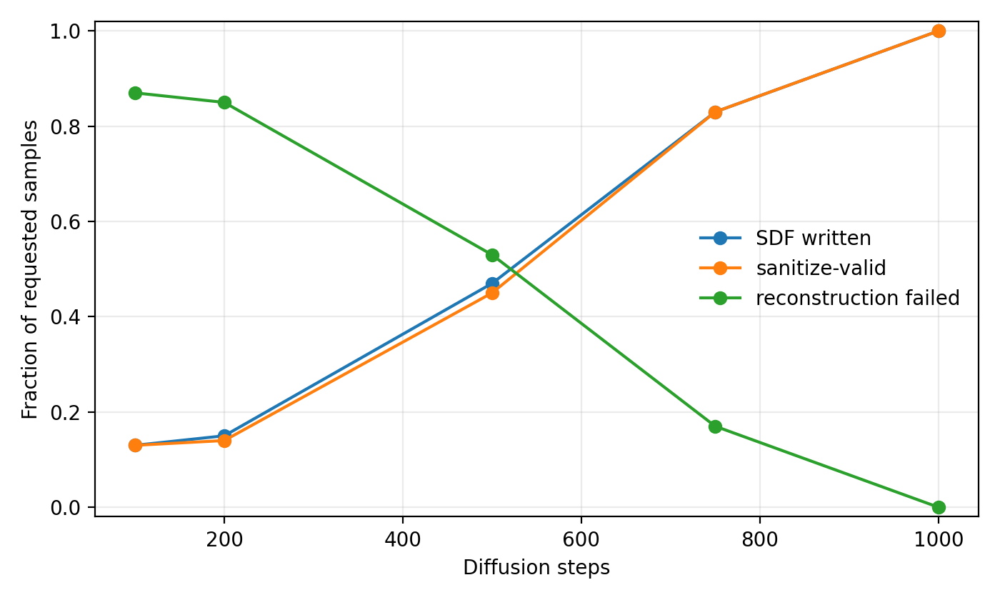

# TargetDiff diffusion-step sweep

Fixed protocol: 8GJL/C1101, `num_samples=100`, `seed=1`, `batch_size=5`; only `sample.num_steps` changes.

| steps | total_generated | sdf_written | reconstruction_failed | sdf_records | rdkit_readable | sanitize_valid | unique_smiles |
| --- | --- | --- | --- | --- | --- | --- | --- |
| 100 | 100 | 13 | 87 | 13 | 13 | 13 | 13 |
| 200 | 100 | 15 | 85 | 15 | 15 | 14 | 14 |
| 500 | 100 | 47 | 53 | 47 | 47 | 45 | 45 |
| 750 | 100 | 83 | 17 | 83 | 83 | 83 | 83 |
| 1000 | 100 | 100 | 0 | 100 | 100 | 100 | 100 |

CSV: [targetdiff_step_sweep_summary.csv](targetdiff_step_sweep_summary.csv)
Plot: [targetdiff_step_success_rates.png](targetdiff_step_success_rates.png)
