# Bond Predictor Diagnostics Report

## Metadata

- processed_npz: `data/crossdocked_raw/processed_edge_noH_full/val.npz`
- split: `val`
- crossdocked_samples: `300`
- sample_mode: `random`
- seed: `20260602`
- noise_stds: `0.0 0.05 0.1 0.2 0.3 0.5`
- methods: `oracle_true_bond openbabel edm diffgui_bond molsnapper_bond local_bond_v0`
- generated_samples: `300`
- generated_timesteps: `10`
- generated_reconstruction_methods: `openbabel edm`
- length_tolerance: `0.25`
- clash_threshold: `0.7`
- requested_device: `cuda:0`
- effective_device: `cuda:0`
- external_bond_device: `cuda:0`
- local_bond_device: `cuda:0`
- torch_cuda_available: `True`
- torch_cuda_device_count: `8`

## Clean CrossDocked Predictor Test

| method | sanitize | edge_f1 | typed_f1 | pred/true | bad_len | sec/mol |
| --- | --- | --- | --- | --- | --- | --- |
| diffgui_bond | 0.8900 | 0.9989 | 0.5677 | 0.9995 | 0.0033 | 0.0373 |
| edm | 0.9167 | 0.9900 | 0.5296 | 0.9812 | 0.0000 | 0.0020 |
| local_bond_v0 | 0.2500 | 0.9999 | 0.8176 | 0.9998 | 0.0017 | 0.0020 |
| molsnapper_bond | 0.7267 | 1.0000 | 0.9014 | 1.0001 | 0.0077 | 0.0350 |
| openbabel | 0.6467 | 1.0000 | 0.5960 | 1.0000 | 0.0041 | 0.0023 |
| oracle_true_bond | 0.8767 | 1.0000 | 0.9586 | 1.0000 | 0.0072 | 0.0013 |

## Noise Robustness Sweep

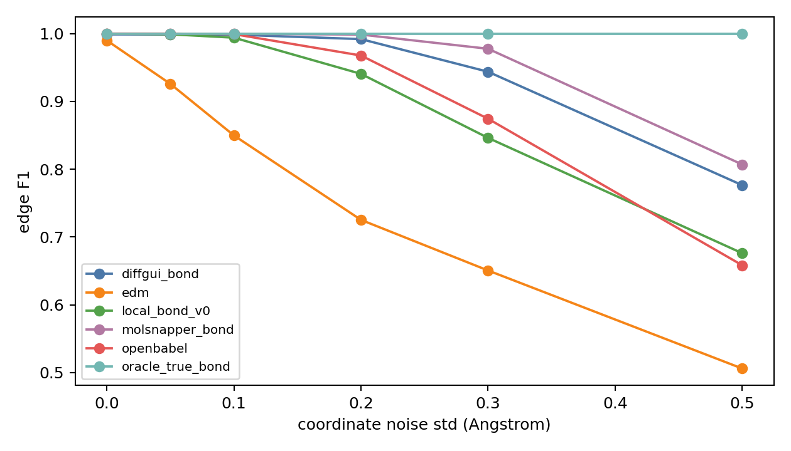

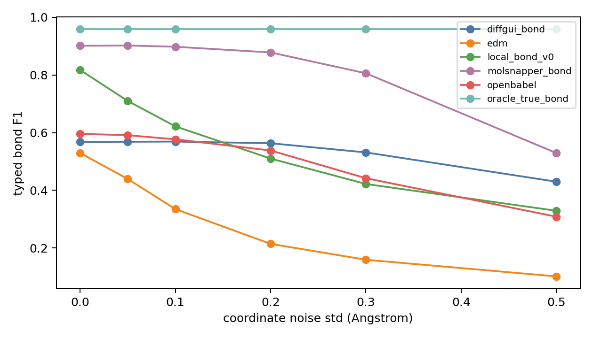

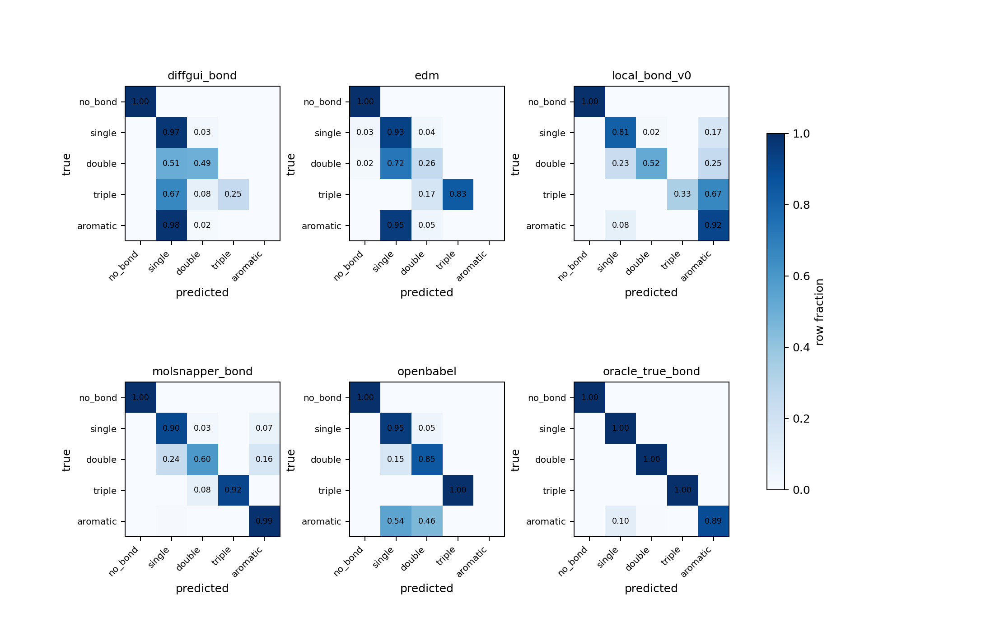

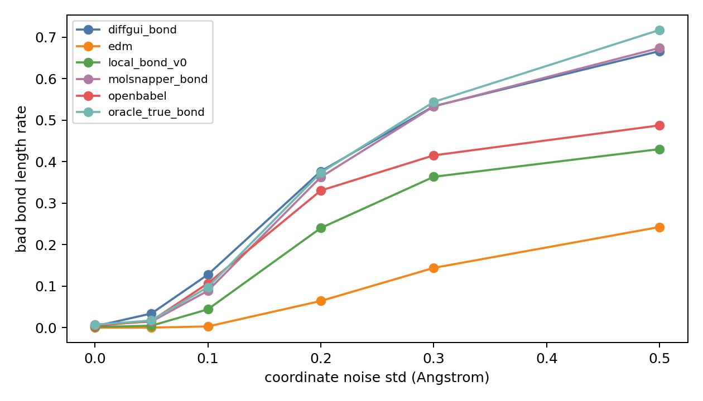

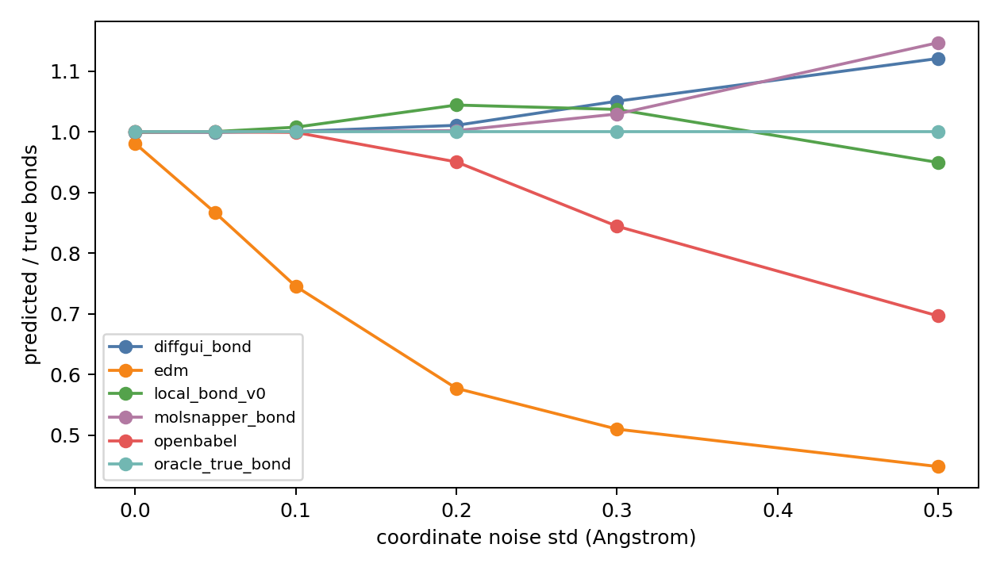

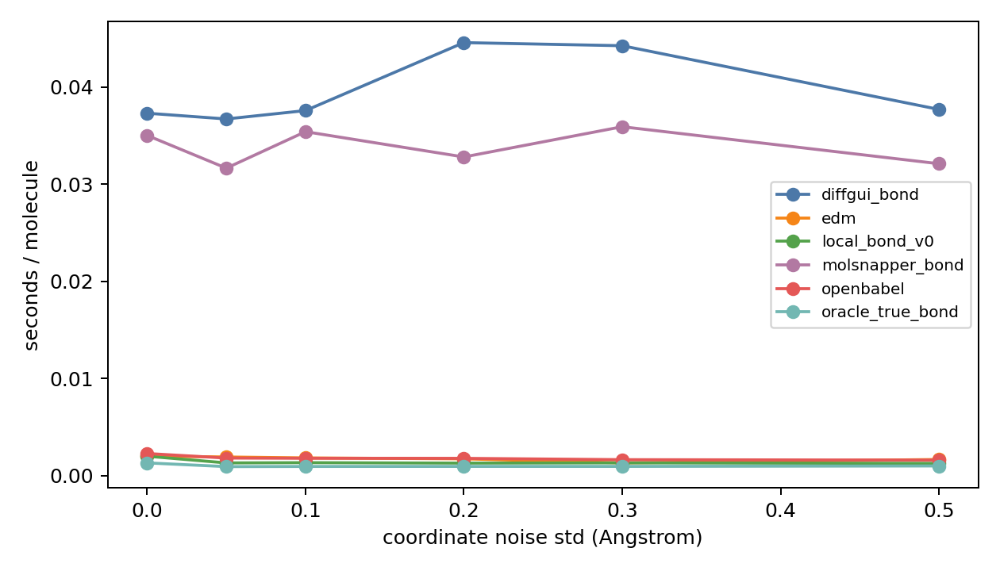

## Generated Point Cloud Geometry

| source | samples | atoms | C frac | hetero frac | NN mean | clash frac | cand/atom | true recall |
| --- | --- | --- | --- | --- | --- | --- | --- | --- |
| crossdocked_clean | 300 | 23.2967 | 0.6544 | 0.3456 | 1.3969 | 0.0000 | 1.0613 | 0.9998 |
| diffsbdd_generated | 300 | 23.1333 | 0.7924 | 0.2076 | 1.2902 | 0.0006 | 1.0786 | 0.0000 |

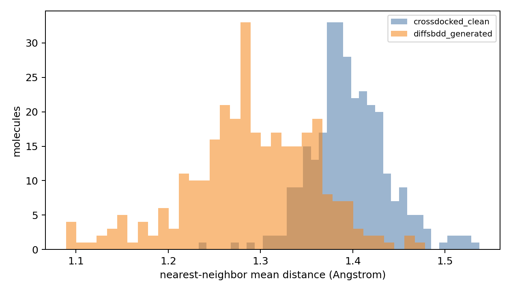

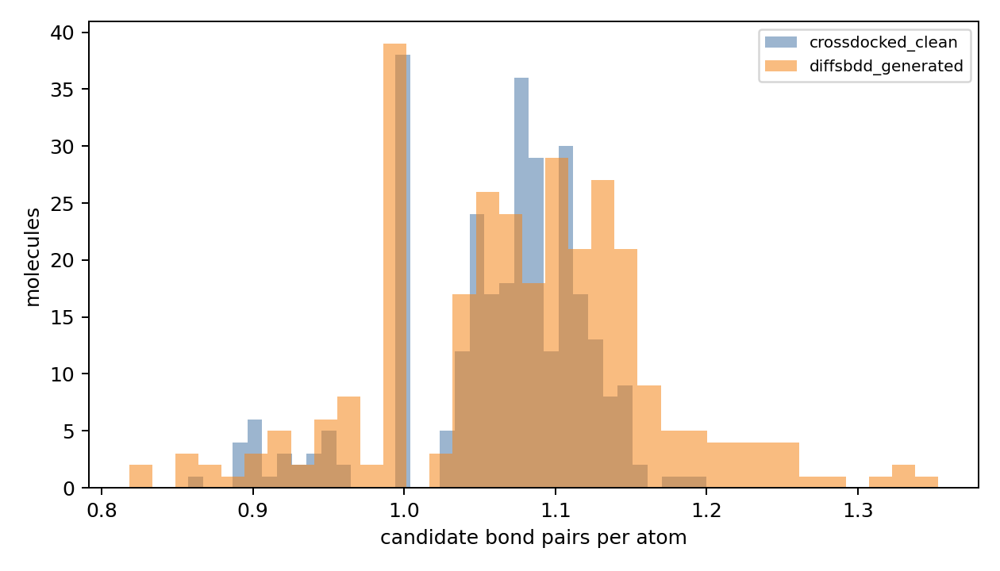

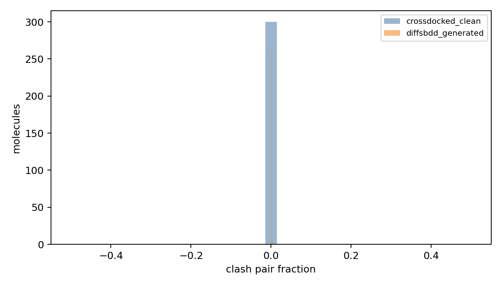

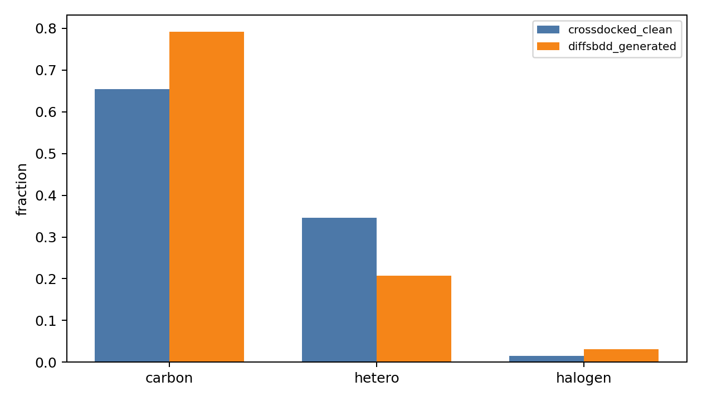

## Generated Reconstruction

| method | samples | sanitize | bad_len | fragments | QED | sec/mol |
| --- | --- | --- | --- | --- | --- | --- |
| edm | 300 | 0.1533 | 0.0315 | 3.2833 | 0.0797 | 0.0014 |
| openbabel | 300 | 0.7467 | 0.1737 | 1.2800 | 0.4171 | 0.0019 |

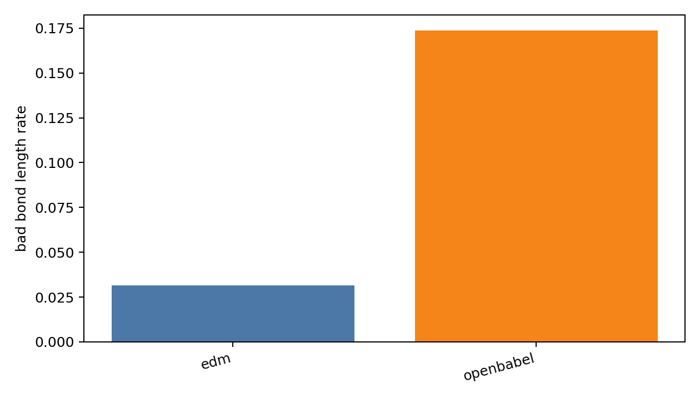

## Files

- [clean_noise_per_molecule.csv](clean_noise_per_molecule.csv)
- [clean_noise_summary.csv](clean_noise_summary.csv)
- [clean_noise_bond_type_confusion.csv](clean_noise_bond_type_confusion.csv)
- [clean_noise_bond_type_metrics.csv](clean_noise_bond_type_metrics.csv)
- [generated_geometry_per_molecule.csv](generated_geometry_per_molecule.csv)
- [generated_geometry_summary.csv](generated_geometry_summary.csv)
- [generated_reconstruction_per_molecule.csv](generated_reconstruction_per_molecule.csv)
- [generated_reconstruction_summary.csv](generated_reconstruction_summary.csv)
