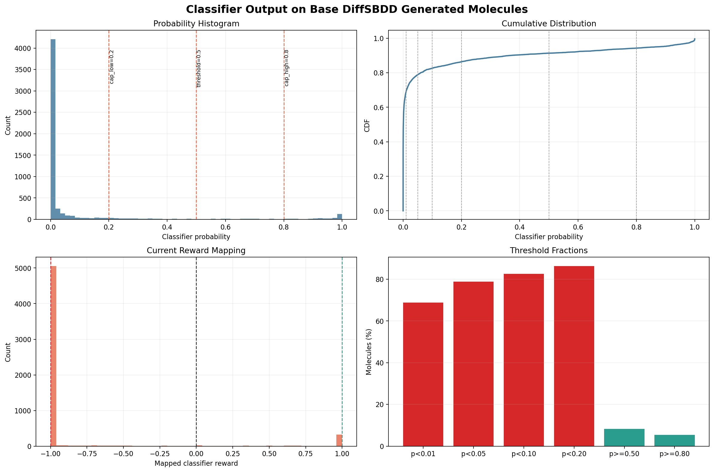
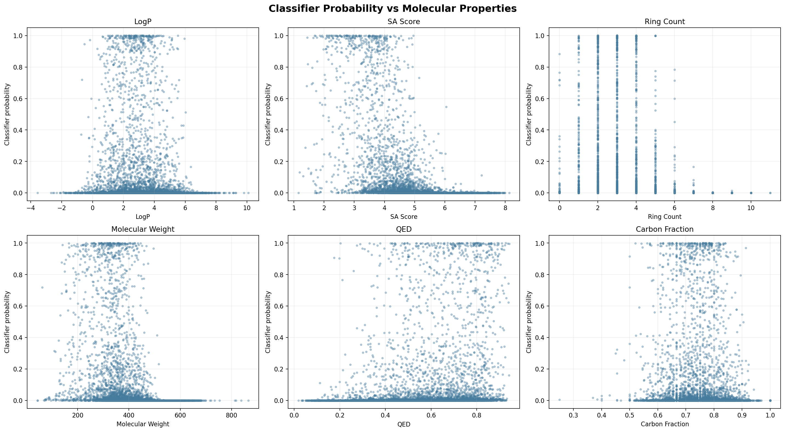
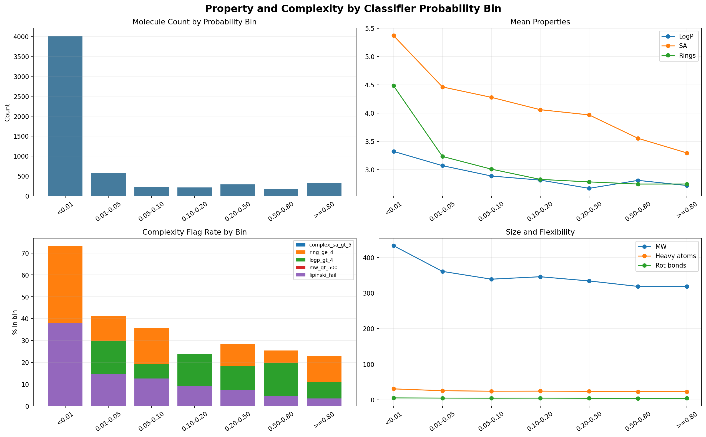
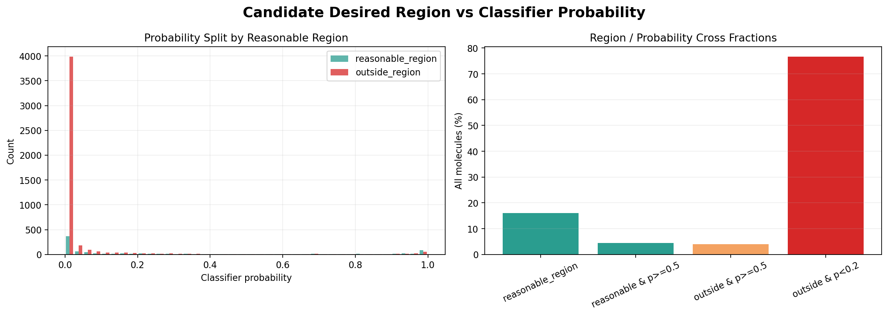

# 基础 DiffSBDD 生成分子的 classifier 输出分布

- SDF: `/data/disk6/DiffB110/OUT/260407_generate_ligands_10000/260407generated_10000_filtered.sdf`
- Model: `/data/disk6/DiffB110/chembl_classifier/models/chembl_classifier_selected_v0_2_1_weighted.pt`
- 结论: **不可直接作为稠密 RL reward**

## 关键结论

- scored valid molecules: 5829
- probability median: 0.0007
- probability mean: 0.0975
- p < 0.20: 86.34%
- p >= 0.50: 8.30%
- p >= 0.80: 5.40%
- mapped reward floor (-1): 86.36%
- mapped reward positive: 8.30%

## 图表

## Summary

| metric | value |
| --- | --- |
| input_records | 5829.0000 |
| valid_scored | 5829.0000 |
| sanitize_or_featurize_failed | 0.0000 |
| prob_mean | 0.0975 |
| prob_median | 0.0007 |
| prob_q01 | 0.0000 |
| prob_q05 | 0.0000 |
| prob_q10 | 0.0000 |
| prob_q25 | 0.0000 |
| prob_q75 | 0.0250 |
| prob_q90 | 0.3477 |
| prob_q95 | 0.8320 |
| prob_q99 | 0.9980 |
| prob_lt_0_01_ratio | 0.6883 |
| prob_lt_0_05_ratio | 0.7883 |
| prob_lt_0_10_ratio | 0.8266 |
| prob_lt_0_20_ratio | 0.8634 |
| prob_ge_0_50_ratio | 0.0830 |
| prob_ge_0_80_ratio | 0.0540 |
| mapped_reward_mean | -0.8253 |
| mapped_reward_median | -1.0000 |
| mapped_reward_floor_ratio | 0.8636 |
| mapped_reward_positive_ratio | 0.0830 |
| mapped_reward_gt_0_5_ratio | 0.0697 |

## Probability Bin Property Summary

| prob_bin | classifier_prob_count | classifier_prob_mean | classifier_prob_median | classifier_reward_mapped_count | classifier_reward_mapped_mean | classifier_reward_mapped_median | mol_wt_count | mol_wt_mean | mol_wt_median | logp_count | logp_mean | logp_median | tpsa_count | tpsa_mean | tpsa_median | qed_count | qed_mean | qed_median | sa_score_count | sa_score_mean | sa_score_median | ring_count_count | ring_count_mean | ring_count_median | rot_bonds_count | rot_bonds_mean | rot_bonds_median | heavy_atom_count_count | heavy_atom_count_mean | heavy_atom_count_median | carbon_fraction_count | carbon_fraction_mean | carbon_fraction_median | hetero_atoms_count | hetero_atoms_mean | hetero_atoms_median | spiro_atoms_count | spiro_atoms_mean | spiro_atoms_median | bridgehead_atoms_count | bridgehead_atoms_mean | bridgehead_atoms_median |
| --- | --- | --- | --- | --- | --- | --- | --- | --- | --- | --- | --- | --- | --- | --- | --- | --- | --- | --- | --- | --- | --- | --- | --- | --- | --- | --- | --- | --- | --- | --- | --- | --- | --- | --- | --- | --- | --- | --- | --- | --- | --- | --- |
| <0.01 | 4012 | 0.0010 | 0.0001 | 4012 | -1.0000 | -1.0000 | 4012 | 433.0934 | 427.4635 | 4012 | 3.3228 | 3.2878 | 4012 | 80.5562 | 77.0150 | 4012 | 0.5085 | 0.5228 | 4012 | 5.3684 | 5.3014 | 4012 | 4.4826 | 4.0000 | 4012 | 5.1648 | 5.0000 | 4012 | 30.5735 | 30.0000 | 4012 | 0.7533 | 0.7561 | 4012 | 7.5795 | 7.0000 | 4012 | 0.1817 | 0.0000 | 4012 | 0.3614 | 0.0000 |
| 0.01-0.05 | 583 | 0.0243 | 0.0211 | 583 | -1.0000 | -1.0000 | 583 | 360.8364 | 369.4460 | 583 | 3.0703 | 3.0345 | 583 | 70.3588 | 68.1100 | 583 | 0.6054 | 0.6264 | 583 | 4.4614 | 4.5145 | 583 | 3.2333 | 3.0000 | 583 | 4.7015 | 4.0000 | 583 | 25.3602 | 26.0000 | 583 | 0.7384 | 0.7419 | 583 | 6.5969 | 6.0000 | 583 | 0.0772 | 0.0000 | 583 | 0.0961 | 0.0000 |
| 0.05-0.10 | 223 | 0.0710 | 0.0700 | 223 | -1.0000 | -1.0000 | 223 | 338.9758 | 344.3600 | 223 | 2.8874 | 2.9642 | 223 | 68.6139 | 68.2500 | 223 | 0.6188 | 0.6415 | 223 | 4.2778 | 4.3453 | 223 | 3.0090 | 3.0000 | 223 | 4.3946 | 4.0000 | 223 | 24.0448 | 25.0000 | 223 | 0.7483 | 0.7500 | 223 | 6.0448 | 6.0000 | 223 | 0.0404 | 0.0000 | 223 | 0.1256 | 0.0000 |
| 0.10-0.20 | 215 | 0.1493 | 0.1521 | 215 | -1.0000 | -1.0000 | 215 | 345.7954 | 354.4030 | 215 | 2.8150 | 2.7827 | 215 | 70.9057 | 70.8300 | 215 | 0.6103 | 0.6283 | 215 | 4.0595 | 4.1608 | 215 | 2.8279 | 3.0000 | 215 | 4.5628 | 5.0000 | 215 | 24.2837 | 25.0000 | 215 | 0.7344 | 0.7368 | 215 | 6.5349 | 6.0000 | 215 | 0.0326 | 0.0000 | 215 | 0.0465 | 0.0000 |
| 0.20-0.50 | 291 | 0.3150 | 0.2993 | 291 | -0.6167 | -0.6690 | 291 | 333.9780 | 347.4590 | 291 | 2.6699 | 2.6420 | 291 | 72.2059 | 72.8000 | 291 | 0.6369 | 0.6539 | 291 | 3.9672 | 4.0070 | 291 | 2.7835 | 3.0000 | 291 | 4.1203 | 4.0000 | 291 | 23.5395 | 24.0000 | 291 | 0.7280 | 0.7333 | 291 | 6.3574 | 6.0000 | 291 | 0.0447 | 0.0000 | 291 | 0.0619 | 0.0000 |
| 0.50-0.80 | 169 | 0.6537 | 0.6567 | 169 | 0.5123 | 0.5224 | 169 | 318.5750 | 332.4000 | 169 | 2.8103 | 2.8260 | 169 | 66.1243 | 60.8500 | 169 | 0.6737 | 0.7001 | 169 | 3.5534 | 3.6065 | 169 | 2.7456 | 3.0000 | 169 | 3.8047 | 4.0000 | 169 | 22.6036 | 24.0000 | 169 | 0.7384 | 0.7500 | 169 | 5.8462 | 6.0000 | 169 | 0.0296 | 0.0000 | 169 | 0.0355 | 0.0000 |
| >=0.80 | 315 | 0.9453 | 0.9674 | 315 | 1.0000 | 1.0000 | 315 | 318.6149 | 322.4080 | 315 | 2.7197 | 2.7362 | 315 | 71.0943 | 67.5600 | 315 | 0.6807 | 0.7074 | 315 | 3.2950 | 3.4037 | 315 | 2.7460 | 3.0000 | 315 | 4.0286 | 4.0000 | 315 | 22.6127 | 23.0000 | 315 | 0.7285 | 0.7308 | 315 | 6.1111 | 6.0000 | 315 | 0.0063 | 0.0000 | 315 | 0.0254 | 0.0000 |

## Probability Bin Flag Summary

| prob_bin | flag_prob_lt_0_01 | flag_prob_lt_0_05 | flag_prob_lt_0_10 | flag_prob_lt_0_20 | flag_prob_ge_0_50 | flag_prob_ge_0_80 | flag_reward_floor | flag_reward_positive | flag_reward_gt_0_5 | flag_complex_sa_gt_5 | flag_complex_sa_gt_6 | flag_ring_ge_4 | flag_ring_ge_6 | flag_rot_gt_10 | flag_mw_gt_500 | flag_logp_gt_4 | flag_logp_gt_5 | flag_carbon_gt_0_8 | flag_bridge_or_spiro | flag_lipinski_fail |
| --- | --- | --- | --- | --- | --- | --- | --- | --- | --- | --- | --- | --- | --- | --- | --- | --- | --- | --- | --- | --- |
| <0.01 | 1.0000 | 1.0000 | 1.0000 | 1.0000 | 0.0000 | 0.0000 | 1.0000 | 0.0000 | 0.0000 | 0.6468 | 0.2228 | 0.7321 | 0.2311 | 0.0833 | 0.2326 | 0.3579 | 0.1892 | 0.2637 | 0.2547 | 0.3804 |
| 0.01-0.05 | 0.0000 | 1.0000 | 1.0000 | 1.0000 | 0.0000 | 0.0000 | 1.0000 | 0.0000 | 0.0000 | 0.2058 | 0.0154 | 0.4134 | 0.0480 | 0.0429 | 0.0069 | 0.2985 | 0.1012 | 0.2178 | 0.1046 | 0.1458 |
| 0.05-0.10 | 0.0000 | 0.0000 | 1.0000 | 1.0000 | 0.0000 | 0.0000 | 1.0000 | 0.0000 | 0.0000 | 0.1390 | 0.0135 | 0.3587 | 0.0404 | 0.0224 | 0.0000 | 0.1928 | 0.0942 | 0.2646 | 0.0807 | 0.1256 |
| 0.10-0.20 | 0.0000 | 0.0000 | 0.0000 | 1.0000 | 0.0000 | 0.0000 | 1.0000 | 0.0000 | 0.0000 | 0.0884 | 0.0047 | 0.2279 | 0.0186 | 0.0186 | 0.0047 | 0.2372 | 0.0698 | 0.2326 | 0.0512 | 0.0930 |
| 0.20-0.50 | 0.0000 | 0.0000 | 0.0000 | 0.0000 | 0.0000 | 0.0000 | 0.0034 | 0.0000 | 0.0000 | 0.0859 | 0.0034 | 0.2852 | 0.0172 | 0.0172 | 0.0069 | 0.1821 | 0.0481 | 0.1959 | 0.0722 | 0.0722 |
| 0.50-0.80 | 0.0000 | 0.0000 | 0.0000 | 0.0000 | 1.0000 | 0.0000 | 0.0000 | 1.0000 | 0.5385 | 0.0118 | 0.0059 | 0.2544 | 0.0178 | 0.0000 | 0.0000 | 0.1953 | 0.0473 | 0.1893 | 0.0414 | 0.0473 |
| >=0.80 | 0.0000 | 0.0000 | 0.0000 | 0.0000 | 1.0000 | 1.0000 | 0.0000 | 1.0000 | 1.0000 | 0.0000 | 0.0000 | 0.2286 | 0.0000 | 0.0032 | 0.0000 | 0.1111 | 0.0317 | 0.1333 | 0.0159 | 0.0349 |

## 文件

- `base_diffsbdd_classifier_scores.csv`: 每个有效分子的 classifier probability/reward 与性质。
- `classifier_probability_summary.csv`: probability、reward 映射和阈值比例。
- `property_by_probability_bin.csv`: classifier probability 分箱后的性质统计。
- `complexity_flags_by_probability_bin.csv`: 分箱后的复杂度/疏水/规则失败比例。
- `top_classifier_molecules.csv` / `bottom_classifier_molecules.csv`: classifier 高低分分子。