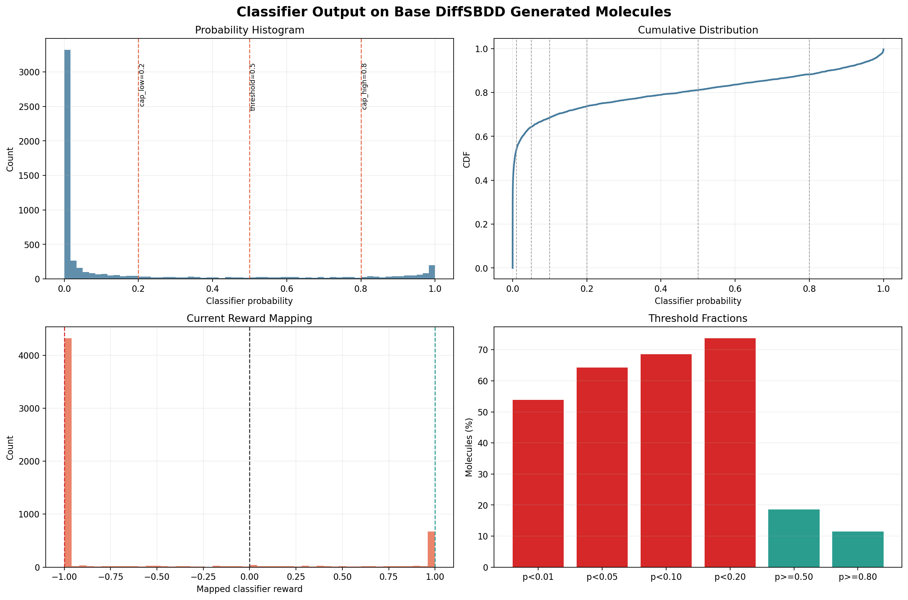
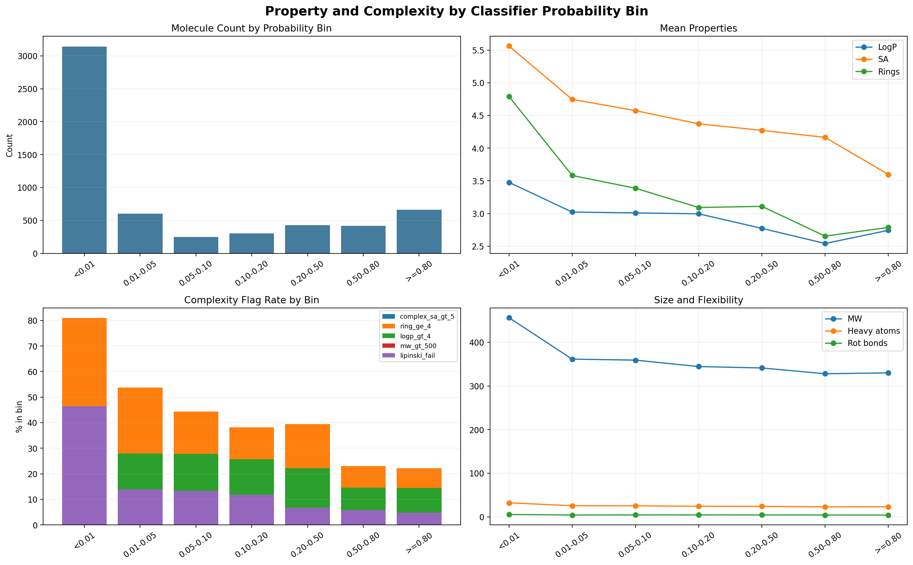
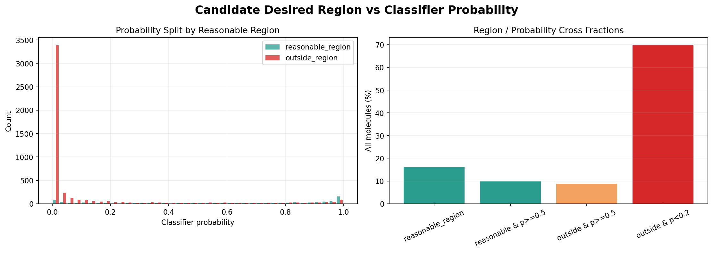

# 基础 DiffSBDD 生成分子的 classifier 输出分布

- SDF: `/data/disk6/DiffB110/OUT/260407_generate_ligands_10000/260407generated_10000_filtered.sdf`
- Model: `/data/disk6/DiffB110/chembl_classifier/models/chembl_classifier_selected_v0_2_hardneg.pt`
- 结论: **不可直接作为稠密 RL reward**

## 关键结论

- scored valid molecules: 5829
- probability median: 0.0055
- probability mean: 0.1925
- p < 0.20: 73.73%
- p >= 0.50: 18.56%
- p >= 0.80: 11.41%
- mapped reward floor (-1): 73.73%
- mapped reward positive: 18.56%

## 图表

## Summary

| metric | value |
| --- | --- |
| input_records | 5829.0000 |
| valid_scored | 5829.0000 |
| sanitize_or_featurize_failed | 0.0000 |
| prob_mean | 0.1925 |
| prob_median | 0.0055 |
| prob_q01 | 0.0000 |
| prob_q05 | 0.0000 |
| prob_q10 | 0.0000 |
| prob_q25 | 0.0000 |
| prob_q75 | 0.2310 |
| prob_q90 | 0.8447 |
| prob_q95 | 0.9646 |
| prob_q99 | 0.9986 |
| prob_lt_0_01_ratio | 0.5389 |
| prob_lt_0_05_ratio | 0.6426 |
| prob_lt_0_10_ratio | 0.6852 |
| prob_lt_0_20_ratio | 0.7373 |
| prob_ge_0_50_ratio | 0.1856 |
| prob_ge_0_80_ratio | 0.1141 |
| mapped_reward_mean | -0.6274 |
| mapped_reward_median | -1.0000 |
| mapped_reward_floor_ratio | 0.7373 |
| mapped_reward_positive_ratio | 0.1856 |
| mapped_reward_gt_0_5_ratio | 0.1491 |

## Probability Bin Property Summary

| prob_bin | classifier_prob_count | classifier_prob_mean | classifier_prob_median | classifier_reward_mapped_count | classifier_reward_mapped_mean | classifier_reward_mapped_median | mol_wt_count | mol_wt_mean | mol_wt_median | logp_count | logp_mean | logp_median | tpsa_count | tpsa_mean | tpsa_median | qed_count | qed_mean | qed_median | sa_score_count | sa_score_mean | sa_score_median | ring_count_count | ring_count_mean | ring_count_median | rot_bonds_count | rot_bonds_mean | rot_bonds_median | heavy_atom_count_count | heavy_atom_count_mean | heavy_atom_count_median | carbon_fraction_count | carbon_fraction_mean | carbon_fraction_median | hetero_atoms_count | hetero_atoms_mean | hetero_atoms_median | spiro_atoms_count | spiro_atoms_mean | spiro_atoms_median | bridgehead_atoms_count | bridgehead_atoms_mean | bridgehead_atoms_median |
| --- | --- | --- | --- | --- | --- | --- | --- | --- | --- | --- | --- | --- | --- | --- | --- | --- | --- | --- | --- | --- | --- | --- | --- | --- | --- | --- | --- | --- | --- | --- | --- | --- | --- | --- | --- | --- | --- | --- | --- | --- | --- | --- |
| <0.01 | 3141 | 0.0012 | 0.0001 | 3141 | -1.0000 | -1.0000 | 3141 | 456.6288 | 453.6730 | 3141 | 3.4771 | 3.4626 | 3141 | 84.8136 | 82.3100 | 3141 | 0.4650 | 0.4700 | 3141 | 5.5608 | 5.5039 | 3141 | 4.7908 | 5.0000 | 3141 | 5.4371 | 5.0000 | 3141 | 32.2544 | 32.0000 | 3141 | 0.7575 | 0.7586 | 3141 | 7.9067 | 8.0000 | 3141 | 0.2216 | 0.0000 | 3141 | 0.4425 | 0.0000 |
| 0.01-0.05 | 605 | 0.0252 | 0.0228 | 605 | -1.0000 | -1.0000 | 605 | 361.5993 | 370.4960 | 605 | 3.0226 | 3.1299 | 605 | 66.8407 | 65.0700 | 605 | 0.6225 | 0.6608 | 605 | 4.7457 | 4.7623 | 605 | 3.5818 | 4.0000 | 605 | 4.2512 | 4.0000 | 605 | 25.5835 | 26.0000 | 605 | 0.7537 | 0.7600 | 605 | 6.2711 | 6.0000 | 605 | 0.0777 | 0.0000 | 605 | 0.1322 | 0.0000 |
| 0.05-0.10 | 248 | 0.0726 | 0.0698 | 248 | -1.0000 | -1.0000 | 248 | 359.2993 | 364.1435 | 248 | 3.0098 | 2.9994 | 248 | 67.9582 | 65.8050 | 248 | 0.6231 | 0.6464 | 248 | 4.5739 | 4.6353 | 248 | 3.3871 | 3.0000 | 248 | 4.4234 | 4.0000 | 248 | 25.3710 | 26.0000 | 248 | 0.7491 | 0.7600 | 248 | 6.3871 | 6.0000 | 248 | 0.0806 | 0.0000 | 248 | 0.0726 | 0.0000 |
| 0.10-0.20 | 304 | 0.1449 | 0.1431 | 304 | -1.0000 | -1.0000 | 304 | 344.5515 | 355.0670 | 304 | 2.9959 | 2.9922 | 304 | 65.8872 | 63.2050 | 304 | 0.6152 | 0.6271 | 304 | 4.3713 | 4.4678 | 304 | 3.0921 | 3.0000 | 304 | 4.5263 | 4.0000 | 304 | 24.3125 | 25.0000 | 304 | 0.7491 | 0.7500 | 304 | 6.1480 | 6.0000 | 304 | 0.0526 | 0.0000 | 304 | 0.0921 | 0.0000 |
| 0.20-0.50 | 428 | 0.3396 | 0.3366 | 428 | -0.5346 | -0.5446 | 428 | 341.3049 | 350.4275 | 428 | 2.7733 | 2.7918 | 428 | 68.0197 | 66.8300 | 428 | 0.6432 | 0.6821 | 428 | 4.2718 | 4.3547 | 428 | 3.1098 | 3.0000 | 428 | 4.3902 | 4.0000 | 428 | 24.1355 | 25.0000 | 428 | 0.7414 | 0.7419 | 428 | 6.2593 | 6.0000 | 428 | 0.0327 | 0.0000 | 428 | 0.0794 | 0.0000 |
| 0.50-0.80 | 417 | 0.6471 | 0.6475 | 417 | 0.4905 | 0.4916 | 417 | 328.0787 | 339.8220 | 417 | 2.5420 | 2.5395 | 417 | 70.1507 | 68.8500 | 417 | 0.6499 | 0.6736 | 417 | 4.1645 | 4.2830 | 417 | 2.6547 | 3.0000 | 417 | 4.2974 | 4.0000 | 417 | 22.9664 | 24.0000 | 417 | 0.7180 | 0.7200 | 417 | 6.4412 | 6.0000 | 417 | 0.0168 | 0.0000 | 417 | 0.0288 | 0.0000 |
| >=0.80 | 665 | 0.9347 | 0.9522 | 665 | 1.0000 | 1.0000 | 665 | 330.0609 | 335.3600 | 665 | 2.7431 | 2.7246 | 665 | 71.0541 | 68.6500 | 665 | 0.6784 | 0.7055 | 665 | 3.5980 | 3.6634 | 665 | 2.7880 | 3.0000 | 665 | 4.1203 | 4.0000 | 665 | 23.2226 | 24.0000 | 665 | 0.7186 | 0.7241 | 665 | 6.5023 | 6.0000 | 665 | 0.0150 | 0.0000 | 665 | 0.0211 | 0.0000 |

## Probability Bin Flag Summary

| prob_bin | flag_prob_lt_0_01 | flag_prob_lt_0_05 | flag_prob_lt_0_10 | flag_prob_lt_0_20 | flag_prob_ge_0_50 | flag_prob_ge_0_80 | flag_reward_floor | flag_reward_positive | flag_reward_gt_0_5 | flag_complex_sa_gt_5 | flag_complex_sa_gt_6 | flag_ring_ge_4 | flag_ring_ge_6 | flag_rot_gt_10 | flag_mw_gt_500 | flag_logp_gt_4 | flag_logp_gt_5 | flag_carbon_gt_0_8 | flag_bridge_or_spiro | flag_lipinski_fail |
| --- | --- | --- | --- | --- | --- | --- | --- | --- | --- | --- | --- | --- | --- | --- | --- | --- | --- | --- | --- | --- |
| <0.01 | 1.0000 | 1.0000 | 1.0000 | 1.0000 | 0.0000 | 0.0000 | 1.0000 | 0.0000 | 0.0000 | 0.7485 | 0.2802 | 0.8090 | 0.2967 | 0.1000 | 0.2986 | 0.4002 | 0.2273 | 0.2843 | 0.3066 | 0.4651 |
| 0.01-0.05 | 0.0000 | 1.0000 | 1.0000 | 1.0000 | 0.0000 | 0.0000 | 1.0000 | 0.0000 | 0.0000 | 0.3438 | 0.0314 | 0.5372 | 0.0380 | 0.0298 | 0.0000 | 0.2793 | 0.1041 | 0.2744 | 0.1256 | 0.1388 |
| 0.05-0.10 | 0.0000 | 0.0000 | 1.0000 | 1.0000 | 0.0000 | 0.0000 | 1.0000 | 0.0000 | 0.0000 | 0.2903 | 0.0040 | 0.4435 | 0.0282 | 0.0282 | 0.0000 | 0.2782 | 0.1048 | 0.2702 | 0.1048 | 0.1331 |
| 0.10-0.20 | 0.0000 | 0.0000 | 0.0000 | 1.0000 | 0.0000 | 0.0000 | 1.0000 | 0.0000 | 0.0000 | 0.1579 | 0.0132 | 0.3816 | 0.0164 | 0.0461 | 0.0033 | 0.2566 | 0.0691 | 0.2270 | 0.0789 | 0.1184 |
| 0.20-0.50 | 0.0000 | 0.0000 | 0.0000 | 0.0000 | 0.0000 | 0.0000 | 0.0000 | 0.0000 | 0.0000 | 0.1332 | 0.0093 | 0.3949 | 0.0117 | 0.0187 | 0.0023 | 0.2220 | 0.0491 | 0.2126 | 0.0654 | 0.0678 |
| 0.50-0.80 | 0.0000 | 0.0000 | 0.0000 | 0.0000 | 1.0000 | 0.0000 | 0.0000 | 1.0000 | 0.4892 | 0.0959 | 0.0024 | 0.2302 | 0.0048 | 0.0240 | 0.0000 | 0.1463 | 0.0312 | 0.1367 | 0.0288 | 0.0576 |
| >=0.80 | 0.0000 | 0.0000 | 0.0000 | 0.0000 | 1.0000 | 1.0000 | 0.0000 | 1.0000 | 1.0000 | 0.0241 | 0.0000 | 0.2226 | 0.0030 | 0.0045 | 0.0000 | 0.1444 | 0.0421 | 0.1233 | 0.0241 | 0.0481 |

## 文件

- `base_diffsbdd_classifier_scores.csv`: 每个有效分子的 classifier probability/reward 与性质。
- `classifier_probability_summary.csv`: probability、reward 映射和阈值比例。
- `property_by_probability_bin.csv`: classifier probability 分箱后的性质统计。
- `complexity_flags_by_probability_bin.csv`: 分箱后的复杂度/疏水/规则失败比例。
- `top_classifier_molecules.csv` / `bottom_classifier_molecules.csv`: classifier 高低分分子。