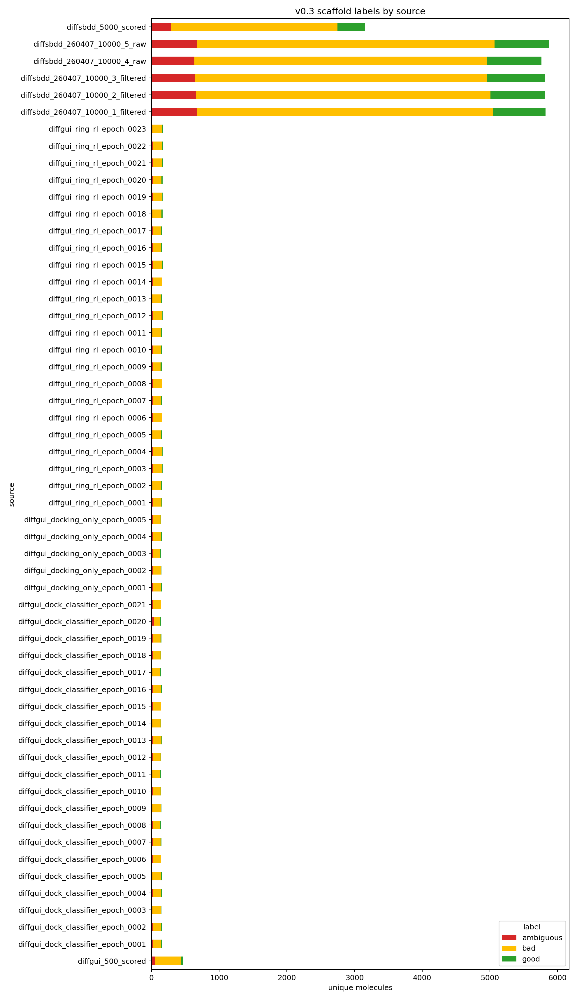

# Classifier v0.3 scaffold curation

## 输入

- 旧正样本：`analysis/classifier_v0_2_1_weighted_20260608/selected_positives_v0_2_1_weighted.smi`
- 旧负样本：`analysis/classifier_v0_2_1_weighted_20260608/selected_negatives_v0_2_1_weighted_labeled.smi`
- 新分子来源数：56

## 新分子标签统计

| label | n |
|---|---:|
| bad | 30630 |
| good | 5029 |
| ambiguous | 4559 |

## 主要原因统计

| primary_reason | n |
|---|---:|
| bad_fused_heterocycle | 17142 |
| bad_large_ring | 7782 |
| ambiguous_manual_review | 4559 |
| good_aromatic_reasonable | 2925 |
| bad_saturated_polycycle_no_aromatic | 2462 |
| good_single_benzene_low_halogen | 2104 |
| bad_three_member_ring | 1209 |
| bad_high_carbon_low_hetero | 572 |
| bad_fragmented | 532 |
| bad_many_halogen | 512 |
| bad_poly_fused_or_bridge_ring | 403 |
| bad_multi_aromatic_heterocycle | 11 |
| bad_overhalogenated_small_aromatic | 5 |

## 输出

- `new_molecule_classification.csv`：所有新分子规则特征和标签
- `sdf_by_reason/`：按标签原因拆分的 SDF，供人工复查
- `manual_review_priority_negative_examples.sdf`：优先人工看的 hard negative
- `selected_positives_v0_3_scaffold.smi` / `selected_negatives_v0_3_scaffold_labeled.smi`：可用于下一步训练

