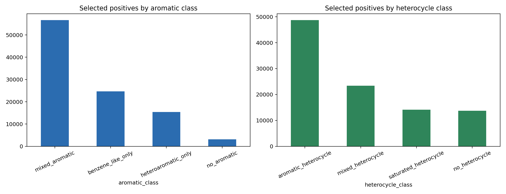
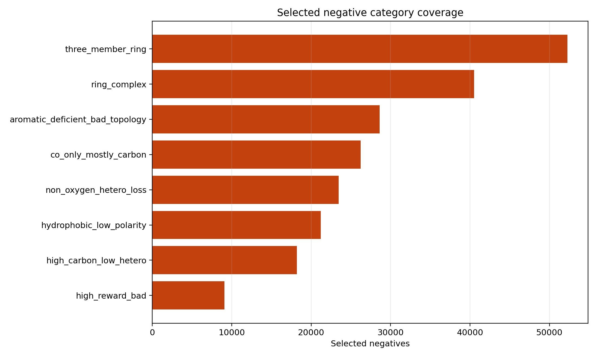

# 分类器训练样本选择 v0.1

生成时间：2026-05-27 16:35:16

## 一、产物性质

这是训练样本清单的 v0.1 候选版本，仍然放在 analysis 目录中，没有覆盖
`chembl_classifier/data`。

## 二、样本规模

- selected positives：100,000
- selected negatives：70,000
- combined dataset：170,000
- positive scaffold cap：每个 sampled Murcko scaffold 最多 10 条

## 三、正样本分布

正样本从 strict ChEMBL property pool 中按性质分层、芳香层分层抽样，并对 sampled
Murcko scaffold 做限额。

芳香类别：

- `mixed_aromatic`: 56.69%
- `benzene_like_only`: 24.70%
- `heteroaromatic_only`: 15.43%
- `no_aromatic`: 3.17%

## 四、负样本覆盖

负样本来自 generated hard negatives，不包含全部 OUT 分子。

- `three_member_ring`: 52,249
- `ring_complex`: 40,498
- `aromatic_deficient_bad_topology`: 28,612
- `co_only_mostly_carbon`: 26,217
- `non_oxygen_hetero_loss`: 23,468
- `hydrophobic_low_polarity`: 21,208
- `high_carbon_low_hetero`: 18,199
- `high_reward_bad`: 9,068

## 五、下一步

这版可以作为分类器 v0.1 的候选训练集。真正替换当前训练流程前，还需要让
`chembl_classifier/data/build_dataset.py` 支持从这些显式样本清单读取正负样本，
并在训练后输出 per-category recall、high_reward_bad false-negative rate 和
scaffold split 结果。
