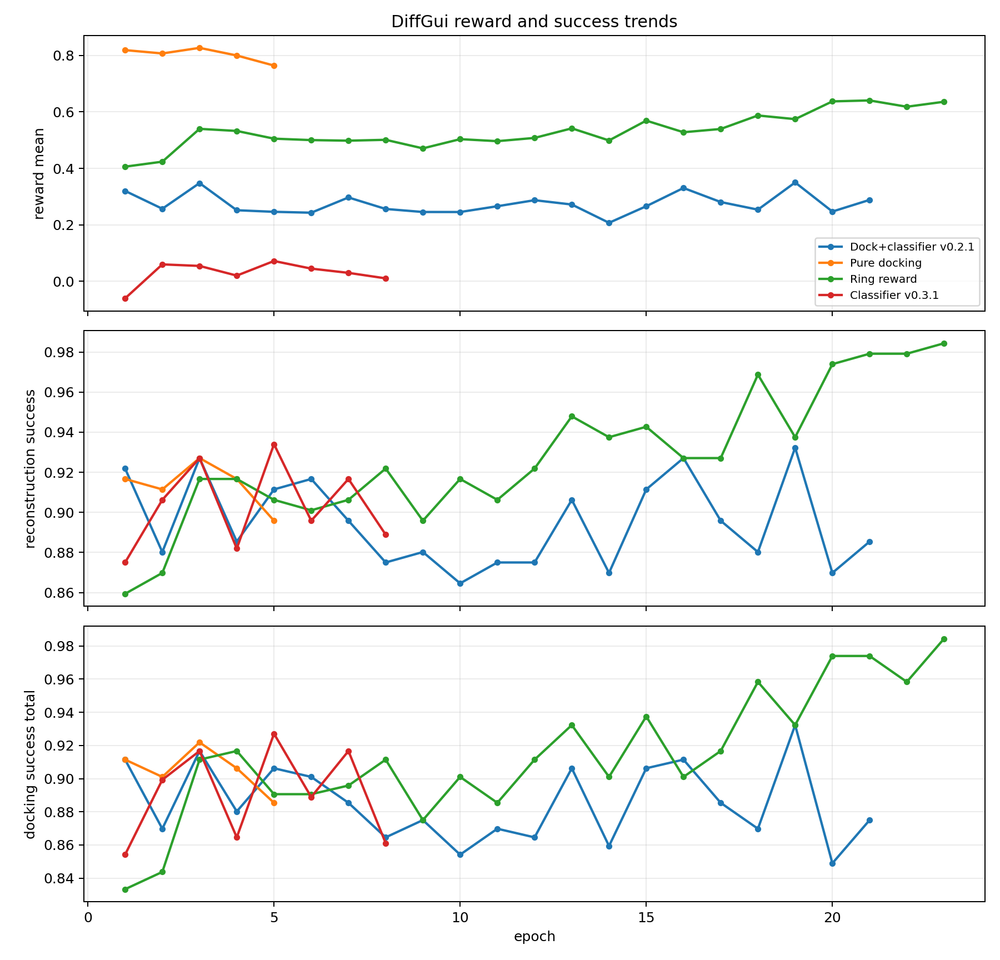
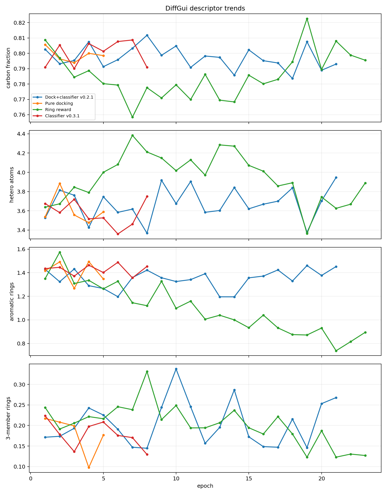
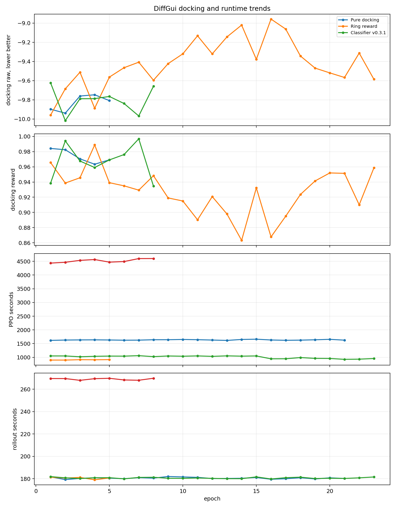
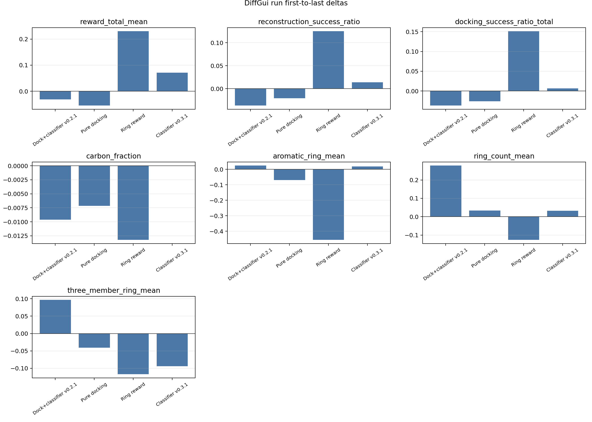

# DiffGui 几次大训练复盘

## 结论先行

1. DiffGui RL 工程已经跑通，200 step / 8 GPU 的 rollout 和 reward 评分稳定，真正的时间瓶颈主要在 PPO 更新。
2. 初版 `docking + classifier v0.2.1` 没有看到 reward 或 docking 的明确上升，说明简单把 DiffSBDD 的 reward 迁移到 DiffGui 不够。
3. `pure docking / lr=1e-5 / last2` 5 个 epoch 内 docking reward 反而略降，不能证明单独 docking 能把方向推好。
4. `ring-last3 / lr=3e-5` 能明显提高总 reward、重建成功率和 docking 成功率，也降低三元环，但同时把芳香环/苯环压下去，并让大环/复杂环问题暴露出来。
5. `classifier v0.3.1 / b36 / PPO=4` 单 epoch 成本过高，前 8 epoch reward 在低位波动，没有看到足够强的改善趋势。
6. `aromatic_scaffold` 那次只启动后被 SIGTERM，没有完整 summary，不能作为训练结论。

## 训练总览

| label | reward | setting | epochs_with_summary | last_reward_total_mean | delta_reward_total_mean | last_reconstruction_success_ratio | last_docking_success_ratio_total | last_carbon_fraction | last_aromatic_ring_mean | last_ring_count_mean | last_three_member_ring_mean | avg_total_seconds | ppo_time_fraction | note |
| --- | --- | --- | --- | --- | --- | --- | --- | --- | --- | --- | --- | --- | --- | --- |
| Dock+classifier v0.2.1 | docking 0.5 + classifier v0.2.1 0.5 | 8GPU, b24/card, 200 steps, last1, lr=1e-6, PPO=2 | 21 | 0.288 | -0.032 | 0.885 | 0.875 | 0.793 | 1.452 | 4.238 | 0.268 | 1834.269 | 0.891 | 初版正式训练，用户手动停止于 22 epoch 前后。 |
| Pure docking | docking 1.0 | 8GPU, b24/card, 200 steps, last2, lr=1e-5, PPO=1 | 5 | 0.764 | -0.055 | 0.896 | 0.885 | 0.799 | 1.347 | 3.976 | 0.176 | 1106.175 | 0.821 | 用于判断单独 docking 是否能推出改善趋势，5 个完整 epoch 后停止。 |
| Ring reward | docking 0.35 + ring_complexity 0.30 + chemistry_guard 0.10 | 8GPU, b24/card, 200 steps, last3, lr=3e-5, PPO=1 | 23 | 0.636 | 0.230 | 0.984 | 0.984 | 0.796 | 0.894 | 4.143 | 0.127 | 1210.622 | 0.836 | 重点测试能否改善复杂环；23 个完整 summary epoch，epoch24 只有 rank-level 文件。 |
| Classifier v0.3.1 | docking 0.5 + classifier v0.3.1 0.5 | 8GPU, b36/card, 200 steps, last1, lr=1e-6, PPO=4 | 8 | 0.010 | 0.071 | 0.889 | 0.861 | 0.791 | 1.453 | 3.947 | 0.130 | 4807.987 | 0.940 | 用坏分子审阅后重训分类器测试；8 个完整 epoch，单 epoch PPO 成本很高。 |
| Aromatic scaffold | docking 0.30 + aromatic_scaffold 0.35 + ring_complexity 0.10 + chemistry_guard 0.10 | 8GPU, b24/card, 200 steps, last3, lr=3e-5, PPO=1 | 0 |  |  |  |  |  |  |  |  |  |  | launch log 显示 2026-06-10 19:58 SIGTERM；无 training_summary.csv，不能作为有效训练趋势。 |

## 图件

## 解释

DiffGui 的底座比 DiffSBDD 更稳，因为它原生预测 atom/bond/halfedge/position，成功写入 SDF 的重建合法性更高。但这几次 RL 说明：底座更强不等于 reward 可以粗糙。只奖励 docking 或笼统惩罚 ring，会把模型推向新的漏洞：苯环减少、复杂脂环/大环仍然存在、卤素和小分子异常需要单独处理。

当前最有价值的结论不是“某个 reward 已经成功”，而是已经定位了下一版 reward 的边界：

- docking 可以保留，但不应单独主导；
- classifier 可以做软约束，但必须用更贴近人工审阅规则的负样本；
- ring reward 不能只惩罚环数量或复杂度，需要明确奖励合理单苯环/合理芳香骨架；
- 强负样本应包括多稠杂环、桥头/螺原子复杂拓扑、七元及以上大环，特别是大环并六元环；
- 正常的两个环稠合、合理三元环、一两个卤素不应被过度惩罚。

## 建议

下一轮 DiffGui 不建议再开 100 epoch 大跑。先用每卡 12-24 分子、3-5 epoch 的小测试，每次只改 1-2 个变量：

1. 固定 `last3, lr=1e-5 或 2e-5, PPO=1`，先把训练速度和 PPO 稳定性拉回来。
2. reward 用 `docking 0.25-0.35 + classifier 0.25-0.35 + rule reward 0.20-0.30`。
3. rule reward 里分开处理：单苯环/合理芳香骨架弱奖励，多稠杂环/大环并六元环/复杂桥螺拓扑强扣分，过小高卤素分子强扣分。
4. 每轮必须输出分子级 reason flags，并抽样进 Maestro 看，不只看 epoch 均值。
