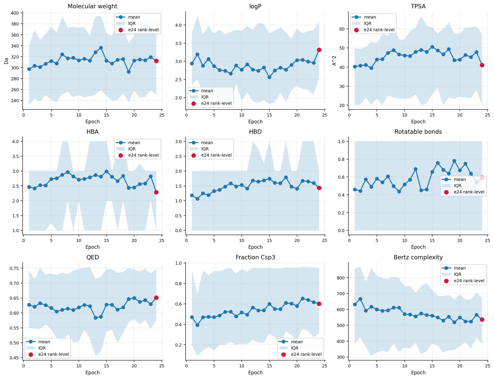
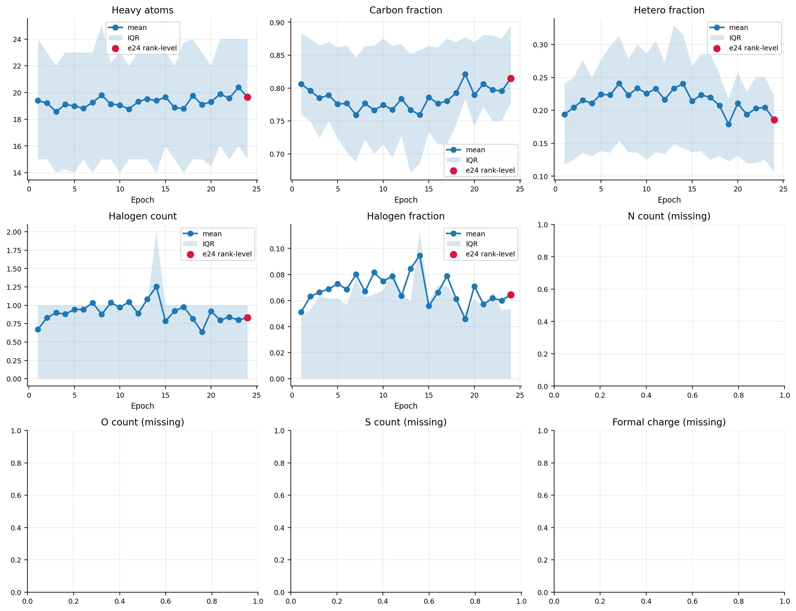
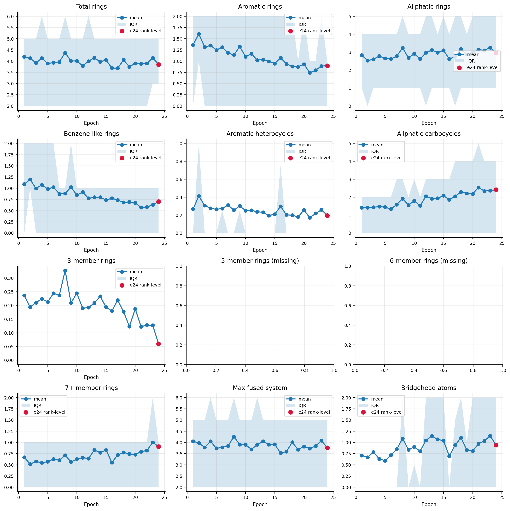
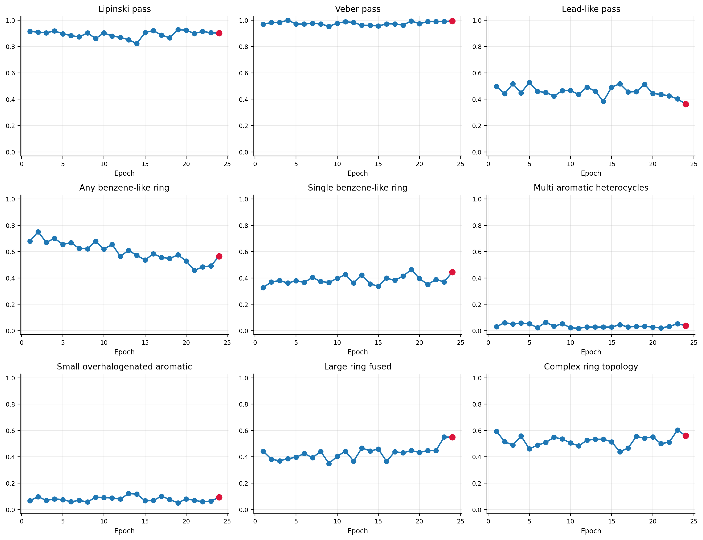
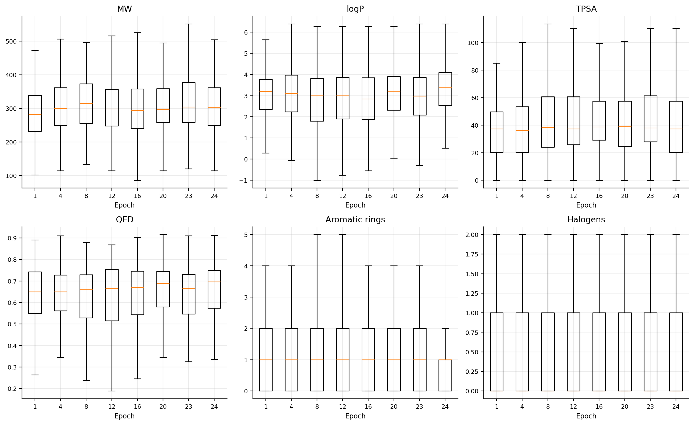
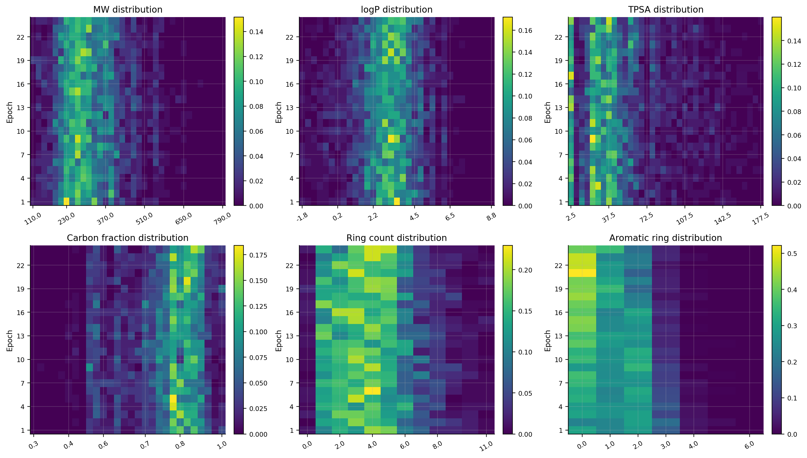
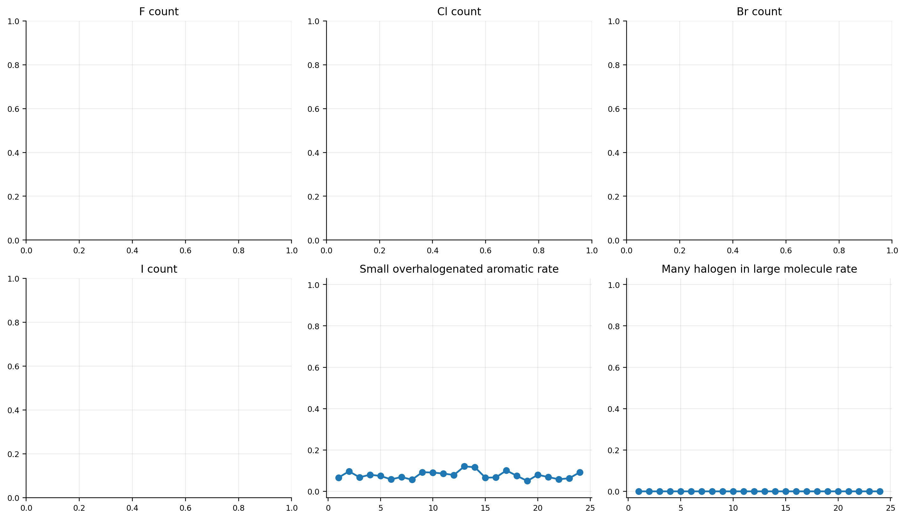

# 分子性质变迁补充图

本节基于 `all_molecules_with_epoch24.csv` 中的 SMILES，用 RDKit 统一重算分子描述子。epoch 1-23 为完整合并数据，epoch 24 为 rank-level 补充数据。

## 关键性质变化

| 指标 | epoch 1 | epoch 23 | 变化 | epoch 24 rank-level |
|---|---:|---:|---:|---:|
| mol_wt_mean | 297.422 | 319.219 | 21.797 | 312.258 |
| logp_calc_mean | 2.940 | 2.960 | 0.020 | 3.318 |
| tpsa_calc_mean | 40.234 | 47.866 | 7.632 | 41.087 |
| qed_calc_mean | 0.627 | 0.629 | 0.002 | 0.651 |
| rotatable_bonds_mean | 0.461 | 0.540 | 0.079 | 0.592 |
| carbon_fraction_calc_mean | 0.806 | 0.796 | -0.011 | 0.815 |
| hetero_atom_fraction_calc_mean | 0.194 | 0.204 | 0.011 | 0.185 |
| halogen_count_mean | 0.673 | 0.799 | 0.126 | 0.832 |
| ring_count_calc_mean | 4.194 | 4.143 | -0.051 | 3.853 |
| aromatic_ring_count_calc_mean | 1.358 | 0.889 | -0.469 | 0.897 |
| benzene_like_ring_count_mean | 1.091 | 0.630 | -0.461 | 0.701 |
| aromatic_heterocycles_mean | 0.267 | 0.259 | -0.007 | 0.196 |
| large_ring_count_mean | 0.667 | 1.000 | 0.333 | 0.908 |
| max_fused_ring_system_size_calc_mean | 4.048 | 4.079 | 0.031 | 3.761 |
| lipinski_pass_rate | 0.915 | 0.905 | -0.010 | 0.902 |
| small_overhalogenated_aromatic_rate | 0.067 | 0.063 | -0.003 | 0.092 |
| large_ring_fused_flag_rate | 0.442 | 0.550 | 0.108 | 0.549 |
| complex_ring_topology_flag_rate | 0.594 | 0.603 | 0.009 | 0.560 |

## 新增图件

## 新增数据文件

- `molecular_properties_by_molecule.csv`
- `molecular_properties_epoch_summary.csv`
- `molecular_properties_first_last_delta.csv`
