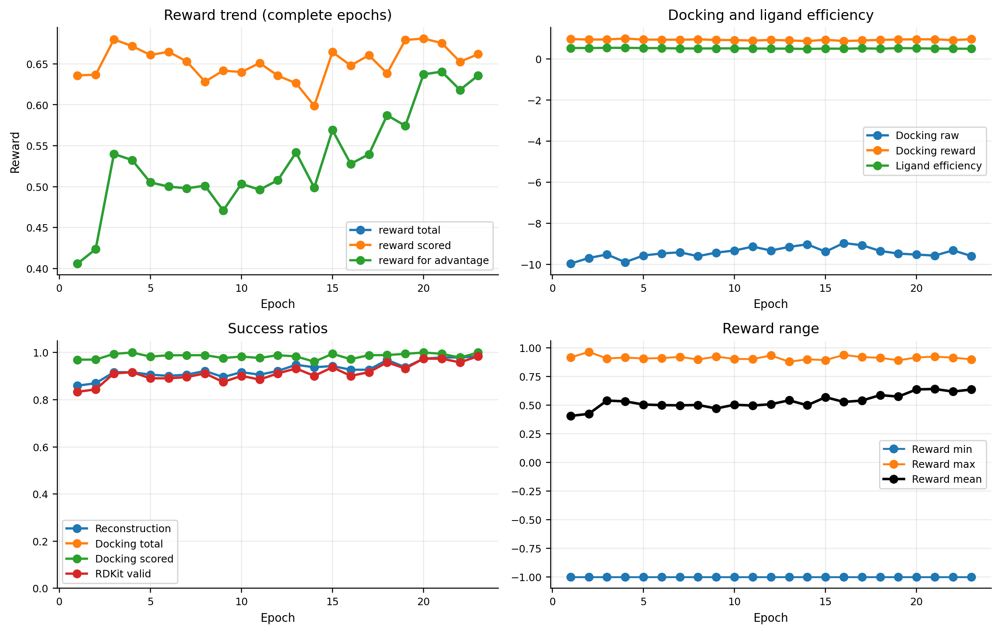
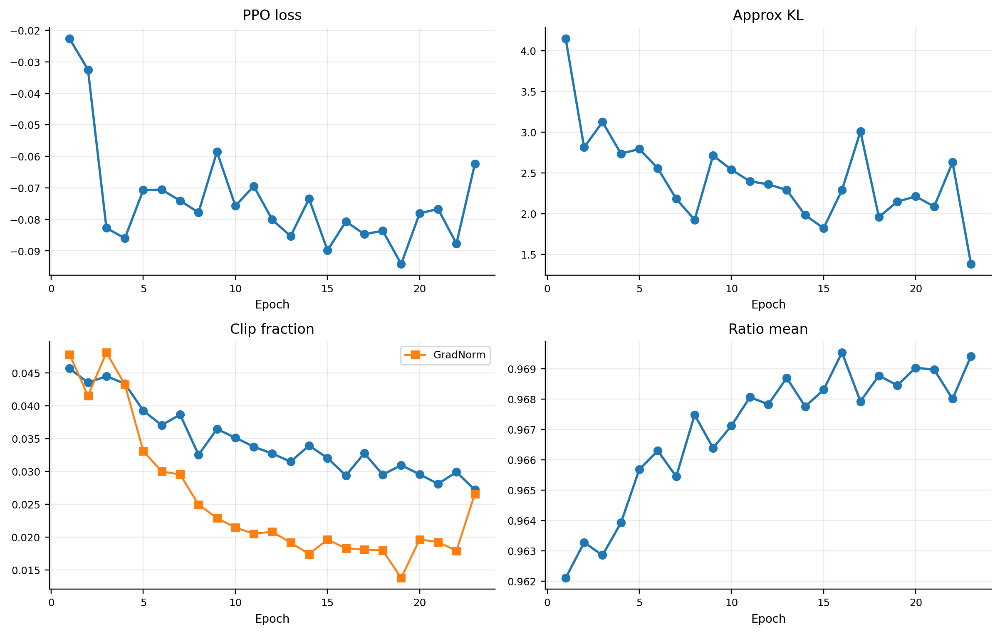
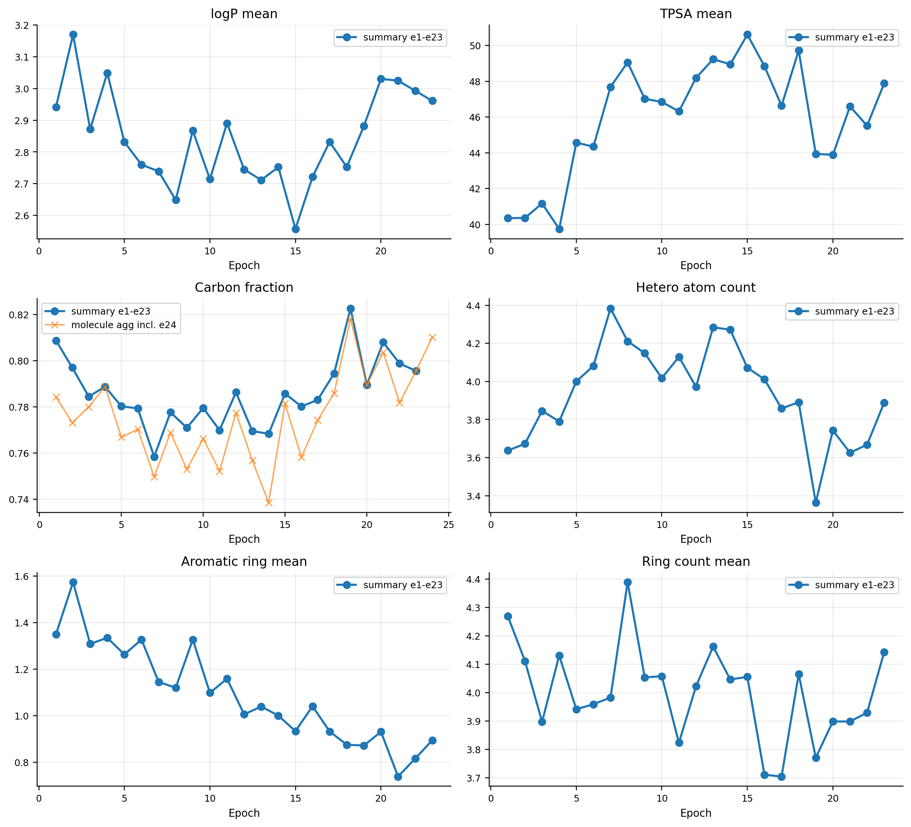
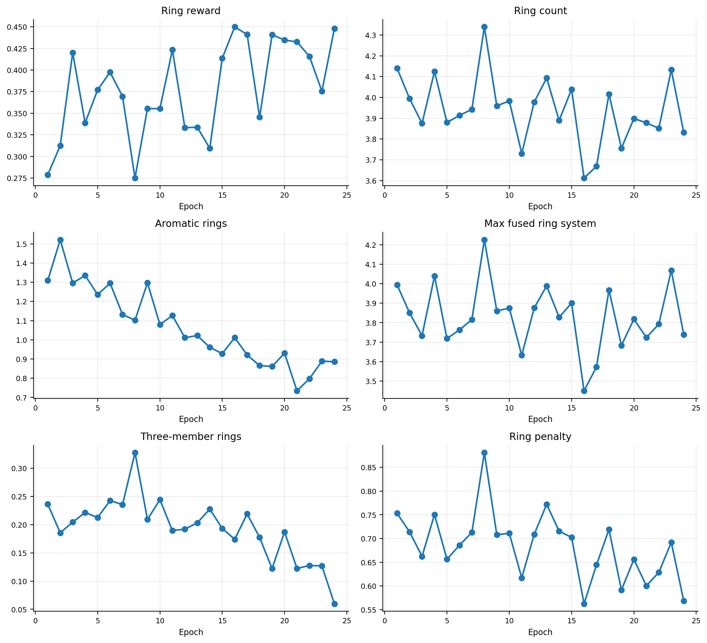
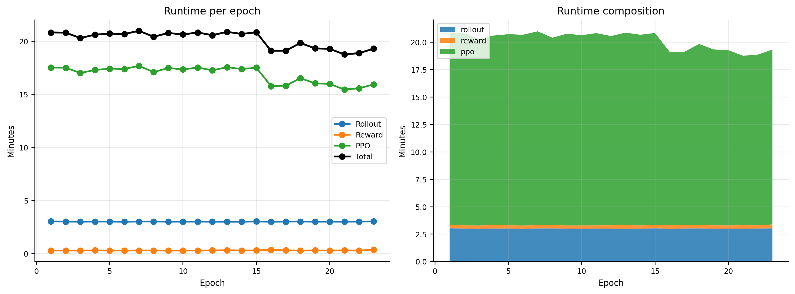
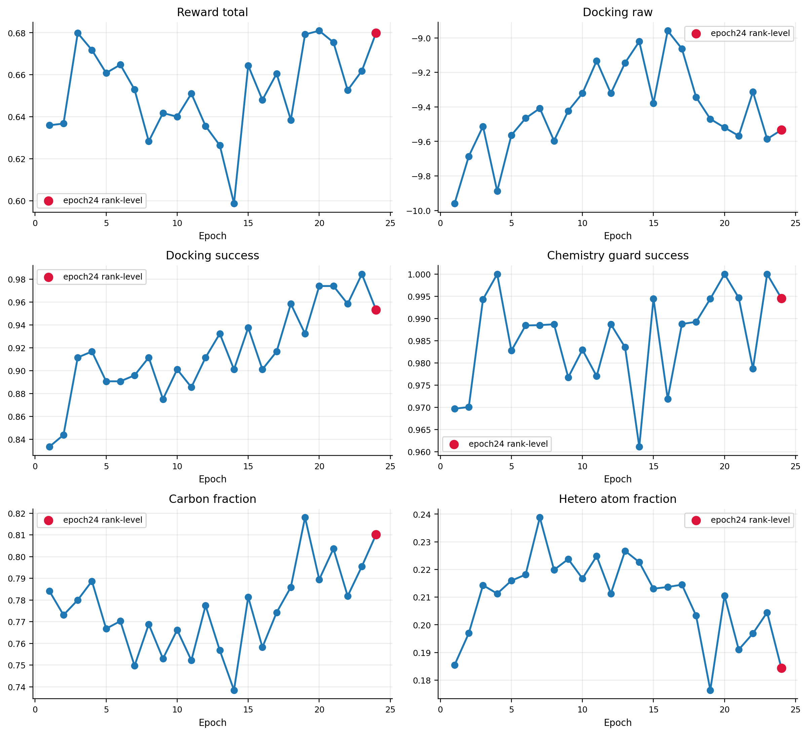
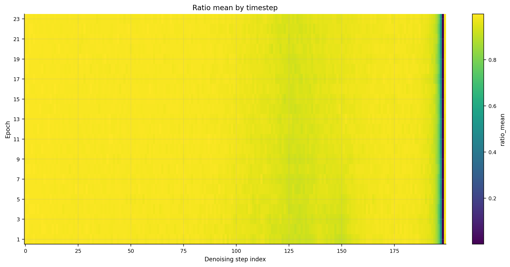
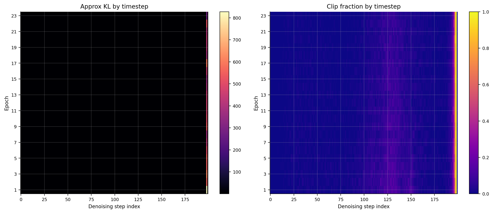

# DiffGui ring-last3-lr3e-5 训练作图与简要结论

## 数据来源

- Run directory: `OUT/diffgui-8gpu-ring-last3-lr3e5_20260610_114650`
- 配置：8 GPU；每卡 batch 24，总 batch 192；200 diffusion steps；last 3 EGNN blocks 解冻；learning rate 3e-5；配置目标 24 epoch。
- 完整训练汇总：`training_summary.csv` 只有 epoch 1-23 共 23 行。
- `epoch_0024/` 有 rank-level 分子、docking、reward 文件，但没有完整合并后的 `training_summary` / PPO 汇总；因此训练曲线按 epoch 1-23，分子聚合图额外标出 epoch 24 rank-level 数据。

## 关键数值

| 指标 | epoch 1 | epoch 23 | 变化 |
|---|---:|---:|---:|
| reward_total_mean | 0.406 | 0.636 | 0.230 |
| reward_total_scored_mean | 0.636 | 0.662 | 0.026 |
| docking_raw_mean | -9.959 | -9.586 | 0.373 |
| docking_reward_mean | 0.966 | 0.959 | -0.007 |
| reconstruction_success_ratio | 0.859 | 0.984 | 0.125 |
| docking_success_ratio_total | 0.833 | 0.984 | 0.151 |
| carbon_fraction | 0.809 | 0.796 | -0.013 |
| hetero_atom_mean | 3.638 | 3.889 | 0.251 |
| aromatic_ring_mean | 1.350 | 0.894 | -0.456 |
| ring_count_mean | 4.269 | 4.143 | -0.126 |
| three_member_ring_mean | 0.244 | 0.127 | -0.117 |
| PPO_ApproxKL | 4.149 | 1.380 | -2.770 |
| ClipFrac | 0.046 | 0.027 | -0.018 |

## 图件

## 输出文件

- `training_summary_selected.csv`
- `molecule_epoch_aggregates.csv`
- `all_molecules_with_epoch24.csv`
- `first_last_complete_epoch_delta.csv`
- `ratio_by_timestep_all_epochs.csv`
- `ratio_mean_timestep_matrix.csv`
- `ppo_step_metrics_all_epochs.csv`
- `ppo_timestep_aggregates.csv`

## 初步判断

1. 这次训练主要可用来说明：ring complexity reward 的方向会明显改变分子环分布，但也可能把模型推向“不像药物候选物”的环结构模式，需要和 aromatic/hetero/halogen/size 的规则一起约束。
2. PPO 时间占比远大于 rollout 和 reward，瓶颈仍在 PPO 更新。
3. epoch 24 不应和前 23 个完整 epoch 混作同一类训练点，因为它缺少合并 summary 和 PPO 完整记录；图中只在分子聚合层面作为红点补充参考。

## 分子性质变迁补充

详见 [`molecular_property_report.md`](molecular_property_report.md)。新增图件为 `09_...` 到 `15_...`。
