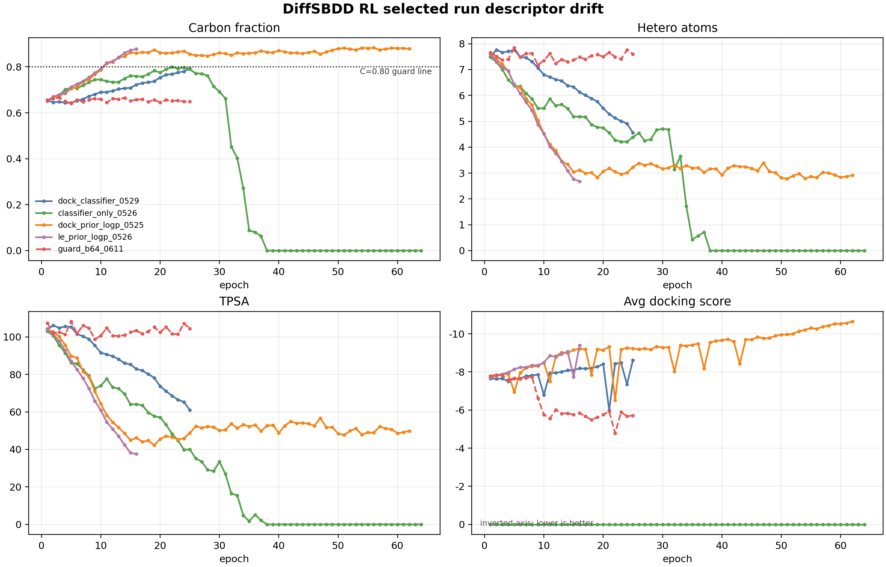
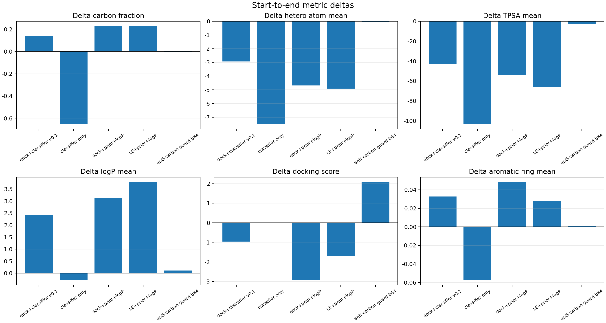

# DiffSBDD RL 旧训练漂移与下一轮小步测试计划

生成日期：2026-06-11

## 核心判断

- 旧的 docking / classifier / ChEMBL prior / logP 组合不是没有学到东西，而是学到的方向经常是“高碳、低 TPSA、少杂原子、强疏水”。
- 最新 anti-carbon guard b64 证明显式描述符护栏能压住高碳，但 `chemistry_guard=0.30` 叠加 strict pool/过滤后过强：芳香环几乎消失，docking 从约 -7.8 走弱到约 -5.7。
- 下一步不要大改 reward，也不要一次上复杂分类器/复杂 guard；奖励函数部分必须执行单变量原则：每次实验只允许改动一个 reward 相关变量，其余 reward 权重和阈值固定，否则训练结束后无法判断是哪一项带来了变化。
- DePPA 的启发不是照搬整套，而是三点：rank-based dense reward、invalid 相对惩罚、pretrained KL 防偏离。

## 关键图

## 代表性 run 起止对比

| run_label | epochs | generated_per_epoch | reward_setup | rdkit_valid_ratio_start | rdkit_valid_ratio_end | avg_docking_start | avg_docking_end | carbon_fraction_start | carbon_fraction_end | hetero_atom_mean_start | hetero_atom_mean_end | tpsa_mean_start | tpsa_mean_end | logp_mean_start | logp_mean_end | aromatic_ring_mean_start | aromatic_ring_mean_end | diagnosis |
| --- | --- | --- | --- | --- | --- | --- | --- | --- | --- | --- | --- | --- | --- | --- | --- | --- | --- | --- |
| dock+classifier v0.1 | 25 | 1792 | docking 0.5 + classifier 0.5; KL=0 | 0.670 | 0.838 | -7.658 | -8.617 | 0.655 | 0.794 | 7.494 | 4.561 | 104.169 | 60.974 | 0.337 | 2.765 | 0.047 | 0.080 | docking 变好但高碳/低 TPSA/低杂原子漂移明显 |
| classifier only | 64 | 560 | classifier 1.0; KL=0 | 0.645 | 0.000 | 0.000 | 0.000 | 0.652 | 0.000 | 7.483 | 0.000 | 103.055 | 0.000 | 0.289 | 0.000 | 0.057 | 0.000 | classifier 单独做导航会把有效率推崩，不能作为唯一 reward |
| dock+prior+logP | 62 | 630 | docking + ECFP/FCFP prior + logP distribution; KL=0 | 0.638 | 0.933 | -7.715 | -10.643 | 0.651 | 0.879 | 7.601 | 2.911 | 103.845 | 49.850 | 0.342 | 3.466 | 0.038 | 0.086 | docking/valid 变好，但高碳和少杂原子更严重 |
| LE+prior+logP | 16 | 630 | LE + ECFP/FCFP prior + logP distribution; KL=0 | 0.638 | 0.884 | -7.681 | -9.386 | 0.651 | 0.878 | 7.601 | 2.680 | 103.855 | 37.531 | 0.341 | 4.131 | 0.038 | 0.066 | 没有 docking 也会向高 logP、高碳、低 TPSA 漂移 |
| anti-carbon guard b64 | 25 | 512 | docking 0.2 + prior/logP + chemistry_guard 0.3 + KL=0.001 | 0.656 | 0.650 | -7.795 | -5.717 | 0.657 | 0.649 | 7.655 | 7.602 | 107.314 | 104.427 | 0.261 | 0.370 | 0.027 | 0.028 | 高碳被压住，但芳香环几乎消失，docking 变差，属于过修 |

## DePPA 做了什么，和当前 DiffB110 的关系

- DePPA 也是在 DiffSBDD/DDPM 反扩散轨迹上做 PPO 式更新：rollout 时保存每个反扩散步的 observation/action/old logprob，reward 后重新算 new logprob，用 PPO clip loss 更新 denoiser。
- 它的 reward 默认是 QED、SA、Vina score、diversity/distance，可选 strain；每个 reward 先在本批 valid 分子里做 rank/percentile，再映射到正态分布，所以信号更稠密。
- invalid 分子不是简单固定 -1，而是设为 valid 分子 combined reward 均值减 3 个标准差；这比硬阈值更平滑。
- 它可选 frozen pretrained model，使用 sampled K3 近似 KL(current || pretrained) 防止策略偏离预训练模型。当前项目已经有 `pretrained_logprob_k3` 和 `analytic_current_ref` 两个可测 KL 模式。
- 但 DePPA 本身没有解决你现在发现的药化问题：高碳、稠环、七元环、大环并六元环、苯环需要但多稠环不需要。这些仍要靠你自己的 descriptor/structure guard。

## 后续实验纪律

- 奖励函数部分只允许单变量改动：一次实验只改一个 reward 权重、阈值或开关。
- 如果要测试 KL mode、学习率、batch、PPO epochs，这些应作为单独实验，不和 reward 变量同时改。
- 每次实验记录必须写清楚：唯一改动项、固定项、预期方向、通过/停止标准。否则结果不能用于总结 reward 设计。

## 建议下一轮小步测试

| step | purpose | change_only | keep_fixed | small_run | pass_signal | stop_signal |
| --- | --- | --- | --- | --- | --- | --- |
| T1 | 确认 anti-carbon 是否只是过强 | 只改 chemistry_guard weight: 0.30 -> 0.10 | violation_penalty、其他 reward 权重、lr=1e-5、ppo_epochs=2、KL=0.001 不变 | 8GPU, batch 16-32/card, 3-5 epochs | carbon_fraction 0.65-0.78; hetero_atom_mean 5.5-7.5; aromatic_ring_mean 不低于 0.04; docking 不劣于 -7.5 | aromatic_ring_mean 继续接近 0 或 avg_docking > -6.5 |
| T2 | 确认单分子违规惩罚是否过强 | 只改 violation_penalty: 0.35 -> 0.15 | 使用 T1 选定的 chemistry_guard weight；其他 reward 权重、lr、ppo_epochs、KL 不变 | 8GPU, batch 16-32/card, 3-5 epochs | docking/LE 有回升，carbon/TPSA/hetero 仍不过界 | 高碳漂移重新出现，或 valid/sanitize 明显变差 |
| T3 | 恢复苯环/芳香骨架，不奖励多稠环 | 只新增/调整 aromatic scaffold reward weight: 0.03-0.05 | 使用 T1/T2 最稳 guard；不动 docking/先验/logP；不动学习率 | 8GPU, batch 16-32/card, 3-5 epochs | aromatic_ring_mean 回到 0.06-0.15；复杂环不过度上升；carbon 不超过 0.80 | 多环/稠环比例肉眼明显增加，或 carbon_fraction 再上 0.82 |
| T4 | 判断 KL/DePPA-style 是否能稳住漂移 | 只切换 kl_mode: analytic_current_ref vs pretrained_logprob_k3；kl_coef 不变 | 用 T1/T2/T3 最稳 reward，不动任何 reward 权重 | 每组 3 epochs | reward 更新时 PPO_LogRatio/KL 稳，描述符漂移变慢 | KL 很小但漂移照旧，说明 reward 问题优先于 KL |
| T5 | 再看 docking 是否能回升 | 只改 docking reward weight: 0.20 -> 0.25 或 0.30 | 结构 guard 和 KL 固定为前面最稳版本；不动其他 reward 权重 | 8GPU, batch 16-32/card, 5 epochs | avg_docking 变更负，同时 carbon/TPSA/hetero 不越界 | docking 变好但 carbon_fraction 快速上升、TPSA 快速下降 |

## 文件

- `selected_run_epoch_metrics.csv`：所选 run 的逐 epoch 指标。
- `selected_run_start_end_delta.csv`：起止变化。
- `selected_run_readable_summary.csv`：更容易读的摘要表。
- `incremental_test_plan.csv`：下一轮小步测试表。