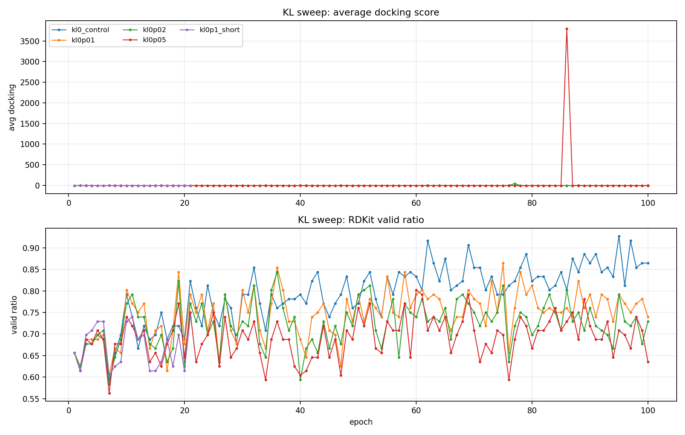
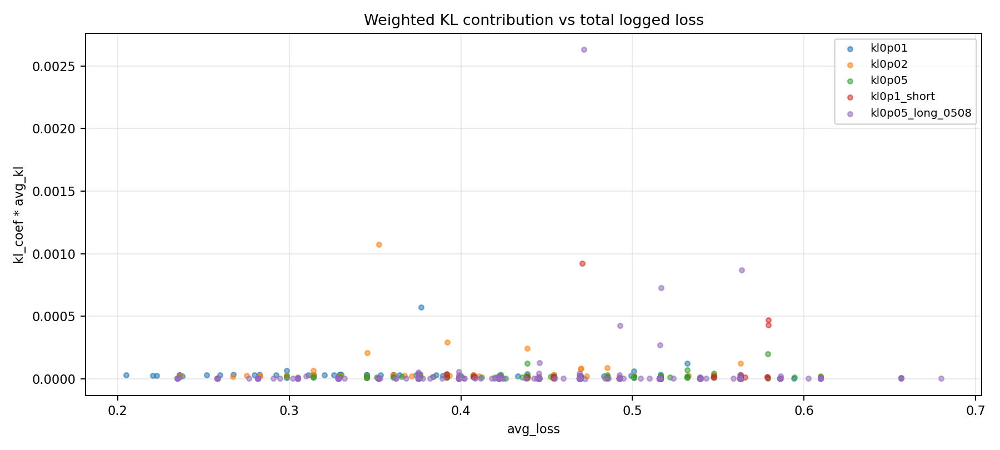
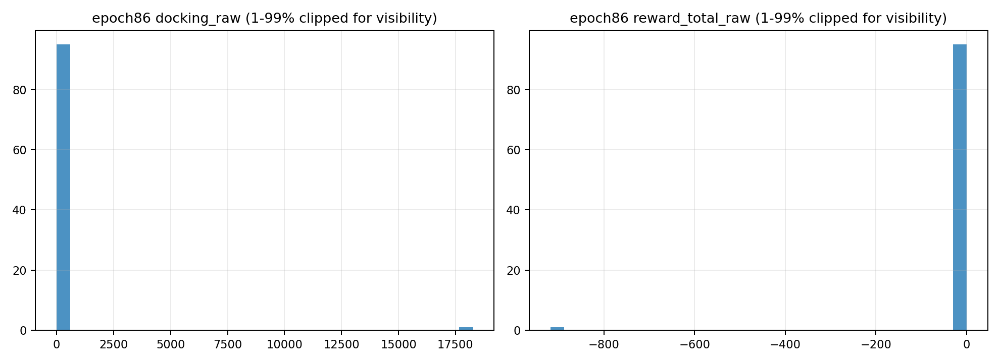

# KL 约束旧训练异常诊断

生成日期：2026-06-04

## 结论先行

你记得的旧 KL 训练主要是下面几组，不是最近的 docking+classifier run：

- `OUT/qed-sa-docking-8gjl-8gpu-kl-0_20260511_153246`：KL=0 control。
- `OUT/qed-sa-docking-8gjl-8gpu-kl-0p01_20260511_162333`：KL=0.01，100 epoch，有 KL 尖峰。
- `OUT/qed-sa-docking-8gjl-8gpu-kl-0p02_20260511_171944`：KL=0.02，100 epoch，有 KL 尖峰。
- `OUT/qed-sa-docking-8gjl-8gpu-kl-0p05_20260511_181521`：KL=0.05，100 epoch，整体更新最不动；同时 epoch 86 有 docking 极端异常值。
- `OUT/qed-sa-docking-8gjl-8gpu-kl-0p1_20260511_191018`：KL=0.1，只跑到 21 epoch。
- `OUT/qed-sa-docking-8gjl-8gpu_20260508_212050`：更早的 KL=0.05 长跑，473 epoch，也有偶发 KL 尖峰。

最重要结论：**按日志里的 epoch 平均值看，KL 项本身的加权贡献极小，不足以直接解释“模型完全更新不动”。** 最大 `kl_coef * avg_kl` 只有 0.00263，而 PPO/loss 大多在 0.3-0.6。真正更像 bug/异常的是：

1. KL sweep 的 `training_summary.csv` 中 `reward_mean/reward_min/reward_max` 全为 0，但 `molecules.csv` 中 `reward_total` 明明非零。这说明旧 summary 记录链路有 bug 或字段不一致，不能用 summary 的 reward_mean 判断训练是否有 reward。
2. `kl-0p05` 的 epoch 86 出现一个 `docking_raw=365431.25` 的离谱分子，把 `avg_docking` 拉到 3800.823，`avg_docking_norm=-380.353`。这不是正常 docking 信号，会污染 reward/advantage/训练判断。
3. 当前代码里的 KL 标度有隐患：logprob 是除以 `valid_nodes * D`，但 KL mask 分支只除以 `mask.sum()`，没有除以特征维 D。这个会让 KL 的有效尺度和 logprob 不一致。
4. KL 用的是 `KL(ref || current)`，当 current sigma 偏小的时候容易尖峰；建议至少同时记录 `KL(current || ref)` 和 symmetric KL。

## Run 总表

```csv
run_label,epochs,kl_coef,avg_kl_mean,avg_kl_max,weighted_kl_max,spike_gt_0p005,dock_start,dock_end,dock_delta_end_minus_start,valid_start,valid_end,reward_mean_all_zero,docking_absurd_positive_epochs
kl0_control,100,0.0,0.0,0.0,0.0,0,-5.231094,-7.28699,-2.0558960000000006,0.65625,0.864583,True,
kl0p01,100,0.01,0.0032168199999999996,0.057182,0.00057182,4,-5.228927,-6.482646,-1.2537190000000002,0.65625,0.739583,True,
kl0p02,100,0.02,0.0021154999999999998,0.053775,0.0010755,5,-5.231385,-5.99176,-0.7603749999999998,0.65625,0.729167,True,
kl0p05,100,0.05,0.00037209000000000005,0.00395,0.00019750000000000003,0,-5.228104,-4.979302,0.2488020000000004,0.65625,0.635417,True,86
kl0p1_short,21,0.1,0.0009974761904761906,0.009229,0.0009228999999999999,1,-5.230177,-6.035385,-0.8052079999999995,0.65625,0.739583,True,
kl0p05_long_0508,473,0.05,0.000299262156448203,0.052609,0.0026304500000000003,5,-5.014453,-4.3595,0.6549529999999999,0.65625,0.640625,False,
kl0p01_6gpu_0513,25,0.01,0.0006831599999999999,0.009083,9.083000000000001e-05,1,-4.989785,-6.70591,-1.716125,0.631944,0.763889,False,

```



## KL 尖峰 epoch

阈值：`avg_kl > 0.005`。

```csv
run_label,epoch,kl_coef,avg_kl,weighted_kl,avg_loss,avg_ppo_loss,avg_docking,rdkit_valid_ratio
kl0p01,14,0.01,0.006395,6.395e-05,0.500864,0.500801,-5.737292,0.666667
kl0p01,41,0.01,0.012309,0.00012309000000000002,0.531972,0.531849,-5.589677,0.645833
kl0p01,69,0.01,0.00677,6.77e-05,0.298495,0.298427,-7.087396,0.802083
kl0p01,85,0.01,0.057182,0.00057182,0.376816,0.376244,-6.777365,0.75
kl0p02,12,0.02,0.014739,0.00029478,0.392145,0.39185,-6.115646,0.739583
kl0p02,20,0.02,0.006252,0.00012504,0.563102,0.562977,-5.021948,0.625
kl0p02,64,0.02,0.053775,0.0010755,0.352228,0.351153,-4.453552,0.729167
kl0p02,69,0.02,0.010412,0.00020824,0.345395,0.345187,-6.353479,0.770833
kl0p02,85,0.02,0.012252,0.00024504,0.438814,0.438569,-5.929885,0.708333
kl0p1_short,12,0.1,0.009229,0.0009228999999999999,0.470565,0.469642,-5.461708,0.6875
kl0p05_long_0508,48,0.05,0.014556,0.0007278,0.516579,0.515851,-5.299531,0.65625
kl0p05_long_0508,125,0.05,0.052609,0.0026304500000000003,0.47163,0.468999,-5.599797,0.6875
kl0p05_long_0508,432,0.05,0.017362,0.0008681,0.563562,0.562694,-5.358641,0.625
kl0p05_long_0508,450,0.05,0.005424,0.00027120000000000003,0.51609,0.515819,-4.988812,0.65625
kl0p05_long_0508,451,0.05,0.008524,0.00042620000000000006,0.492856,0.492429,-5.62575,0.671875
kl0p01_6gpu_0513,21,0.01,0.009083,9.083000000000001e-05,0.406767,0.406676,-6.333653,0.729167

```


## KL 对 loss 的实际贡献

按日志计算：

```text
weighted_KL = kl_coef * avg_kl
loss ≈ PPO_Loss + weighted_KL
```

最大贡献：

- `kl0p01`: 0.000572
- `kl0p02`: 0.001076
- `kl0p05`: 0.000198
- `kl0p1`: 0.000923
- `kl0p05_long_0508`: 0.002630

所以如果这些日志可信，KL 不是直接压死更新的主因；更可能是 reward/advantage 质量、异常 docking、记录 bug、或者 KL 被 epoch 平均掩盖了局部 timestep/microbatch 尖峰。



## `kl-0p05` epoch 86 docking 异常

该 epoch 有一个 valid 分子 docking 返回极端正值：

```csv
molecule_id,rank,smiles,rdkit_valid,docking_raw,docking_reward,reward_total,reward_total_raw
8,3,CCC(=C=CC1CCC2(O1)C(OCCCCC(=O)NC1CCCCC1C1CCC(CCCCC(=O)CCN)O1)C2(O)O)CC(O)(O)CCNNCC1(C)NCCCC1C1=CC=CCC1,1,365431.25,-36543.125,-3.0,-18271.46875
0,0,,0,0.0,-1.0,-1.5,-5.0
2,0,,0,0.0,-1.0,-1.5,-5.0
1,0,,0,0.0,-1.0,-1.5,-5.0
9,1,,0,0.0,-1.0,-1.5,-5.0

```

这个分子把 epoch 86 的统计变成：

- `avg_docking = 3800.823010392487`
- `avg_docking_norm = -380.35313437785953`
- `reward_total_raw mean = -191.213`
- 单分子 `reward_total_raw = -18271.46875`

这应当被当作 docking backend failure，而不是正常分子。



## 可疑问题矩阵

```csv
issue,evidence,impact,likely_fix_or_check,severity
old summary reward fields are all zero in KL sweep,"kl-0/0p01/0p02/0p05/0p1 training_summary reward_mean/min/max are 0, but molecules.csv reward_total is nonzero",旧 summary 不能用 reward_mean 判断 PPO 是否有奖励；会误判为没有训练信号,用 molecule-level reward_total/advantages 复核；当前 recorder/metrics 写法需要确保 summary 写 reward_total_clamped/raw,high_for_diagnosis_medium_for_training
KL weighted contribution is tiny in logged epoch averages,"max kl_coef*avg_kl <= 0.00263, while avg_loss mean is about 0.38-0.49",按记录值看，KL 本身不足以直接把 loss 压死；模型不动另有原因或 KL 被平均后掩盖局部峰值,新增 per-timestep/per-microbatch KL max/p95、weighted_KL、PPO_Loss 分项日志,high
docking outlier in kl-0p05 epoch 86,"one molecule docking_raw=365431.25, avg_docking=3800.823, avg_docking_norm=-380.353",严重污染 reward/advantage/metrics；该 epoch 不能作为正常训练信号,DockingReward 对异常正分/非有限值/超范围值做 hard failure penalty 或 clip,critical_data_quality
KL normalization scale differs from logprob normalization,"compute_log_p divides by valid_nodes*D, compute_gaussian_kl(mask) divides by mask.sum only",KL 标度按 feature 维累加，不同 D/atom feature 会改变有效 kl_coef；可能让系数不可解释,KL denominator 改为 expanded mask 元素数或显式除以 D；加单元测试,medium_high
KL direction uses KL(ref || current),actor comments and code pass mu_ref/sigma_ref as first distribution,当 current sigma 偏小时更容易尖峰；trust-region 常见监控也应记录 current||ref 或 symmetric KL,同时记录 forward/reverse/symmetric KL；决定 penalty 用哪个,medium

```

## 为什么 `kl-0p05` 看起来最“不动”

和 KL=0 control 比：

- KL=0：`avg_docking -5.231 -> -7.287`，valid `0.656 -> 0.865`。
- KL=0.01：`avg_docking -5.229 -> -6.483`，有进步但弱于 KL=0。
- KL=0.02：`avg_docking -5.231 -> -5.992`，进步更弱。
- KL=0.05：`avg_docking -5.228 -> -4.979`，基本没有优化，甚至略差。

但这不是因为日志里的 KL penalty 大，而是至少混合了三个因素：

1. KL=0.05 的信号确实更保守，可能降低有效更新。
2. batch 很小：每 epoch 只有 96 分子，docking/reward 方差很高。
3. 出现了离谱 docking outlier 和 summary reward 记录异常，导致这组 run 的判断不干净。

## 建议怎么查 bug / 怎么修

### P0：先修记录和异常值

- 在 training summary 中同时记录：`reward_total_raw_mean`、`reward_total_norm_mean`、`advantages_mean/std/min/max`、`positive_advantage_rate`。
- DockingReward 对以下情况直接 failure penalty：非有限值、正值过大、绝对值超过合理范围，例如 `dock_score > 50` 或 `abs(score) > 100`。
- 旧 run 的 `reward_mean=0` 不能再作为判断依据。

### P1：修 KL 标度和日志

- `compute_gaussian_kl(mask)` 分母应当和 logprob 一致，使用 `mask.expand_as(kl_elementwise).sum()` 或 `mask.sum() * D`。
- 记录 `KL_Penalty_raw`、`KL_Weighted`、`PPO_Loss`、`Loss`，不要只记录 `avg_kl`。
- 记录 per-timestep KL 的 mean/p95/max，因为 epoch 平均会掩盖局部尖峰。

### P2：重新做一个小 KL sanity test

新代码下只跑 3 组，每组 10 epoch：

- KL=0
- KL=0.001
- KL=0.003

观察：

- `KL_Weighted / |PPO_Loss|` 是否在 1%-10% 之间。
- `ratio_mean/std/max` 和 `ClipFrac` 是否正常。
- `advantages` 是否仍以负值为主。
- docking 异常值是否被截断。

当前不建议直接再用 0.05；对 DiffSBDD 这个 PPO 链路来说，0.05 旧实验已经太保守，而且日志无法证明它是稳定有效的 trust-region。

## 输出文件

- `kl_run_summary.csv`：每个 KL run 总结。
- `kl_epoch_summary.csv`：逐 epoch 指标。
- `kl_spike_epochs.csv`：KL 尖峰 epoch。
- `kl0p05_epoch86_molecules.csv`：异常 epoch 分子级记录。
- `suspected_issue_matrix.csv`：问题矩阵。
