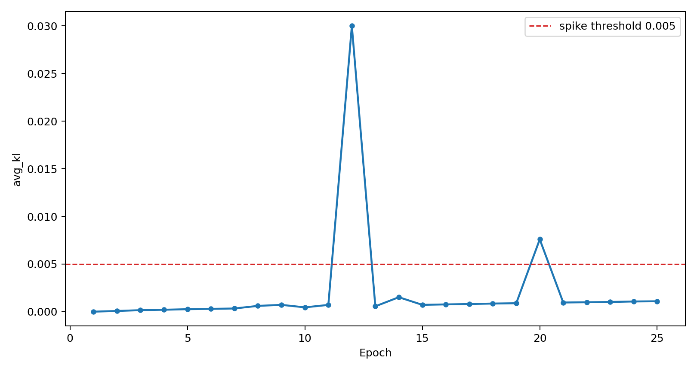
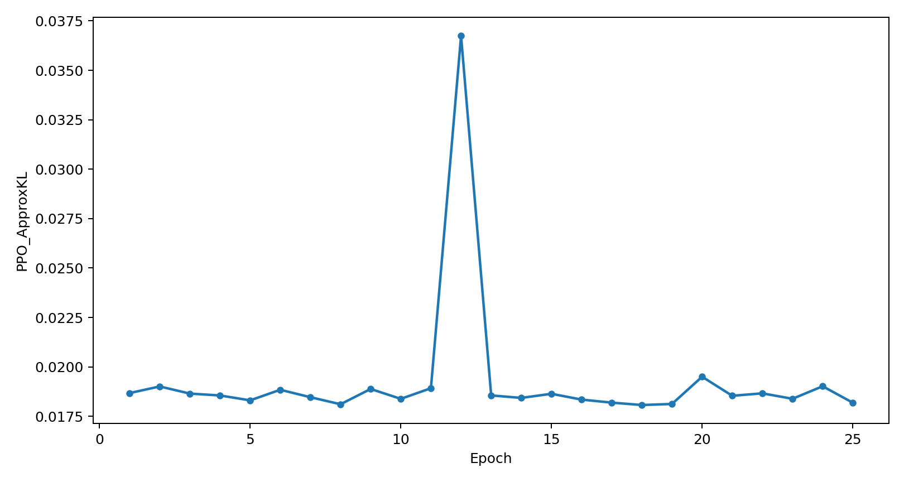

# KL 0.02 诊断短跑报告

## 目的

复现旧 `kl0p02` 训练中 `avg_kl > 0.005` 的两次 KL 跳跃，并利用新增 PPO/KL 诊断列判断跳跃是否真的足以压住 PPO 更新。

## 运行设置

| 项目 | 设置 |
|---|---|
| 配置 | `launch/generated/kl_diagnostics/8gpu_dock_kl0p02_25epoch_diagnostics.yaml` |
| 输出目录 | `OUT/kl-diagnostic-8gpu-kl0p02-25ep_20260604_110012` |
| GPU | 8 |
| 全局 batch | 96 |
| seed | 42 |
| KL 系数 | 0.02 |
| epoch | 25 |
| KL 跳跃阈值 | `avg_kl > 0.005` |

## 结果

| 指标 | 数值 |
|---|---:|
| 完成 epoch | 25 |
| KL 跳跃次数 | 2 |
| 最终 `avg_kl` | 0.001091 |
| 最终 `KL_Penalty_Weighted` | 0.000022 |
| 最终 `PPO_ApproxKL` | 0.018188 |
| 最终 `avg_loss` | 0.391699 |
| 最终 `avg_ppo_loss` | 0.391678 |
| 最终 `avg_docking` | -8.369718 |
| 最终 `rdkit_valid_ratio` | 0.739583 |

## KL 跳跃 epoch

| epoch | avg_kl | KL_Penalty_Weighted | PPO_ApproxKL | PPO_LogRatio_AbsP95 | ClipFrac_HighT | ClipFrac_MidT | ClipFrac_LowT | avg_loss | avg_docking | rdkit_valid_ratio |
|---:|---:|---:|---:|---:|---:|---:|---:|---:|---:|---:|
| 12 | 0.030007 | 0.000600 | 0.036748 | 0.030903 | 0.000000 | 0.000000 | 0.028571 | 0.361359 | -8.143822 | 0.760417 |
| 20 | 0.007593 | 0.000152 | 0.019502 | 0.022881 | 0.000000 | 0.000000 | 0.028571 | 0.547546 | -8.031984 | 0.635417 |

## 图

## 初步结论

1. 两次 KL 跳跃已经复现，位置为 epoch 12 和 epoch 20，与旧 `kl0p02` 记录一致。
2. epoch 12 的 `avg_kl=0.030007`，但乘以 `kl_coef=0.02` 后只有 `0.000600`，远小于同 epoch 的 `avg_ppo_loss=0.360759`。
3. epoch 20 的 `avg_kl=0.007593`，加权后只有 `0.000152`，同样远小于 `avg_ppo_loss=0.547394`。
4. 两个跳跃 epoch 的 `ClipFrac_HighT/MidT/LowT` 都没有同步异常，`ClipFrac_LowT` 维持在 0.028571，说明 PPO clip 不是这两次 KL 跳跃的主要限制。
5. `PPO_ApproxKL` 在 epoch 12 同步升高到 0.036748，但 epoch 20 只到 0.019502，说明 frozen-reference KL 跳跃和 old-policy approximate KL 相关但不完全等价。

## 后续判断

这次结果支持前一份 KL 对比报告的判断：日志里的 frozen analytic KL 会跳，但加权后对 loss 的直接贡献很小。下一步应继续检查 reward/advantage 稀疏、docking outlier、logprob 尺度和 KL 归一化，而不是单纯认为 `kl_coef=0.02` 直接把模型训练压死。
