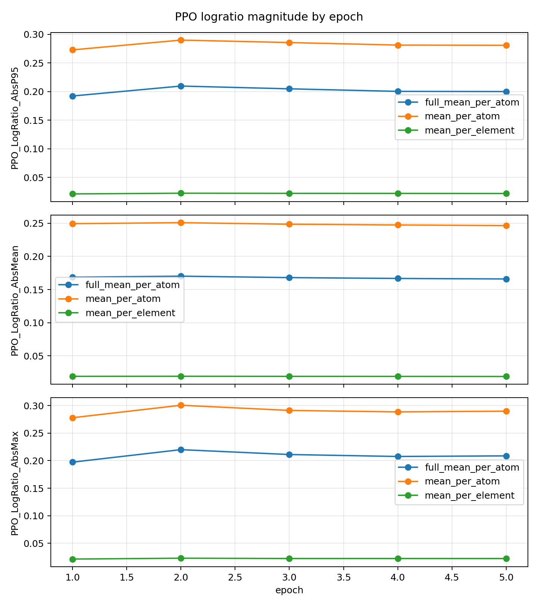
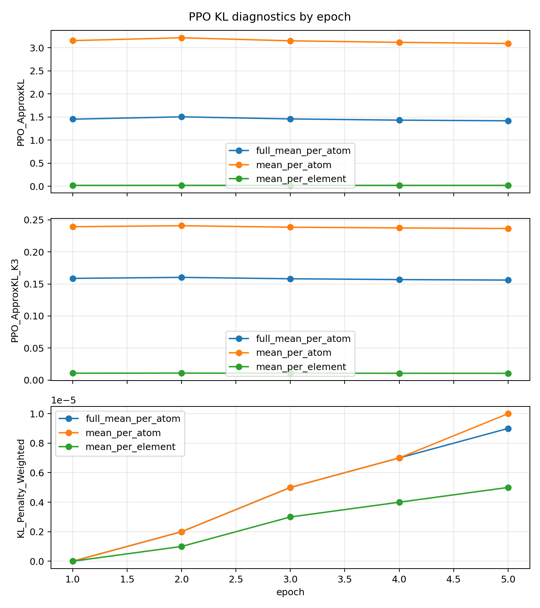
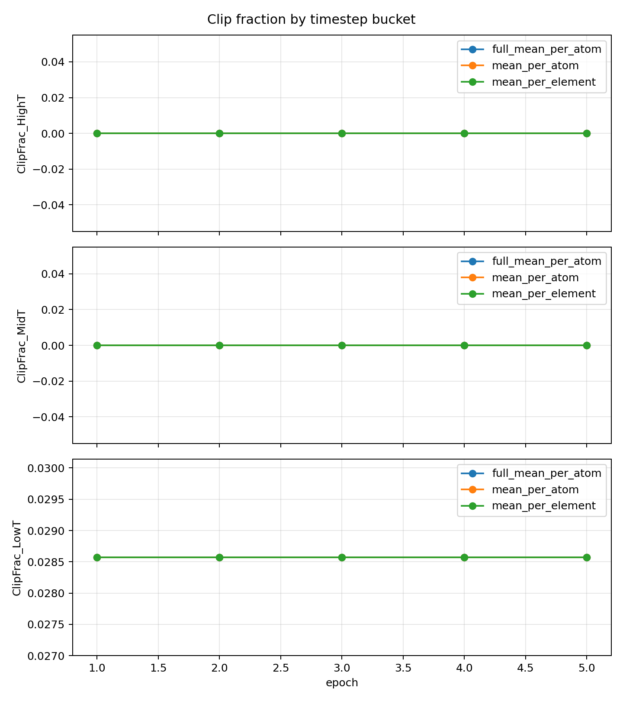
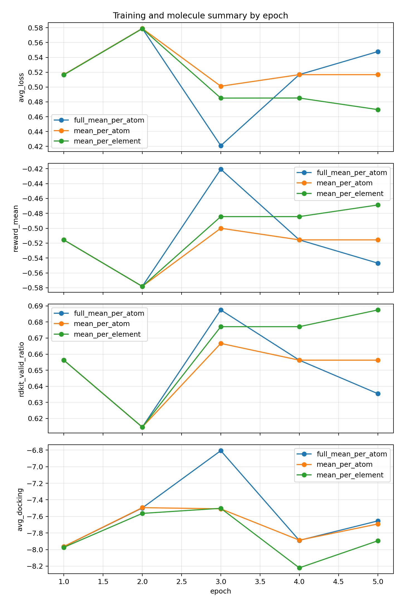
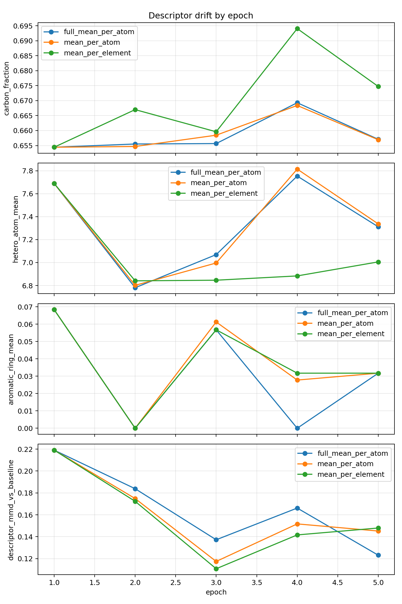

# DiffSBDD logprob 模式短程对照实验

## 实验设置

- 基础配置：`OUT/qed-sa-docking-8gjl-8gpu-kl-0p02_20260511_171944/config.yaml`。
- 三组均为 8 GPU、每卡 batch 12、global batch 96、5 epoch、100 步采样、seed 42。
- 只改 `model.logprob_mode` 和必要的 clamp；reward、KL 系数、采样目标保持一致。
- 输出目录见 `final_summary.csv` 的 `out_dir` 列。

## 最后一轮核心指标

| mode | rdkit_valid_ratio | reward_mean | avg_reward_raw | avg_docking | avg_loss | PPO_LogRatio_AbsMean | PPO_LogRatio_AbsP95 | PPO_ApproxKL | PPO_ApproxKL_K3 | KL_Penalty_Weighted | carbon_fraction | hetero_atom_mean | aromatic_ring_mean |
| --- | --- | --- | --- | --- | --- | --- | --- | --- | --- | --- | --- | --- | --- |
| full_mean_per_atom | 0.635417 | -0.546875 | 0.036636 | -7.65439 | 0.547835 | 0.165978 | 0.200035 | 1.41811 | 0.156074 | 9e-06 | 0.657091 | 7.31176 | 0.031746 |
| mean_per_atom | 0.65625 | -0.515625 | 0.070507 | -7.69122 | 0.51672 | 0.246453 | 0.28092 | 3.09425 | 0.236549 | 1e-05 | 0.656937 | 7.3369 | 0.031746 |
| mean_per_element | 0.6875 | -0.46875 | 0.134606 | -7.89432 | 0.469596 | 0.018964 | 0.021734 | 0.01833 | 0.010546 | 5e-06 | 0.674735 | 7.0058 | 0.031746 |

## 关键结论

- `mean_per_element` 保留原始尺度，最后一轮 `PPO_LogRatio_AbsP95=0.02173`，`PPO_ApproxKL=0.01833`，更新幅度最小。
- `mean_per_atom` 把特征维度先求和再按原子平均，最后一轮 `PPO_LogRatio_AbsP95=0.2809`，`PPO_ApproxKL=3.094`，明显放大 PPO 比率变化，但没有出现 clip frac 大面积爆炸。
- `full_mean_per_atom` 加入完整 Normal 常数和 `-log(sigma)` 后，最后一轮 `PPO_LogRatio_AbsP95=0.2`，`PPO_ApproxKL=1.418`；在这个短跑里没有比 `mean_per_atom` 更稳定或更有效。
- 三组最终有效率分别为 `mean_per_element=68.75%`、`mean_per_atom=65.62%`、`full_mean_per_atom=63.54%`。5 epoch 太短，质量趋势只能作为烟测，不应作为最终分子质量判断。
- `avg_kl` / `KL_Penalty_Weighted` 仍然很小，最后一轮加权 KL 约为 `mean_per_element=5e-06`、`mean_per_atom=1e-05`、`full_mean_per_atom=9e-06`。这支持之前判断：真正限制更新的更可能是 logprob 尺度、稀疏奖励和 PPO 比率，而不是当前 KL 惩罚过强。

## 图

## 文件

- `summary_by_epoch.csv`：三组逐 epoch 指标长表。
- `final_summary.csv`：三组最后一轮摘要。
- `analyze_results.py`：本报告和图的生成脚本。

## 下一步建议

1. 保留默认 `mean_per_element` 兼容旧实验，但后续 RL 调参优先尝试 `mean_per_atom`。
2. 先跑 20-30 epoch 的 `mean_per_atom`，确认 `PPO_LogRatio_AbsP95` 是否持续增长、KL 是否出现用户说的周期性跳跃。
3. 同时把 reward 稀疏问题拆出来：增加化学护栏和好分子池重排/重训，否则 logprob 尺度修好后仍可能只是在高碳方向更快偏移。
