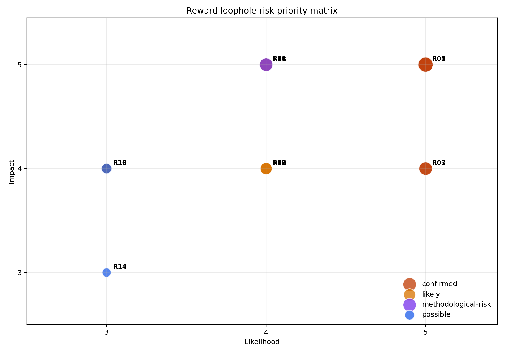

# Reward Loophole Risk Register

生成时间：2026-05-27

## 一、当前判断

当前 DiffSBDD + DDPO 的主要风险不是“单个分子不合理”，而是模型会在奖励函数、
分类器和 docking 之间寻找可利用的分布漏洞。最确定的模式是：

1. 高碳、少杂原子。
2. C/O-only mostly-carbon，即大量碳 + 1-3 个氧，缺少 N/S/卤素等非氧杂原子。
3. 三元环、复杂环、稠环富集。
4. top reward 区域仍出现 strict_core_fail 的坏结构。

因此，后续训练分类器时不能只看 overall AUC，而必须看每个 loophole category 的
recall，以及 top reward decile 中坏结构比例。

## 二、优先级图

## 三、最高优先级风险

| ID | 漏洞 | 状态 | 优先级 | 证据 | 防护 |
|---|---|---:|---:|---|---|
| R01 | C/O-only mostly-carbon collapse | confirmed | 25 | strict ChEMBL `co_only_high_c_low_o=0.08%`，OUT `11.01%` | 新增 hard-negative 类别；正样本按 hetero signature 分层 |
| R02 | High-carbon low-hetero collapse | confirmed | 25 | ChEMBL `C>=0.90=1.46%`，OUT `17.5%`；ChEMBL `hetero<=1=0.40%`，OUT `10.8%` | carbon fraction 区间护栏；C>=0.95/no_hetero hard negatives |
| R05 | Top-reward bad false positives | confirmed | 25 | top reward 样本仍含高碳、低杂原子、C/O-only、复杂环 | 每轮 RL 做 hard-negative mining |
| R03 | Three-member-ring proliferation | confirmed | 20 | OUT valid 三元环 `51.9%`，关键 run 到 `68.2%` | 三元环独立监控；高 reward 三元环进 hard negatives |
| R04 | Complex fused/bridged ring collapse | confirmed | 20 | OUT `ring_complex=24.9%`，关键 run 到 `60.9%` | ring topology guardrails |
| R07 | Non-oxygen heteroatom loss | confirmed | 20 | strict ChEMBL `has_nitrogen=94.82%`，OUT `50.18%`；strict ChEMBL `has_halogen=35.72%`，OUT `7.66%` | hetero signature 分层和专项 recall |
| R08 | Generated-source labeling shortcut | methodological-risk | 20 | 若所有 OUT 都作负样本，分类器会学“生成来源”而非化学合理性 | OUT 默认 unlabeled，只抽 hard negatives |
| R11 | Docking hydrophobic/pose artifact | likely | 20 | docking 容易偏好疏水、稠环、贴表面或构象异常结构 | ligand efficiency、pose sanity、关键相互作用、分布约束 |

完整表格见：`risk_register.tsv`

## 四、分类器训练时必须增加的评估

每次分类器训练后至少报告：

| 指标 | 目的 |
|---|---|
| overall ROC-AUC / PR-AUC | 基础分类能力 |
| scaffold split ROC-AUC / PR-AUC | 防止随机 split 虚高 |
| per-category negative recall | 确认每种漏洞都被识别 |
| high_reward_bad false-negative rate | 直接评估 reward 漏洞是否还在 |
| generated-good false-positive risk | 防止把好生成分子误杀 |
| top reward decile bad-rate | 检查 RL 实际会不会钻空子 |
| hetero signature distribution drift | 防止 C/O-only 或非氧杂原子缺失 |

## 五、下一步数据集策略

正样本：

- 从当前 strict ChEMBL property pool 中抽样。
- 按 scaffold、descriptor bin、hetero signature 三重分层。
- 保证 `N`、`N+O`、`N+O+halogen`、`S-containing`、`halogen-containing` 等组合有代表性。
- 不把 ChEMBL 尾部极端高碳、低杂原子、C/O-only mostly-carbon 样本作为强正样本。

负样本：

- 不把所有 OUT 作为负样本。
- 只抽明确命中漏洞的 generated hard negatives。
- 必须包含 `high_reward_bad`、`C/O-only mostly-carbon`、`high_carbon_low_hetero`、
  `three_member_ring`、`ring_complex`、`hydrophobic_low_polarity`、
  `non_oxygen_hetero_loss` 等类别。

奖励上线：

- 分类器只能作为 soft distribution reward。
- 对 confirmed loopholes 设置显式 hard penalty 或 hard filter 候选。
- 每轮 RL 后更新 risk register 和 hard-negative pool。
