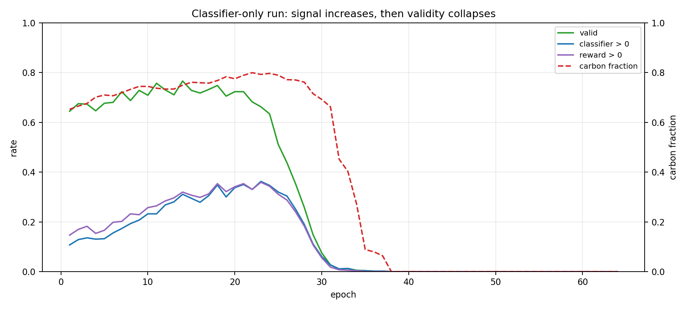
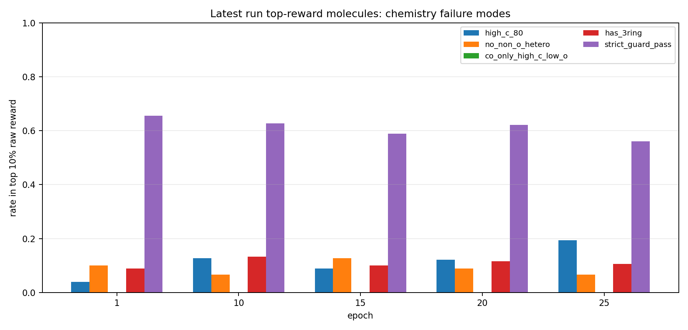
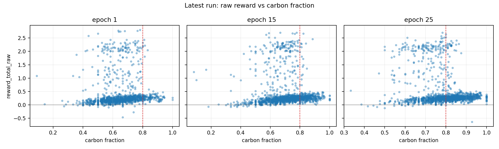

# 强化学习高碳漂移与稀疏奖励诊断

生成日期：2026-06-04

## 结论先行

1. 最新正式 RL run `OUT/7gpu-dock-classifier-v0-1_20260529_133609` 的高碳漂移是实锤：`carbon_fraction` 从 0.6546 上升到 0.7937，`hetero_atom_mean` 从 7.49 降到 4.56，`TPSA` 从 104.17 降到 60.97，`LogP` 从 0.34 升到 2.77。
2. 这个漂移不是单纯 docking 导致。`7gpu-classifier-only_20260526_210715` 也从 0.652 高碳化到 0.775，并在后期有效率坍缩到 0。说明当前 classifier reward 自身也没有守住分布。
3. “学得慢”主要来自有用奖励稀疏：最新 run 到 epoch 25，classifier 正分只占全部分子的 9.71%，valid 内 11.58%；valid 且 docking<=-8 且 classifier>0 只有 3.79%。PPO 每轮大多数样本提供的是失败惩罚或单一 docking 方向，正向组合信号太窄。
4. 当前配置只启用 docking 0.5 + chembl_classifier 0.5，QED/SA/LE/ChEMBL prior/diversity/logP/connectivity 全为 0，`kl_coef=0`。因此模型一旦发现“碳更多、更疏水、TPSA 更低”能让 docking 或 classifier 某些区域变好，就没有足够机制把它拉回药化分布。
5. 最直接处理不是先换底座，而是先把 RL reward 改成“目标奖励 + 化学护栏 + 分布护栏 + 稠密 shaping + replay/top-N 审核池”。否则即使换更强底座，RL 仍可能把分布推歪。

## 最新 run 关键曲线

```csv
epoch,rdkit_valid_ratio,reward_mean,avg_docking,avg_chembl_classifier_reward,logp_mean,tpsa_mean,carbon_fraction,hetero_atom_mean,aromatic_ring_mean,fraction_logp_high,fraction_tpsa_low
1,0.669643,-0.713619,-7.658405,-0.840537,0.337489,104.169335,0.654553,7.493727,0.047216,0.015976,0.06967
5,0.700335,-0.657303,-7.645267,-0.847147,0.37345,105.25669,0.64387,7.762567,0.046957,0.014351,0.059034
10,0.722656,-0.797575,-6.793711,-0.823926,1.189526,91.582442,0.689725,6.802008,0.049493,0.037017,0.106705
15,0.794085,-0.476677,-8.084177,-0.821436,1.345963,85.319131,0.708552,6.33249,0.054468,0.043535,0.124171
20,0.84375,-0.382392,-8.411425,-0.815448,2.154911,73.671219,0.753539,5.499445,0.059061,0.092067,0.184307
25,0.83817,-0.390944,-8.617007,-0.802076,2.765378,60.974268,0.793666,4.56117,0.079826,0.158312,0.274235

```


## 奖励稀疏证据

```csv
epoch,valid_rate,classifier_positive_all_rate,classifier_positive_valid_rate,classifier_full_valid_rate,docking_le_minus8_valid_rate,dock8_and_classifier_positive_valid_rate,reward_positive_rate,reward_clamped_high_rate,reward_clamped_low_rate
1,0.6696428571428571,0.07198660714285714,0.1075,0.065,0.435,0.034166666666666665,0.11216517857142858,0.060267857142857144,0.33035714285714285
5,0.7003348214285714,0.0703125,0.100398406374502,0.05737051792828685,0.4239043824701195,0.031075697211155377,0.11328125,0.05915178571428571,0.3002232142857143
10,0.72265625,0.07924107142857142,0.10965250965250965,0.05868725868725869,0.43474903474903476,0.03397683397683398,0.11049107142857142,0.053013392857142856,0.37723214285714285
15,0.7940848214285714,0.08705357142857142,0.10962754743499649,0.059030217849613494,0.550948699929726,0.04146170063246662,0.12667410714285715,0.07087053571428571,0.20591517857142858
20,0.84375,0.08649553571428571,0.10251322751322751,0.06018518518518518,0.6349206349206349,0.031084656084656083,0.13225446428571427,0.07254464285714286,0.15680803571428573
25,0.8381696428571429,0.09709821428571429,0.11584553928095873,0.06790945406125166,0.6864181091877497,0.03794940079893475,0.13560267857142858,0.07924107142857142,0.16183035714285715

```


## 主要 run 起止对比

```csv
run_label,epochs,last_epoch,rdkit_valid_ratio_start,rdkit_valid_ratio_end,avg_docking_start,avg_docking_end,carbon_fraction_start,carbon_fraction_end,hetero_atom_mean_start,hetero_atom_mean_end,tpsa_mean_start,tpsa_mean_end,logp_mean_start,logp_mean_end,avg_chembl_classifier_reward_start,avg_chembl_classifier_reward_end
dock_classifier_0529,25,25,0.669643,0.83817,-7.658405,-8.617007,0.654553,0.793666,7.493727,4.56117,104.169335,60.974268,0.337489,2.765378,-0.840537,-0.802076
dock_classifier_0528,25,25,0.665179,0.741071,-7.712678,-7.722889,0.654505,0.705496,7.550564,6.318381,103.926921,83.141711,0.320949,1.404278,-0.819849,-0.875403
classifier_only_0526,64,64,0.644643,0.0,0.0,0.0,0.652348,0.0,7.48286,0.0,103.054601,0.0,0.289242,0.0,,
dock_prior_logp_0525,62,62,0.638095,0.933333,-7.715393,-10.642895,0.651002,0.878846,7.601061,2.910717,103.845435,49.849978,0.341902,3.465558,,
le_prior_logp_0526,16,16,0.638095,0.884127,-7.681236,-9.386214,0.651002,0.877882,7.601061,2.679562,103.85504,37.530625,0.341269,4.130739,,

```



## Top reward 区域是否可靠

下表用 RDKit 从 SMILES 重新计算分子性质。`strict_guard_pass` 是给 future replay/top-N pool 的初筛规则，不是最终发表标准：heavy atoms 10-35、C fraction<=0.78、hetero>=3、non-O hetero>=1、TPSA 40-140、LogP<=4.5、无三元环。

```csv
epoch,subset,n_valid_parse,strict_guard_pass_rate,high_c_80_rate,high_c_90_rate,low_hetero_le2_rate,no_non_o_hetero_rate,co_only_high_c_low_o_rate,has_3ring_rate,logp_high_gt4p5_rate,tpsa_low_lt60_rate,carbon_fraction_mean,hetero_atoms_mean,tpsa_mean,logp_mean,aromatic_ring_mean
1,all_valid_parse,1200,0.30666666666666664,0.11416666666666667,0.0225,0.03833333333333333,0.2,0.019166666666666665,0.4375,0.024166666666666666,0.17583333333333334,0.6544872389115675,7.498333333333333,104.197725,0.33777076666666767,0.0475
1,top10_reward_total_raw,180,0.6555555555555556,0.03888888888888889,0.0,0.0,0.1,0.0,0.08888888888888889,0.005555555555555556,0.2611111111111111,0.6399187599670899,6.588888888888889,87.03305555555556,0.6262307222222226,0.1388888888888889
10,all_valid_parse,1295,0.3019305019305019,0.20154440154440154,0.027799227799227798,0.05637065637065637,0.1583011583011583,0.018532818532818532,0.4409266409266409,0.061003861003861,0.25096525096525096,0.6896899484417053,6.808494208494208,91.70401544401545,1.1875977451737463,0.04942084942084942
10,top10_reward_total_raw,180,0.6277777777777778,0.12777777777777777,0.0,0.0,0.06666666666666667,0.0,0.13333333333333333,0.016666666666666666,0.3,0.6686820229464773,6.261111111111111,79.68050000000001,1.174933833333334,0.17222222222222222
15,all_valid_parse,1423,0.27266338721011946,0.24595924104005623,0.04778636683063949,0.07519325368938862,0.2073085031623331,0.03302881236823612,0.46732255797610683,0.06746310611384398,0.286718200983837,0.7085911292778019,6.3309908643710475,85.30002108222067,1.3471006605762483,0.054111033028812365
15,top10_reward_total_raw,180,0.5888888888888889,0.08888888888888889,0.0,0.0,0.12777777777777777,0.0,0.1,0.022222222222222223,0.31666666666666665,0.6664578178677494,6.094444444444444,74.6413888888889,1.220334944444445,0.1388888888888889
20,all_valid_parse,1512,0.22685185185185186,0.3888888888888889,0.07208994708994709,0.10714285714285714,0.23743386243386244,0.0496031746031746,0.4801587301587302,0.13227513227513227,0.3888888888888889,0.7534502790101814,5.502645502645502,73.71910052910054,2.153560085978837,0.05886243386243386
20,top10_reward_total_raw,180,0.6222222222222222,0.12222222222222222,0.0,0.005555555555555556,0.08888888888888889,0.0,0.11666666666666667,0.022222222222222223,0.35555555555555557,0.6932071224803923,5.655555555555556,70.73983333333334,1.3858091666666672,0.14444444444444443
25,all_valid_parse,1502,0.17909454061251665,0.5366178428761651,0.15246338215712382,0.18908122503328895,0.23834886817576564,0.08322237017310254,0.48535286284953394,0.21504660452729693,0.5106524633821571,0.7938190125293719,4.559254327563249,60.95690412782956,2.7670977629826914,0.07989347536617843
25,top10_reward_total_raw,180,0.5611111111111111,0.19444444444444445,0.0,0.005555555555555556,0.06666666666666667,0.0,0.10555555555555556,0.027777777777777776,0.4777777777777778,0.7160183746930799,5.116666666666666,62.480555555555554,1.6236111111111118,0.16666666666666666

```





## 原因拆解

### 1. Reward 组合欠约束

最新正式配置：

- docking: 0.5
- chembl_classifier: 0.5
- QED/SA/ligand efficiency/ChEMBL prior/diversity/logP/connectivity: 0
- KL: 0
- failure advantage override: -2
- total reward z-score + clamp [-2, 2]

这会让 RL 只有两个方向：对接口袋分数和分类器分数。对接口袋分数通常容易奖励疏水接触、体积填充和低极性；当前 classifier 又没有强制 N/S/halogen/芳香/三元环/复杂环等结构边界，所以策略自然会走向高碳、低 TPSA、低杂原子的捷径。

### 2. Classifier 不是稳定正向导航器

最新 run 中 `avg_chembl_classifier_reward` 长期为负，epoch 1 为 -0.8405，epoch 25 仍为 -0.8021。也就是说 classifier 对大多数生成分子仍在给负分。它不是一个足够稠密的“往哪里改”的信号，更像一个稀疏门槛。

classifier-only run 更关键：classifier 正分比例前期升高，但分布同时高碳化，最后 valid ratio 崩到 0。这说明 classifier reward 单独使用会被策略推到模型/重建不可稳定解析的区域。

### 3. PPO 的有效样本比例太低

最新 run 每轮生成 1792 个分子。epoch 25：

- valid: 1502 / 1792 = 83.82%
- classifier > 0: 174 / 1792 = 9.71%
- valid 内 classifier > 0: 11.58%
- valid 内 docking<=-8: 68.64%
- valid 内 docking<=-8 且 classifier>0: 3.79%

所以 docking 有信号，但“docking 好且 classifier 接受”的分子很少；PPO 大多数更新来自 docking 单轴和失败惩罚，训练就会慢，并且容易在高碳方向达到平台。

### 4. Top reward 分子也不能直接回流

从 top reward 10% 看，高 reward 并不等于结构合理。高碳、低非氧杂原子、三元环和低 TPSA 在 top 区域仍会出现。因此 top-N 不能直接拿去重训，必须先经过 chemistry guard、分布 guard、docking/classifier rerank、scaffold 去重。

## 处理方案

### P0：先改 reward 结构，不先动模型底座

建议新增一个 `ChemistryGuardReward` 或等价组合，作为 hard/soft penalty，不参与普通 z-score 稀释，至少包含：

- carbon fraction 上限：目标 0.55-0.78，超过 0.80 强惩罚。
- hetero / non-O hetero 下限：hetero>=3，至少一个 N/S/halogen/P 或其他非氧杂原子。
- TPSA / LogP 区间：TPSA 不要持续低于 40-60；LogP 不要持续推高到 >4.5。
- 三元环、复杂小环、碎片、sanitize failed、异常价态：明确惩罚。
- 芳香环弱先验：鼓励 1 个左右芳香/药化常见环，但不要奖励多稠环/PAH。

### P1：把 classifier 从稀疏门槛改成稠密 shaping

当前 `good_threshold=0.5`、`bad_threshold=0.5` 的门槛式奖励会让大多数分子得到类似负信号。建议改为：

- 使用 classifier logit/probability 的连续值，而不是只看阈值。
- batch 内 percentile/rank reward：每轮至少 top 20-30% 给相对正优势，避免全批都是负。
- 前 5-10 epoch 放宽阈值，后续 curriculum 收紧。
- 对 generated high-reward bad molecules 做 hard-negative mining，重训 classifier。

### P2：重新打开已有但未启用的组件

一个更稳的 v0.2 reward 初始权重可以是：

```yaml
reward:
  weights:
    docking: 0.25
    chembl_classifier: 0.20
    ligand_efficiency: 0.10
    qed: 0.05
    sa: 0.05
    chembl_prior_ecfp4: 0.05
    chembl_prior_fcfp4: 0.05
    logp_distribution: 0.05
    diversity_ecfp4: 0.05
    chemistry_guard: 0.15
train:
  kl_coef: 0.001  # 可从 0.001/0.003/0.005 sweep
```

注意：`chemistry_guard` 最好不要完全依赖 per-component z-score，否则高碳惩罚可能被 batch 统计洗掉。它应该能作为 hard penalty 或 advantage mask 直接压住坏结构。

### P3：好分子回流要做成 pool，不要简单 top-N 重训

每轮保存：SMILES/SDF、docking、classifier、QED、SA、LogP、TPSA、carbon fraction、hetero、ring、fragment、bad bond 等字段。

进入 `GoodMoleculePool` 的条件建议是：

1. RDKit sanitize 成功，单主片段，无明显异常环/价态。
2. docking 达到当前 batch/top percentile 或固定阈值。
3. classifier 达到 percentile，而不是一开始死卡 0.5。
4. carbon fraction、hetero、TPSA、LogP、ring 通过 guard。
5. scaffold-balanced 去重，避免全是同一类高碳骨架。

用途顺序：先作为 rerank/可视化候选；确认质量后再做 replay buffer 或监督 self-training。

## 建议下一步实验

1. 实现 `ChemistryGuardReward`，先只跑 smoke + 2-3 epoch 7GPU 小正式，验证高碳是否被压住。
2. 同时改 classifier reward 为 dense/rank shaping，比较 “原 classifier vs dense classifier”。
3. 做 4 组 ablation，每组 5-10 epoch：
   - baseline: docking + classifier
   - baseline + chemistry guard
   - baseline + dense classifier
   - baseline + chemistry guard + dense classifier + small KL
4. 指标不是只看 reward：必须看 carbon_fraction、hetero_atom_mean、TPSA、LogP、三元环、strict_guard_pass、classifier 正分率、dock8&classifier 正分率、valid ratio、docking。

## 产物

- `run_epoch_summary.csv`：所选 run 的完整 epoch 曲线。
- `selected_epoch_summary.csv`：关键 epoch 摘要。
- `run_start_end_delta.csv`：每个 run 起止变化。
- `reward_sparsity_by_epoch.csv`：每 epoch 有用奖励比例。
- `selected_epoch_molecule_flags.csv.gz`：关键 epoch 的 RDKit 分子级结构标记。
- `top_reward_flag_summary.csv`：top reward 区域结构问题统计。
