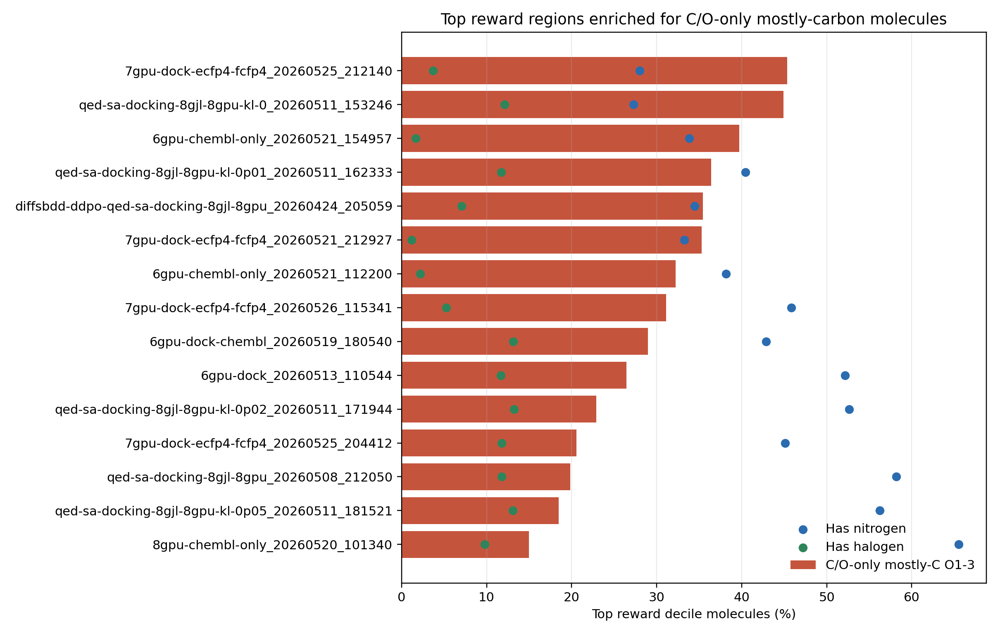
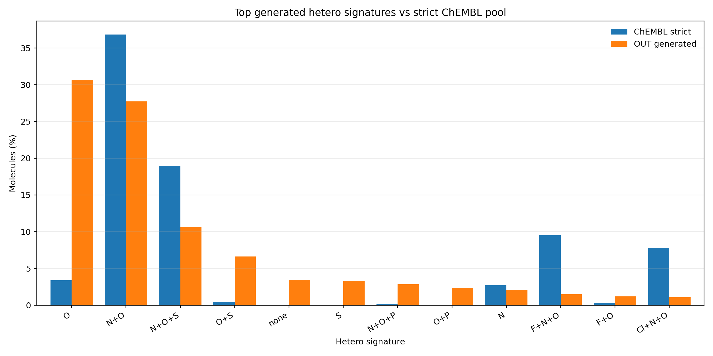

# C/O-only 与非氧杂原子分布专项诊断

生成时间：2026-05-27 15:44:03

## 一、问题定义

本分析针对的不是“全氧崩坏”，而是更符合当前担忧的：

> 生成分子主要由大量碳和少量氧组成，缺少 N、S、卤素、P 等非氧杂原子多样性。

这类模式会让分子看起来满足了“有杂原子/极性不要太低”的简单规则，但本质上仍然是
composition collapse。

## 二、核心指标

- `co_only`：重原子元素只包含 C 和 O，且至少有一个 O。
- `oxygen_only_hetero`：杂原子全是 O，没有 N/S/P/卤素等非氧杂原子。
- `co_only_high_c`：C/O-only 且 carbon fraction >= 0.85。
- `co_only_high_c_low_o`：C/O-only、carbon fraction >= 0.85、O 原子数为 1-2。
- `co_only_mostly_c_o1_3`：C/O-only、carbon fraction >= 0.80、O 原子数为 1-3。
- `no_non_o_hetero`：没有任何非氧杂原子，包括全碳和 C/O-only。

## 三、ChEMBL36 vs OUT 总体对比

| 指标 | ChEMBL36 cleaned | strict ChEMBL property pool | OUT valid generated |
|---|---:|---:|---:|
| co_only | 4.08% | 3.39% | 30.59% |
| oxygen_only_hetero | 4.08% | 3.39% | 30.59% |
| co_only_high_c | 1.32% | 0.52% | 16.50% |
| co_only_high_c_low_o | 0.65% | 0.08% | 11.01% |
| co_only_mostly_c_o1_3 | 1.48% | 0.83% | 16.59% |
| no_non_o_hetero | 4.10% | 3.39% | 34.03% |
| has_nitrogen | 93.64% | 94.82% | 50.18% |
| has_sulfur | 31.13% | 31.36% | 25.01% |
| has_halogen | 35.84% | 35.72% | 7.66% |
| has_non_o_hetero | 95.90% | 96.61% | 65.97% |

## 四、Top reward 区域

- 7gpu-dock-ecfp4-fcfp4_20260525_212140: top reward decile C/O-only mostly-carbon O1-3 = 45.35%, no non-O hetero = 65.11%, has N = 28.02%
- qed-sa-docking-8gjl-8gpu-kl-0_20260511_153246: top reward decile C/O-only mostly-carbon O1-3 = 44.93%, no non-O hetero = 61.53%, has N = 27.27%
- 6gpu-chembl-only_20260521_154957: top reward decile C/O-only mostly-carbon O1-3 = 39.72%, no non-O hetero = 62.96%, has N = 33.84%
- qed-sa-docking-8gjl-8gpu-kl-0p01_20260511_162333: top reward decile C/O-only mostly-carbon O1-3 = 36.40%, no non-O hetero = 48.95%, has N = 40.45%
- diffsbdd-ddpo-qed-sa-docking-8gjl-8gpu_20260424_205059: top reward decile C/O-only mostly-carbon O1-3 = 35.45%, no non-O hetero = 52.23%, has N = 34.46%
- 7gpu-dock-ecfp4-fcfp4_20260521_212927: top reward decile C/O-only mostly-carbon O1-3 = 35.30%, no non-O hetero = 57.31%, has N = 33.26%
- 6gpu-chembl-only_20260521_112200: top reward decile C/O-only mostly-carbon O1-3 = 32.22%, no non-O hetero = 51.23%, has N = 38.17%
- 7gpu-dock-ecfp4-fcfp4_20260526_115341: top reward decile C/O-only mostly-carbon O1-3 = 31.11%, no non-O hetero = 43.15%, has N = 45.84%

## 图示

## 五、结论用法

如果 OUT 或 top reward decile 中 `co_only_high_c_low_o`、`co_only_mostly_c_o1_3`、
`no_non_o_hetero` 显著高于 ChEMBL baseline，就说明模型不是简单“缺氧”，也不是
“氧过多”，而是走向 **C/O-only mostly-carbon collapse**。

对应的数据集策略应是：

1. 不把所有生成分子当负样本。
2. 把 C/O-only 且 high-carbon、low-O、high-reward 的样本作为 hard negatives。
3. 正样本抽样必须按 hetero signature 分层，保证 N、S、卤素、N+O、N+O+halogen 等
   ChEMBL 常见组合不被 C/O-only 分子淹没。
4. logP/TPSA 只能做区间约束，不能把“更低 logP”当作持续正奖励。
