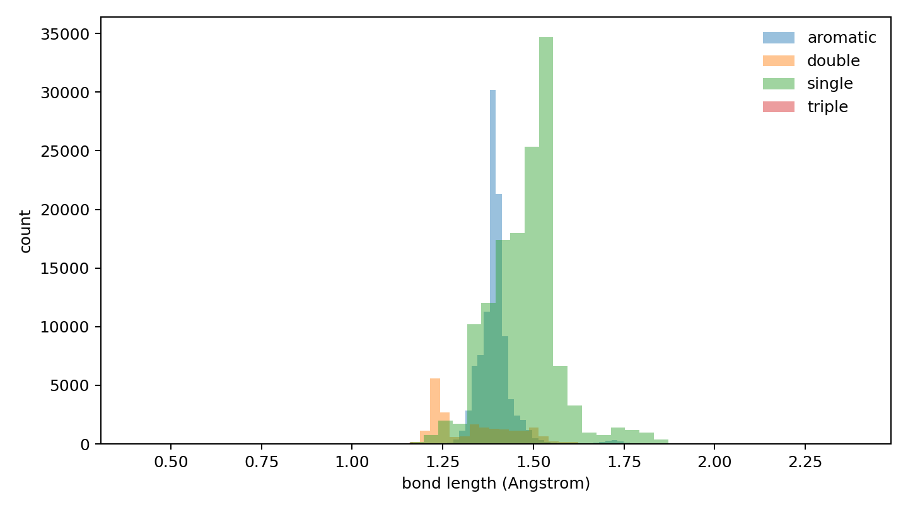

# Local Bond Predictor Data Report

## Purpose

Validate that CrossDocked processed edge labels can provide a stable `ligand_halfedge_index / ligand_halfedge_type` data chain for a local bond predictor baseline.

## Inputs

- processed_dir: `data/crossdocked_raw/processed_edge_noH_full`
- dataset: `crossdock_full`
- train_max_samples: `10000`
- val_max_samples: `300`
- test_max_samples: `100`
- length_tolerance: `0.25` Angstrom
- sample_seed: `42`

## Split Summary

| split | dataset | analyzed | sanitize | bad length | no-bond | halfedge mismatch | bond mismatch | samples/s |
|---|---:|---:|---:|---:|---:|---:|---:|---:|
| train | 99929 | 10000 | 0.86520000 | 0.00725772 | 0.91722093 | 0 | 0 | 390.226 |
| val | 300 | 300 | 0.87666667 | 0.00659222 | 0.91541464 | 0 | 0 | 401.299 |
| test | 100 | 100 | 0.89000000 | 0.00580913 | 0.91837836 | 0 | 0 | 405.999 |

## Real Bond Type Fractions

| split | single | double | triple | aromatic |
|---|---:|---:|---:|---:|
| train | 0.52382867 | 0.08212623 | 0.00215603 | 0.39188907 |
| val | 0.52753700 | 0.09174557 | 0.00160021 | 0.37911722 |
| test | 0.60991736 | 0.08760331 | 0.00082645 | 0.30165289 |

## Sanitize Errors

| split | error | count |
|---|---|---:|
| train | AtomValenceException | 158 |
| train | KekulizeException | 1190 |
| val | AtomValenceException | 5 |
| val | KekulizeException | 32 |
| test | AtomValenceException | 3 |
| test | KekulizeException | 8 |

## Files

- [split_summary.csv](split_summary.csv)
- [bond_type_counts_by_split.csv](bond_type_counts_by_split.csv)
- [bond_length_by_split.csv](bond_length_by_split.csv)
- [bond_pair_length_summary.csv](bond_pair_length_summary.csv)
- [oracle_reconstruction_by_split.csv](oracle_reconstruction_by_split.csv)
- [sanitize_errors_by_split.csv](sanitize_errors_by_split.csv)
- [local_bond_predictor_manifest.json](local_bond_predictor_manifest.json)

## Plots

