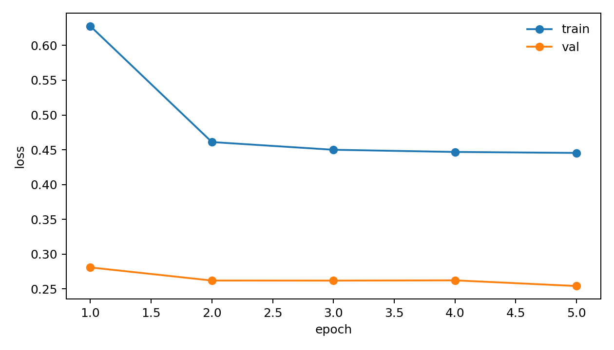
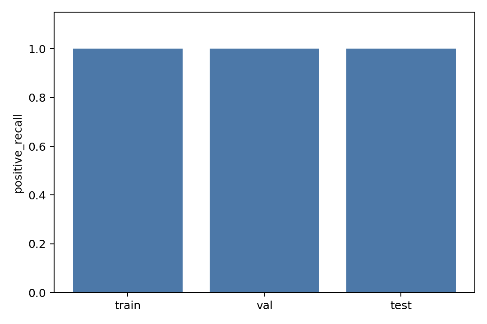

# Local Bond Predictor V0 Report

## Purpose

Train a decoupled pair-MLP bond predictor on CrossDocked true halfedge labels before integrating any reconstruction backend.

## Inputs

- processed_dir: `data/crossdocked_raw/processed_edge_noH_full`
- train_max_samples: `1000`
- val_max_samples: `300`
- test_max_samples: `100`
- train_negative_ratio: `4.0`
- pos_noise_std: `0.05`
- epochs: `5`
- elapsed_sec: `21.137`

## Metrics

| split | loss | accuracy | macro_f1 | positive_precision | positive_recall | positive_f1 | no_bond_recall | aromatic_recall |
|---|---:|---:|---:|---:|---:|---:|---:|---:|
| train | 0.43826767 | 0.94512113 | 0.69889431 | 0.99897367 | 0.99996049 | 0.99946684 | 0.99974185 | 0.76064091 |
| val | 0.25420251 | 0.98555089 | 0.74801734 | 0.99986665 | 0.99986665 | 0.99986665 | 0.99998768 | 0.91874780 |
| test | 0.23368880 | 0.98691356 | 0.65896342 | 1.00000000 | 1.00000000 | 1.00000000 | 1.00000000 | 0.89589041 |

## Training History

| epoch | train_loss | val_loss | val_macro_f1 | val_positive_recall |
|---:|---:|---:|---:|---:|
| 1 | 0.62767847 | 0.28091400 | 0.65995088 | 0.99946660 |
| 2 | 0.46107694 | 0.26207139 | 0.66016054 | 0.99973330 |
| 3 | 0.44999407 | 0.26196252 | 0.66588152 | 0.99973330 |
| 4 | 0.44684931 | 0.26234136 | 0.76324057 | 0.99986665 |
| 5 | 0.44546378 | 0.25420251 | 0.74801734 | 0.99986665 |

## Files

- [metrics.csv](metrics.csv)
- [training_history.csv](training_history.csv)
- [confusion_train.csv](confusion_train.csv)
- [confusion_val.csv](confusion_val.csv)
- [confusion_test.csv](confusion_test.csv)
- [manifest.json](manifest.json)
- [best_model.pt](best_model.pt)
- [last_model.pt](last_model.pt)

## Plots

