# Generated Reconstruction Benchmark Report

- checkpoint: `DiffSBDD/checkpoints/crossdocked_fullatom_cond.ckpt`
- pdbfile: `data/8GJL.pdb`
- ref_ligand: `C:1101`
- resi_list: `None`
- samples: `1000`
- timesteps: `100`
- length_tolerance: `0.25`
- methods: `openbabel edm`
- local_bond_checkpoint: `analysis/local_bond_predictor_v0_20260602_small/best_model.pt`
- local_bond_device: `cpu`
- edge_denoiser_b_checkpoint: `analysis/edge_denoiser_ablation_20260603_B_diffgui_noise005/edge_denoiser_overfit.pt`
- edge_denoiser_c_checkpoint: `analysis/edge_denoiser_ablation_20260603_C_diffgui_noise005_focal2_gpu/edge_denoiser_overfit.pt`
- edge_denoiser_device: `cpu`
- edge_denoiser_timestep: `999`
- edge_denoiser_init_mode: `uniform_random`
- edge_denoiser_seed: `20260603`
- atom_bias: `{'C': -0.0480928531614769, 'N': 0.1150944592358035, 'O': 0.1693662542703554, 'S': -0.12980628320471657, 'Cl': -0.10780487552101424, 'P': 0.5, 'F': -0.30464379994425533}`
- atom_temperature: `1.0`
- atom_local_mask: `{'enabled': True, 'candidate_cutoff': 2.2, 'terminal_degree_max': 1, 'terminal_only_elements': ('F', 'Cl', 'Br', 'I'), 'disable_elements': ('P', 'Br', 'I', 'B')}`
- geometry_refine: `{'enabled': False, 'steps': 10, 'learning_rate': 0.05, 'max_step': 0.05, 'max_total_shift': 0.3, 'use_pocket_clash': True}`

| method | sanitize | bad_bond_length | fragments | largest_frag | aromatic | benzene6 | bad_arom | QED | SA | TPSA | sec/mol |
|---|---:|---:|---:|---:|---:|---:|---:|---:|---:|---:|---:|
| openbabel | 0.656 | 0.047 | 1.104 | 0.980 | 0.554 | 0.375 | 0.268 | 0.392 | 0.416 | 45.754 | 0.0019 |
| edm | 0.466 | 0.004 | 2.899 | 0.786 | 0.012 | 0.002 | 0.005 | 0.216 | 0.267 | 36.726 | 0.0015 |

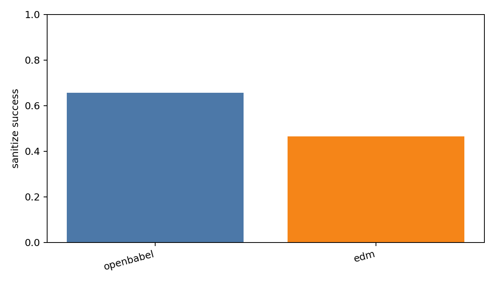

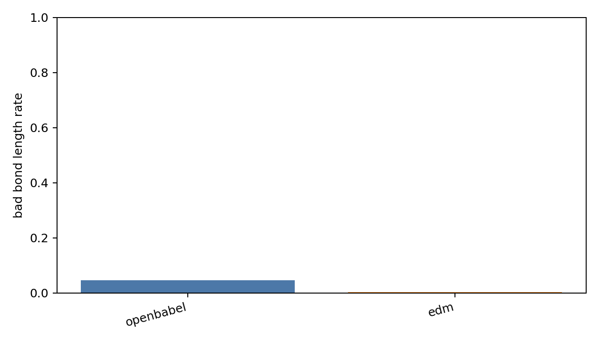

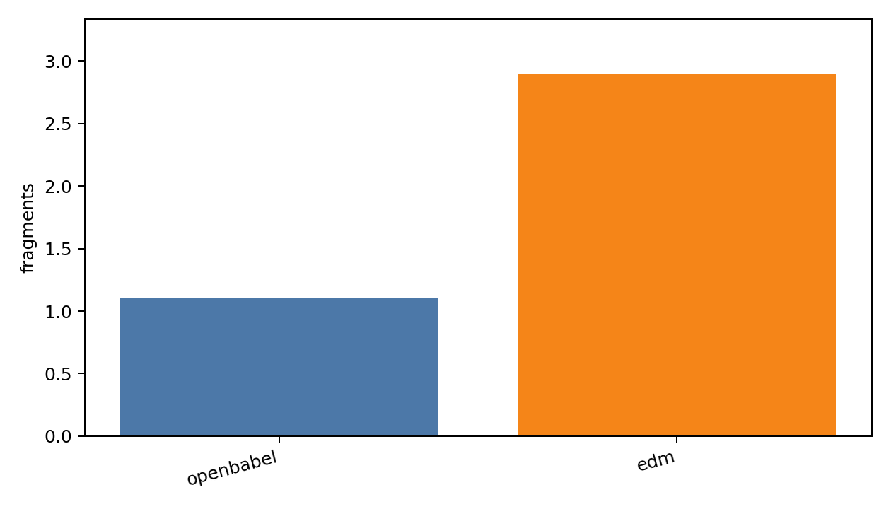

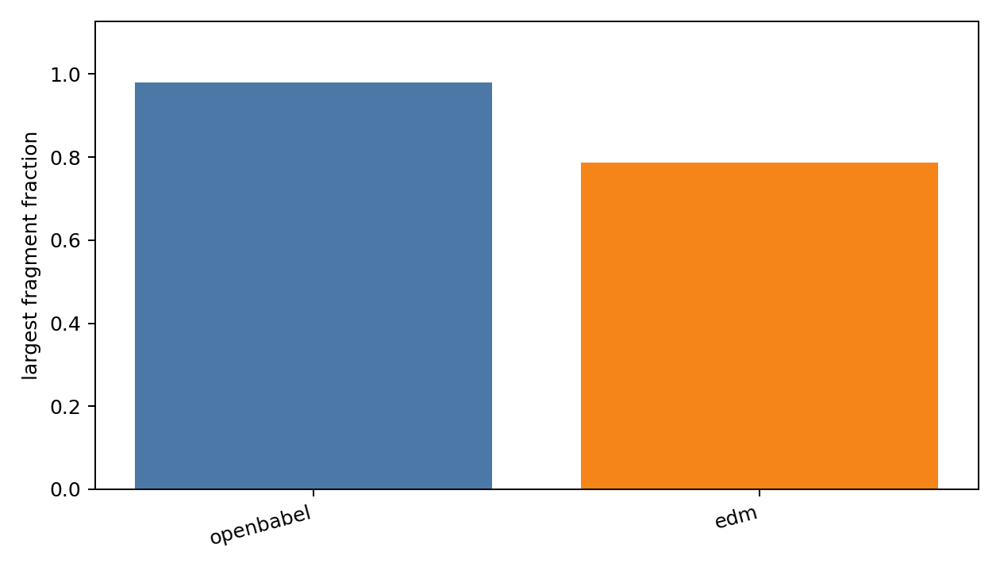

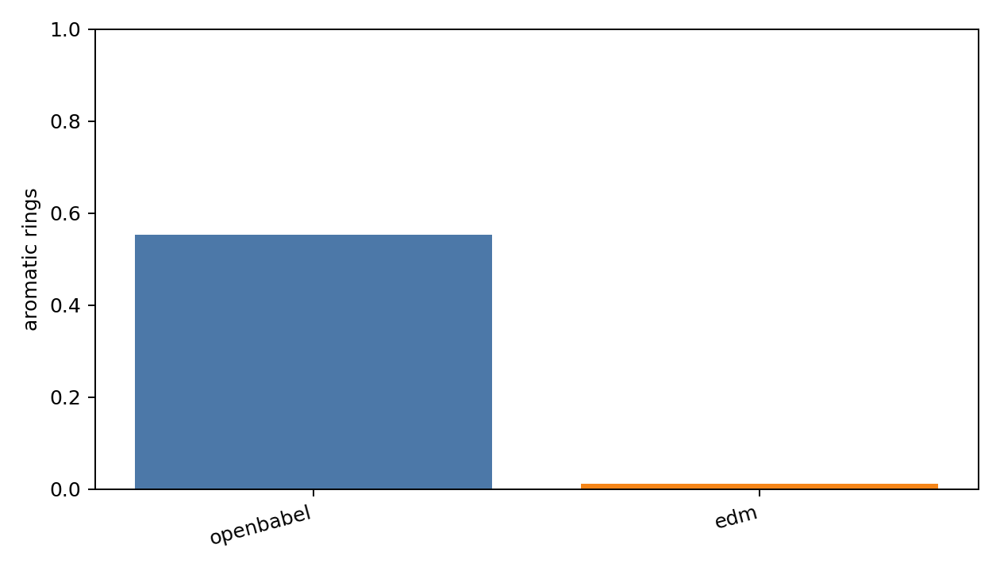

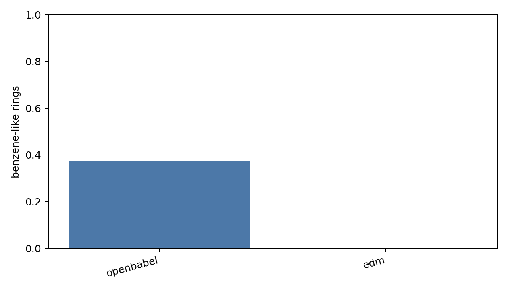

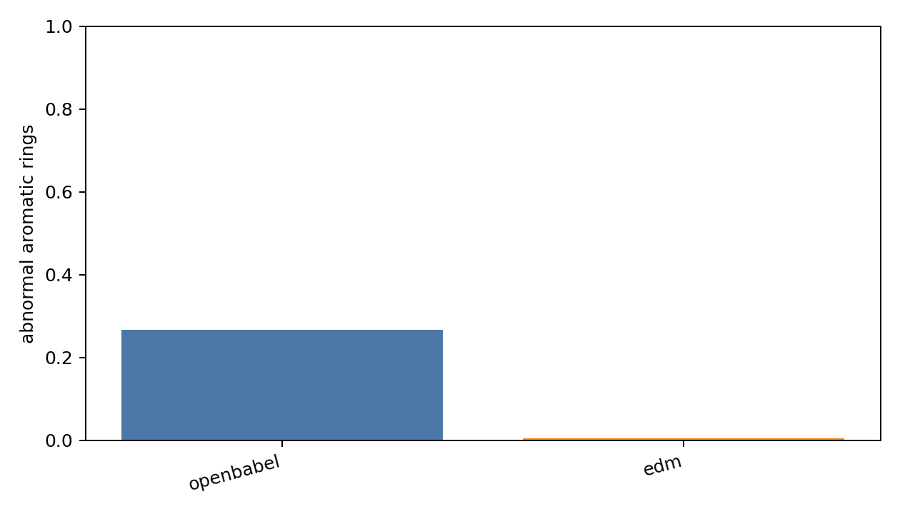

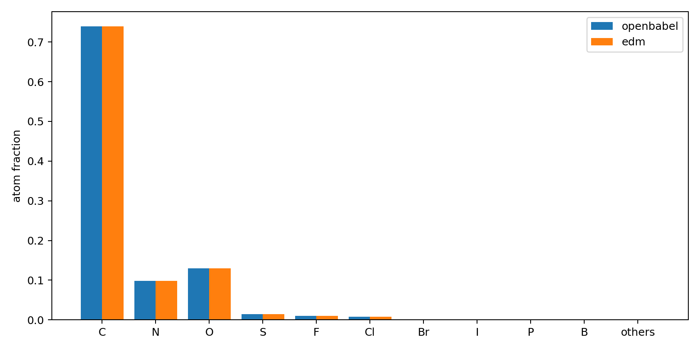

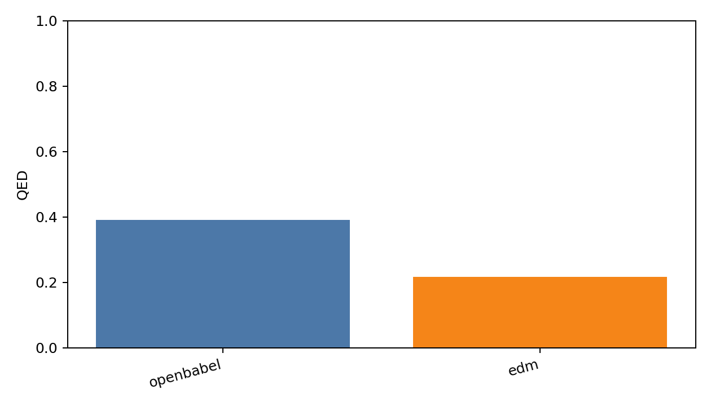

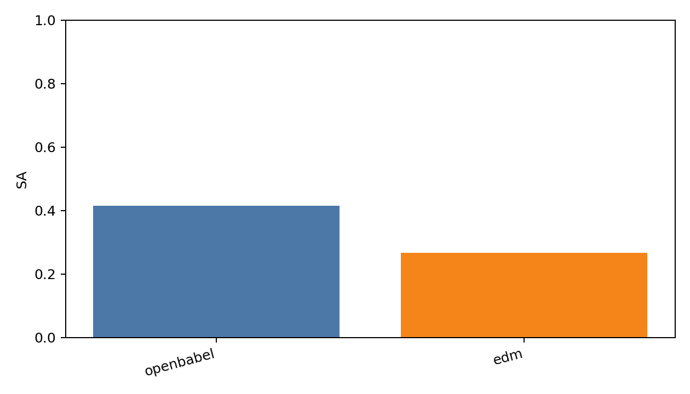

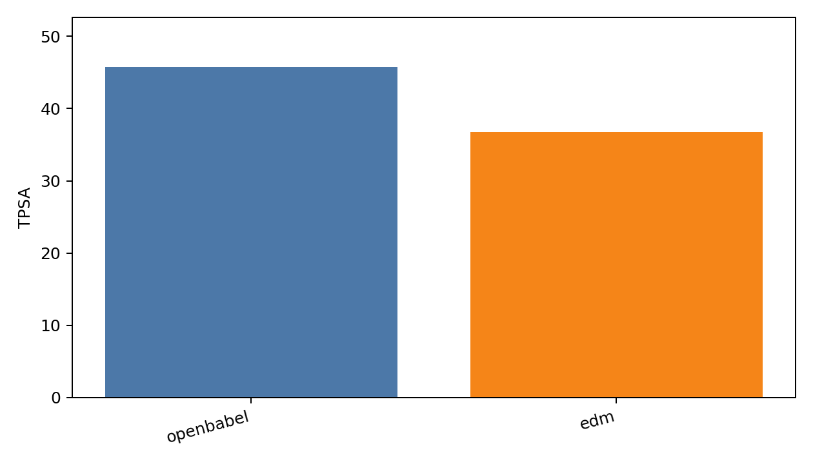

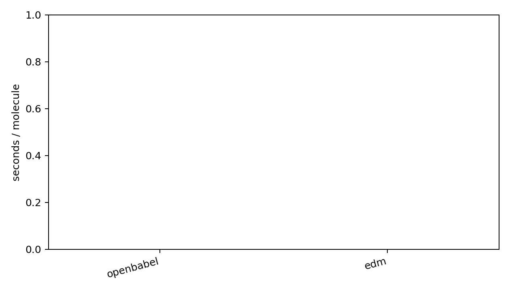
