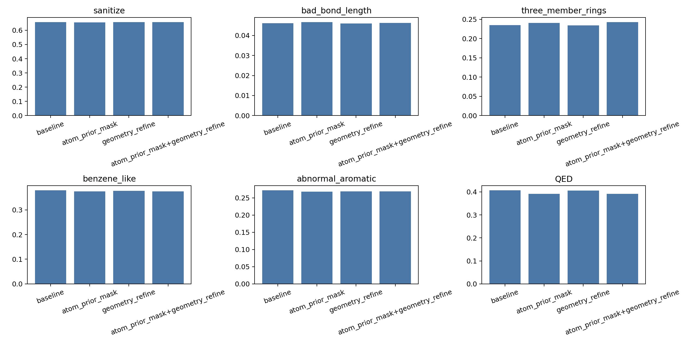
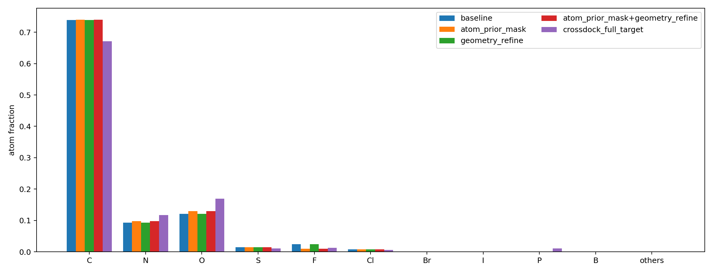

# DiffSBDD generation refinement ablation

## Setup

- samples per group: `1000`
- timesteps: `100`
- seed: `260603`
- reconstruction methods: `openbabel edm`
- atom prior: CrossDocked target vs baseline generated element fractions, log-ratio bias, strength `0.5`, clamp `0.5`
- local atom mask: terminal-only `F,Cl,Br,I`; globally disabled `P,Br,I,B`
- geometry refine: final-only, `10` steps, lr `0.05`, max total shift `0.30 A`

## OpenBabel summary

| group | sanitize | bad bond | 3-rings | benzene-like | abnormal arom | C | N | O | F | Cl | QED | TPSA | atom-score changed |
|---|---:|---:|---:|---:|---:|---:|---:|---:|---:|---:|---:|---:|---:|
| baseline | 0.658 | 0.046 | 0.235 | 0.379 | 0.272 | 0.739 | 0.093 | 0.121 | 0.024 | 0.008 | 0.407 | 41.089 |  |
| atom_prior_mask | 0.656 | 0.047 | 0.241 | 0.375 | 0.268 | 0.740 | 0.098 | 0.130 | 0.010 | 0.008 | 0.392 | 45.754 | 0.016 |
| geometry_refine | 0.658 | 0.046 | 0.234 | 0.377 | 0.269 | 0.739 | 0.093 | 0.121 | 0.024 | 0.008 | 0.406 | 41.188 |  |
| atom_prior_mask+geometry_refine | 0.657 | 0.046 | 0.243 | 0.375 | 0.269 | 0.739 | 0.098 | 0.130 | 0.010 | 0.008 | 0.392 | 45.951 | 0.016 |

## Target element fractions

| element | target | baseline | delta baseline-target |
|---|---:|---:|---:|
| C | 0.6714 | 0.7392 | +0.0678 |
| N | 0.1171 | 0.0930 | -0.0240 |
| O | 0.1696 | 0.1209 | -0.0487 |
| S | 0.0113 | 0.0146 | +0.0033 |
| F | 0.0131 | 0.0241 | +0.0110 |
| Cl | 0.0064 | 0.0080 | +0.0016 |
| Br | 0.0000 | 0.0000 | +0.0000 |
| I | 0.0000 | 0.0000 | +0.0000 |
| P | 0.0111 | 0.0002 | -0.0109 |
| B | 0.0000 | 0.0000 | +0.0000 |
| others | 0.0000 | 0.0000 | +0.0000 |

## Interpretation

- Atom prior/local mask moved N/O upward and F downward, but did not improve sanitize, bad bond length, rings, or QED in this setting.
- Geometry refine at the current conservative setting barely changed the quality metrics, suggesting the default final-only energy is too weak or the point-cloud errors are not locally correctable by small shifts.
- The combined group behaved like atom prior plus a very small geometry perturbation; there is no evidence yet that this combination should enter the main generation path as-is.
- The result supports keeping these mechanisms as configurable ablation tools, not enabling them by default before tuning.

## Atom-score diagnostics

The atom prior did not strongly change the model decisions:

| item | value |
|---|---:|
| atom scores | 22991 |
| changed top-1 decisions | 362 |
| changed fraction | 0.0157 |
| raw C top-1 count | 17044 |
| C changed to non-C | 8 |
| raw F top-1 count | 585 |
| F kept as F | 243 |

This means the current log-ratio bias is too weak relative to the model's atom-score margin. Raw top-1 minus top-2 margin mean was `0.855`; the C bias was only `-0.048`. The local mask mostly changed terminal/high-risk atoms such as F and P, but it did not materially reduce carbon dominance.

There is also a design conflict: CrossDocked target has about `1.11%` P, but the current local mask globally disables P. That is safe for early generation but not chemically faithful if phosphates/phosphonates are expected.

## Next tuning plan

The current settings should not enter the main generation/RL path by default. The next useful step is a smaller parameter sweep:

| direction | sweep | keep criterion |
|---|---|---|
| atom prior calibration | `strength=1.0/2.0/3.0`, `temperature=1.2/1.5/2.0` | C fraction decreases, N/O approach target, sanitize and QED do not collapse |
| local mask repair | stop globally disabling P; only suppress P in clearly implausible local environments | P is not forced to zero, while valence failures do not increase |
| geometry refine strength | max total shift `0.5/0.8`, steps `20/50`, stronger bond/degree weights | bad bond length and three-member rings decrease without large coordinate drift |
| point-cloud diagnosis | near-neighbor degree, clash, and candidate-bond distance distributions | decide whether final-only refinement has room, or model-internal geometry loss is required |

## Plots

## Files

- [all_method_refinement_ablation_summary.csv](all_method_refinement_ablation_summary.csv)
- [openbabel_refinement_ablation_summary.csv](openbabel_refinement_ablation_summary.csv)
- [baseline report](baseline/generated_reconstruction_benchmark_report.md)
- [atom_prior_mask report](atom_prior_mask_only/generated_reconstruction_benchmark_report.md)
- [geometry_refine report](geometry_refine_only/generated_reconstruction_benchmark_report.md)
- [atom_prior_mask+geometry_refine report](atom_prior_mask_geometry_refine/generated_reconstruction_benchmark_report.md)
