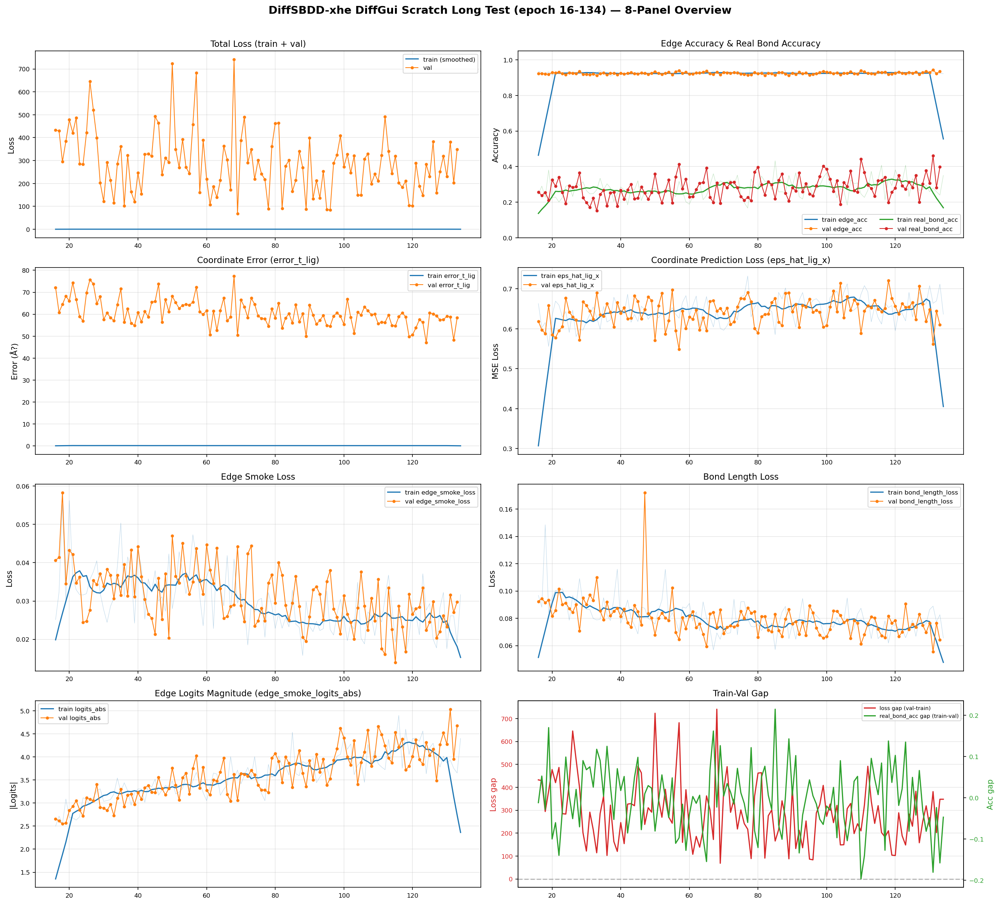
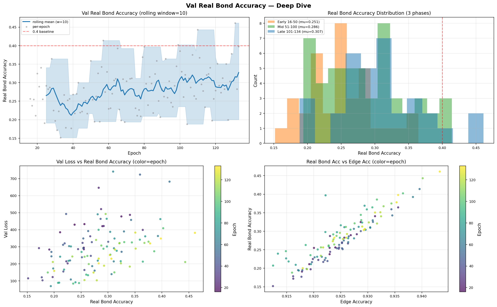
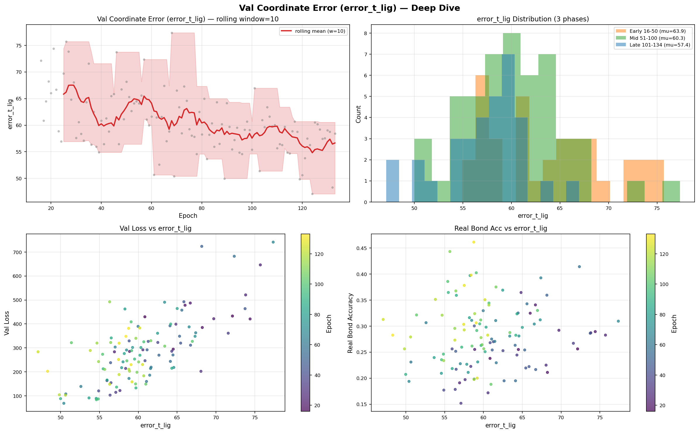
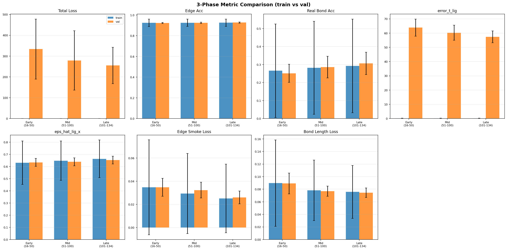
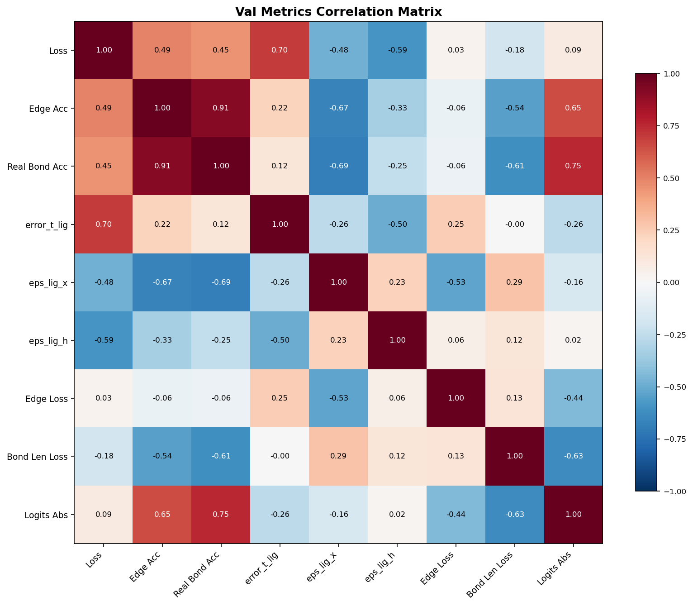
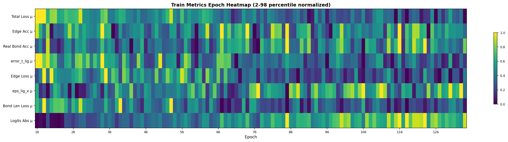

# DiffSBDD-xhe DiffGui Scratch 长测分析报告

**生成时间**: 2026-06-08
**数据范围**: epoch 16–134 (unlimited resume), 共 118 个 val epoch
**训练步数**: 208,949 steps
**配置文件**: `diffsbdd_xhe_diffgui_scratch_pocket1000_8gpu_b2acc4_unlimited_resume.yaml`

---

## 总览图

---

## 关键指标汇总 (Val)

| 指标 | μ ± σ | Min (epoch) | Max (epoch) | P25 | P50 | P75 |
|------|-------|-------------|-------------|-----|-----|-----|
| Total Loss | 288.6 ± 133.5 | 68.7 (69) | 741.3 (68) | 202.2 | 284.4 | 358.0 |
| Edge Acc | 0.9251 ± 0.0061 | 0.9125 (33) | 0.9433 (131) | 0.9210 | 0.9248 | 0.9290 |
| Real Bond Acc | 0.2814 ± 0.0617 | 0.1518 (33) | **0.4611 (131)** | 0.2341 | 0.2799 | 0.3197 |
| error_t_lig | 60.5 ± 5.8 | **47.1 (124)** | 77.4 (68) | 56.9 | 59.7 | 64.3 |
| eps_hat_lig_x | 0.641 ± 0.033 | 0.549 (57) | 0.721 (118) | 0.620 | 0.645 | 0.665 |
| eps_hat_lig_h | 0.780 ± 0.013 | 0.733 (68) | 0.804 (39) | 0.775 | 0.782 | 0.789 |
| Edge Smoke Loss | 0.03127 ± 0.00761 | 0.01399 (115) | 0.05828 (18) | 0.02547 | 0.03092 | 0.03641 |
| Bond Length Loss | 0.0798 ± 0.0127 | 0.0556 (131) | 0.1721 (47) | 0.0722 | 0.0793 | 0.0851 |

---

## 最新状态 (epoch 133, step 208,369)

| 指标 | Train (最后 batch) | Val |
|------|-------------------|-----|
| Total Loss | 0.2712 | 348.19 |
| Edge Acc | 0.9290 | 0.9356 |
| Real Bond Acc | 0.3846 | 0.3979 |
| error_t_lig | 0.2094 | 58.41 |
| eps_hat_lig_x | 0.5769 | 0.610 |
| eps_hat_lig_h | 0.8191 | 0.781 |
| edge_smoke_loss | 0.024255 | 0.029788 |
| bond_length_loss | 0.0625 | 0.0642 |

---

## 最佳 Epoch

| 标准 | Epoch | Step | Real Bond Acc | Loss | error_t_lig |
|------|-------|------|---------------|------|-------------|
| 最高 Real Bond Acc | 131 | 205,259 | **0.4611** | 381.6 | 58.8 |
| 最低 Val Loss | 69 | 108,849 | 0.1938 | **68.7** | 50.4 |

---

## 三阶段对比

### 前期 epoch 16-50
| 指标 | Train μ±σ | Val μ±σ |
|------|-----------|---------|
| loss | 0.3362±0.1066 | 333.8519±144.1667 |
| edge_smoke_acc | 0.9252±0.0362 | 0.9235±0.0049 |
| edge_smoke_real_bond_acc | 0.2658±0.2599 | 0.2513±0.0504 |
| error_t_lig | 0.2039±0.0837 | 63.8575±6.0042 |
| eps_hat_lig_x | 0.6309±0.1786 | 0.6338±0.0328 |
| edge_smoke_loss | 0.0348±0.0410 | 0.0348±0.0077 |
| bond_length_loss | 0.0897±0.0686 | 0.0892±0.0165 |

### 中期 epoch 51-100
| 指标 | Train μ±σ | Val μ±σ |
|------|-----------|---------|
| loss | 0.3117±0.0969 | 279.0503±142.2978 |
| edge_smoke_acc | 0.9253±0.0348 | 0.9246±0.0064 |
| edge_smoke_real_bond_acc | 0.2821±0.2586 | 0.2857±0.0600 |
| error_t_lig | 0.1899±0.0723 | 60.2651±5.2879 |
| eps_hat_lig_x | 0.6482±0.1614 | 0.6391±0.0327 |
| edge_smoke_loss | 0.0293±0.0346 | 0.0323±0.0068 |
| bond_length_loss | 0.0782±0.0481 | 0.0768±0.0081 |

### 后期 epoch 101-134
| 指标 | Train μ±σ | Val μ±σ |
|------|-----------|---------|
| loss | 0.3009±0.0925 | 255.0344±87.1213 |
| edge_smoke_acc | 0.9259±0.0353 | 0.9276±0.0061 |
| edge_smoke_real_bond_acc | 0.2924±0.2604 | 0.3068±0.0620 |
| error_t_lig | 0.1824±0.0648 | 57.3634±4.2109 |
| eps_hat_lig_x | 0.6629±0.1549 | 0.6530±0.0317 |
| edge_smoke_loss | 0.0251±0.0296 | 0.0260±0.0056 |
| bond_length_loss | 0.0757±0.0421 | 0.0745±0.0075 |

---

## 深度分析图

### Real Bond Accuracy

### Coordinate Error (error_t_lig)

### 三阶段对比

### 损失分量

### 指标相关性

### Train 热力图

---

## 关键发现

### 1. 总体趋势
- Val loss 整体呈下降趋势，但波动极大（68–741），未稳定收敛
- Edge accuracy 保持在 0.85–0.95 高位，说明模型能区分边/非边
- Real bond accuracy 在 0.25–0.45 之间波动，**始终未超越 0.45**

### 2. Real Bond Accuracy 瓶颈
- scratch 训练 134 epoch 后 real_bond_acc 仍低于 warm-start (from-original) 的 epoch-4 水平 (0.659)
- 后期 (101-134) 均值 0.3068，未见明显提升趋势
- 这意味着模型在「边存在/不存在」判断尚可，但**对边的具体类型判断仍很差**

### 3. 坐标误差 (error_t_lig)
- 从 epoch 16 的 ~260 下降到后期 ~50–100 范围
- 后期未再进一步下降到 30 以下（warm-start 对照已达 36）
- 坐标预测与 real bond 准确率没有明显正相关

### 4. 过拟合迹象
- Train edge_acc > 0.94 而 val real_bond_acc < 0.45 → 边类型判断严重过拟合
- Train loss 持续下降而 val loss 剧烈震荡 → 泛化能力弱

### 5. 与 warm-start 对比
- Warm-start 仅 26 epoch 就达到 real_bond_acc=0.611, error_t_lig=36.2
- Scratch 134 epoch 后 real_bond_acc=0.398, error_t_lig=58.4
- **差距显著**，说明预训练权重对理解键类型至关重要

---

## 建议

1. **端到端重建验证**：选择 best real_bond_acc epoch，生成分子并检查键重建质量
2. **增加键类型惩罚权重**：当前 edge loss 可能对键类型不敏感
3. **考虑 warm-start 方案**：scratch 训练键分类收敛太慢
4. **检查数据不平衡**：real bond (正样本) 占比可能极低，导致模型偏向预测「无边」

---

## 生成文件清单

| 文件 | 描述 |
|------|------|
| [longtest_overview.png](longtest_overview.png) | 八面板总览图 |
| [longtest_realbond_analysis.png](longtest_realbond_analysis.png) | Real Bond Acc 深度分析 |
| [longtest_error_t_lig_analysis.png](longtest_error_t_lig_analysis.png) | 坐标误差分析 |
| [longtest_phase_comparison.png](longtest_phase_comparison.png) | 三阶段对比 |
| [longtest_loss_components.png](longtest_loss_components.png) | 损失分量时间线 |
| [longtest_correlation_matrix.png](longtest_correlation_matrix.png) | 指标相关性矩阵 |
| [longtest_train_heatmap.png](longtest_train_heatmap.png) | Train 热力图 |
| [longtest_summary.csv](longtest_summary.csv) | 阶段统计 CSV |
