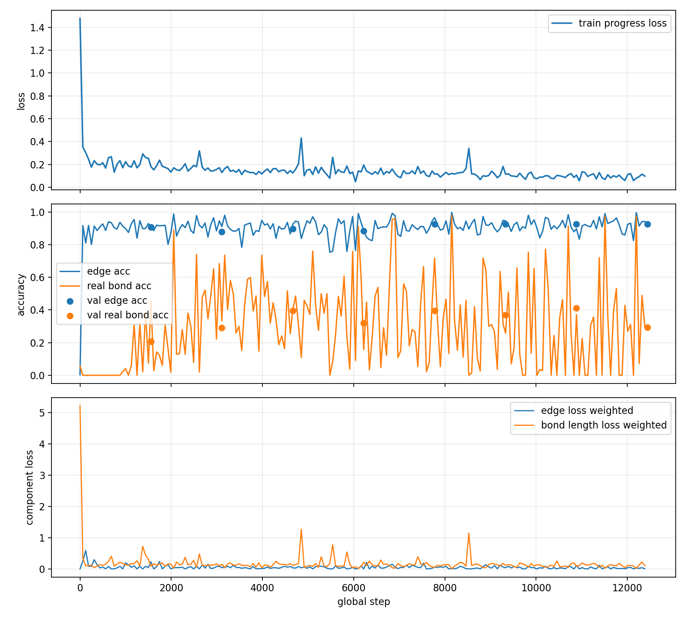

# DiffSBDD-xhe DiffGui-style scratch 长测状态

- 更新时间: `2026-06-06T15:57:40`
- 配置: [`diffsbdd_xhe_diffgui_scratch_pocket1000_8gpu_b2acc4_8ep.yaml`](diffsbdd_xhe_diffgui_scratch_pocket1000_8gpu_b2acc4_8ep.yaml)
- 启动脚本: [`run_xhe_diffgui_scratch_pocket1000_8gpu_b2acc4_8ep.sh`](run_xhe_diffgui_scratch_pocket1000_8gpu_b2acc4_8ep.sh)
- 训练日志: [`train_xhe_diffgui_scratch_pocket1000_8gpu_b2acc4_8ep.log`](train_xhe_diffgui_scratch_pocket1000_8gpu_b2acc4_8ep.log)
- 原始 metrics: [`metrics.csv`](lightning/diffsbdd-xhe-diffgui-scratch-pocket1000-8gpu-260606-b2acc4-8ep/metrics/metrics.csv)
- 解析进度 CSV: [`metrics_so_far.csv`](metrics_so_far.csv)
- 状态 JSON: [`longtest_status.json`](longtest_status.json)

## 当前进度

- 最新 train-progress: epoch `8/8`, batch `6000`, step `12385`, elapsed `166.2` min, loss `0.0970`, edge_acc `0.9417`, real_bond_acc `0.2941`。
- 最新 epoch validation: epoch `7`, step `12439`, loss/val `608`, edge_acc/val `0.9270`, real_bond_acc/val `0.2939`, bond_length_loss/val `0.1035`, error_t_lig/val `93.82`。
- 最近日志错误标记: `no`。

## Epoch 验证汇总

| epoch | step | loss/val | edge_acc/val | real_bond_acc/val | bond_length_loss/val | error_t_lig/val |
|---:|---:|---:|---:|---:|---:|---:|
| 0 | 1554 | 1.82e+03 | 0.9071 | 0.2059 | 0.1937 | 260 |
| 1 | 3109 | 1.72e+03 | 0.8780 | 0.2919 | 0.1510 | 191 |
| 2 | 4664 | 1.09e+03 | 0.8962 | 0.3958 | 0.1287 | 169 |
| 3 | 6219 | 1.06e+03 | 0.8855 | 0.3210 | 0.1302 | 143 |
| 4 | 7774 | 1.06e+03 | 0.9251 | 0.3956 | 0.1203 | 117 |
| 5 | 9329 | 723 | 0.9274 | 0.3706 | 0.1135 | 117 |
| 6 | 10884 | 979 | 0.9273 | 0.4106 | 0.3407 | 105 |
| 7 | 12439 | 608 | 0.9270 | 0.2939 | 0.1035 | 93.82 |

## Checkpoint

| 文件 | 大小 MB | mtime |
|---|---:|---|
| `best-model-epoch=epoch=0007.ckpt` | 18.0 | `2026-06-06T15:51:23` |
| `epoch=epoch=0000.ckpt` | 18.0 | `2026-06-06T13:25:49` |
| `epoch=epoch=0001.ckpt` | 18.0 | `2026-06-06T13:46:45` |
| `epoch=epoch=0002.ckpt` | 18.0 | `2026-06-06T14:07:19` |
| `epoch=epoch=0003.ckpt` | 18.0 | `2026-06-06T14:28:16` |
| `epoch=epoch=0004.ckpt` | 18.0 | `2026-06-06T14:49:01` |
| `epoch=epoch=0005.ckpt` | 18.0 | `2026-06-06T15:09:52` |
| `epoch=epoch=0006.ckpt` | 18.0 | `2026-06-06T15:30:36` |
| `epoch=epoch=0007.ckpt` | 18.0 | `2026-06-06T15:51:23` |
| `last.ckpt` | 18.0 | `2026-06-06T15:51:23` |

## 初步判断

- 该长测用于验证 `xhe` scratch + absorb prior + segment schedule + diffusion KL edge loss 是否能在真实 DiffSBDD 训练链里学习边。
- 仅看前期 `train-progress`，整体 edge accuracy 很快升高，但 real-bond accuracy 起步低且波动大；是否真正改善生成重建，必须等训练完成后做 generation/reconstruction 验证。
- 当前 validation x/h loss 仍偏高，说明坐标/原子类型分支还没稳定，不能只凭 edge accuracy 判断成功。
