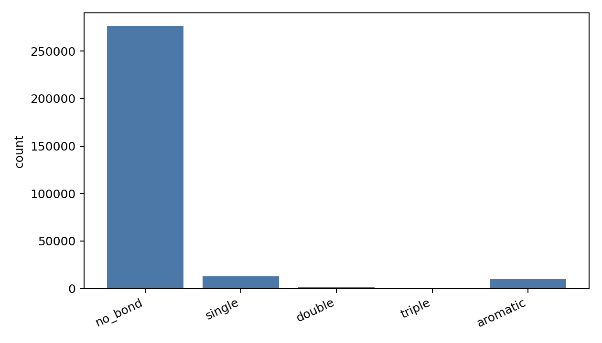
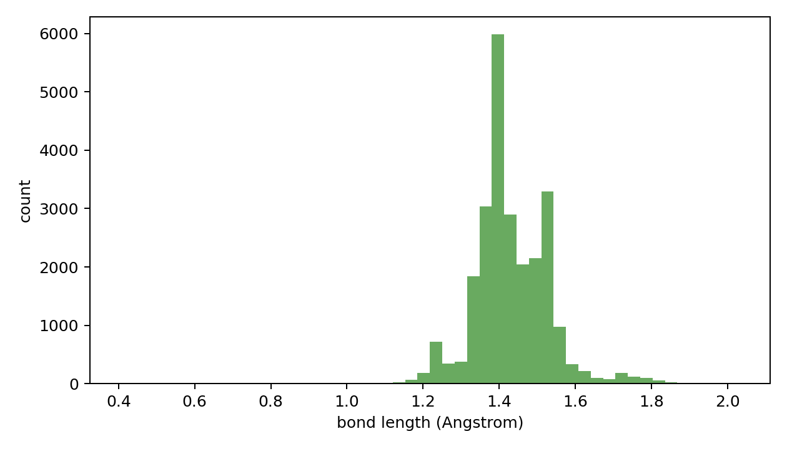

# Edge Data Oracle Report

- npz_path: `data/crossdocked_raw/processed_edge_noH_full/train.npz`
- dataset: `crossdock_full`
- samples: 1000
- oracle_sanitize_success: 870/1000
- unsupported_atom_type: 0
- oracle_sdf: `analysis/edge_data_chain_20260602_n1000/oracle_reconstruct.sdf`
- oracle_sdf_write_success: 1000/1000
- oracle_sdf_write_error: 0
- total_halfedges: 301578
- total_real_bonds: 25161
- no_bond_fraction: 0.916569
- bad_bond_length_rate: 0.006132 (153/24952)

## Sanitize Error Counts

| sanitize_error | count | fraction |
|---|---:|---:|
| AtomValenceException | 11 | 0.01100000 |
| KekulizeException | 119 | 0.11900000 |
| success | 870 | 0.87000000 |

