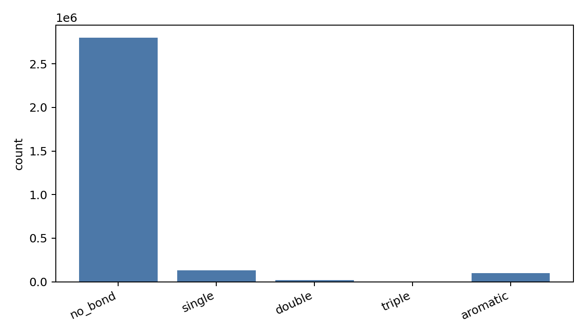
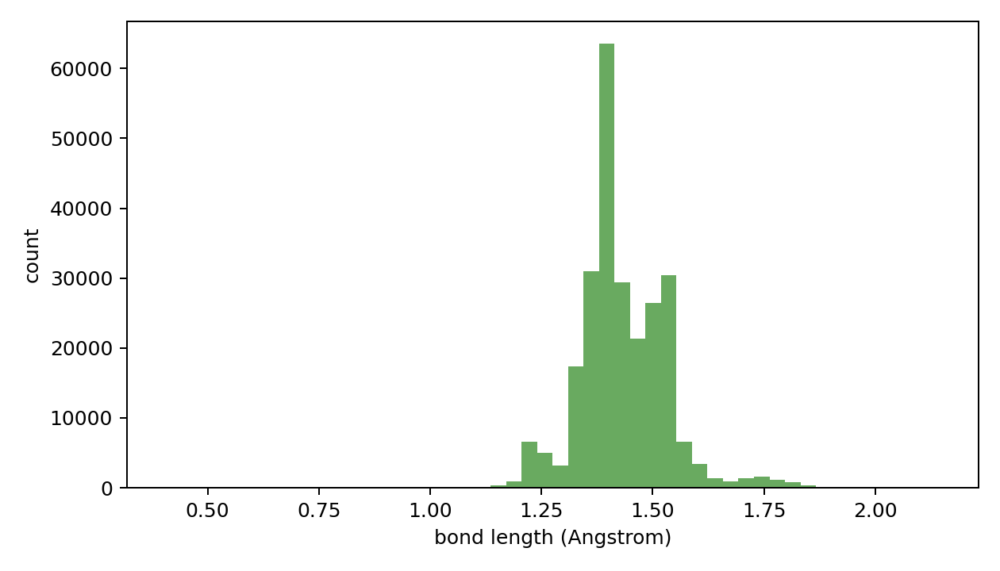

# Edge Data Oracle Report

- npz_path: `data/crossdocked_raw/processed_edge_noH_full/train.npz`
- dataset: `crossdock_full`
- samples: 10000
- oracle_sanitize_success: 10000/10000
- unsupported_atom_type: 0
- oracle_sdf: `analysis/edge_data_chain_20260604_repair_n10000/oracle_reconstruct.sdf`
- oracle_sdf_write_success: 10000/10000
- oracle_sdf_write_error: 0
- total_halfedges: 3056103
- total_real_bonds: 253589
- no_bond_fraction: 0.917022
- bad_bond_length_rate: 0.007265 (1828/251603)

## Sanitize Error Counts

Final sanitize status after oracle reconstruction repairs.

| sanitize_error | count | fraction |
|---|---:|---:|
| success | 10000 | 1.00000000 |

## Initial Sanitize Error Counts

| initial_sanitize_error | count | fraction |
|---|---:|---:|
| AtomValenceException | 168 | 0.01680000 |
| KekulizeException | 1191 | 0.11910000 |
| success | 8641 | 0.86410000 |

## Repair Strategy Counts

| repair_strategy | count | fraction |
|---|---:|---:|
| fix_aromatic | 22 | 0.00220000 |
| fix_valence | 1337 | 0.13370000 |
| none | 8641 | 0.86410000 |

