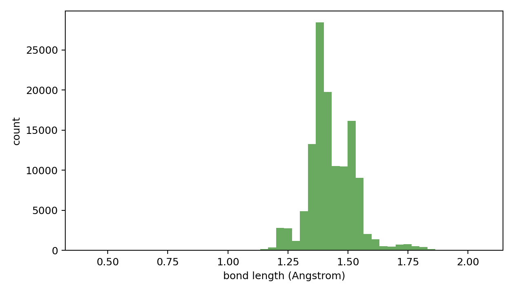

# Edge Data Oracle Report

- npz_path: `data/crossdocked_raw/processed_edge_noH_full/train.npz`
- dataset: `crossdock_full`
- samples: 5000
- oracle_sanitize_success: 4334/5000
- unsupported_atom_type: 0
- total_halfedges: 1526163
- total_real_bonds: 126892
- no_bond_fraction: 0.916856
- bad_bond_length_rate: 0.007135 (898/125857)

