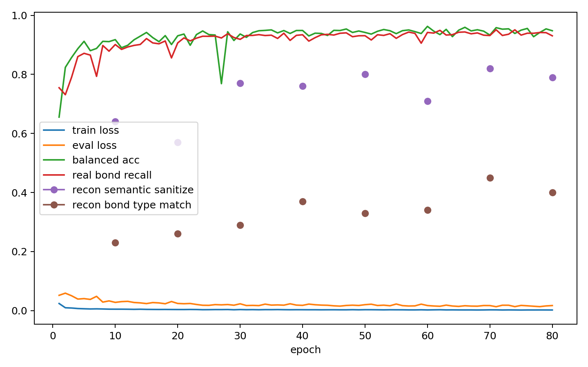

# Edge Denoiser Train/Val Report

- edge_npz: `analysis/edge_data_chain_20260602_n1000/train_edge.npz`
- semantic_npz: `analysis/edge_semantic_bundle_20260602_n1000/train_edge_semantic.npz`
- device: `cuda`
- max_molecules: 1000
- split_mode: `train_val`
- train_molecules: 800
- eval_molecules: 200
- epochs: 80
- batch_size: 16
- model_kind: `node_edge`
- focal_gamma: 1.0
- class_weight_mode: `inverse_sqrt`
- no_bond_weight: 0.1
- pos_noise_std: 0.0
- reconstruction_validation: `True`
- reconstruction_timestep: 500
- reconstruction_limit: 100

## Class Counts And Weights

| bond type | count | weight |
|---|---:|---:|
| no_bond | 222488 | 0.056081 |
| single | 10392 | 0.259477 |
| double | 1657 | 0.649646 |
| triple | 49 | 3.740969 |
| aromatic | 8104 | 0.293828 |

## Eval Class Counts

| bond type | count |
|---|---:|
| no_bond | 53929 |
| single | 2574 |
| double | 439 |
| triple | 12 |
| aromatic | 1934 |

## Final Metrics

| metric | value |
|---|---:|
| train_loss | 0.001920 |
| eval_loss | 0.016963 |
| accuracy | 0.994158 |
| balanced_accuracy | 0.947865 |
| macro_precision | 0.910891 |
| macro_f1 | 0.927689 |
| real_bond_precision | 0.930819 |
| real_bond_recall | 0.930631 |
| real_bond_f1 | 0.930725 |
| no_bond_recall | 1.000000 |
| precision_single | 0.957489 |
| recall_single | 0.936286 |
| f1_single | 0.946769 |
| precision_double | 0.719697 |
| recall_double | 0.865604 |
| f1_double | 0.785936 |
| precision_triple | 0.923077 |
| recall_triple | 1.000000 |
| f1_triple | 0.960000 |
| precision_aromatic | 0.954211 |
| recall_aromatic | 0.937435 |
| f1_aromatic | 0.945749 |

## Final Reconstruction Metrics

| metric | value |
|---|---:|
| recon_molecules | 100.000000 |
| recon_exact_halfedge_match_rate | 0.400000 |
| recon_bond_pair_set_match_rate | 1.000000 |
| recon_bond_type_map_match_rate | 0.400000 |
| recon_plain_sanitize_success_rate | 0.790000 |
| recon_semantic_sanitize_success_rate | 0.790000 |
| recon_plain_smiles_no_stereo_match_rate | 0.430000 |
| recon_semantic_smiles_no_stereo_match_rate | 0.540000 |
| recon_mean_bad_bond_length_fraction | 0.000000 |

## Best Balanced Accuracy Epoch

- epoch: 60
- balanced_accuracy: 0.962664
- real_bond_recall: 0.942125

## Files

- [edge_denoiser_overfit_metrics.csv](edge_denoiser_overfit_metrics.csv)
- [edge_denoiser_overfit_summary.json](edge_denoiser_overfit_summary.json)
- [edge_denoiser_overfit.pt](edge_denoiser_overfit.pt)

