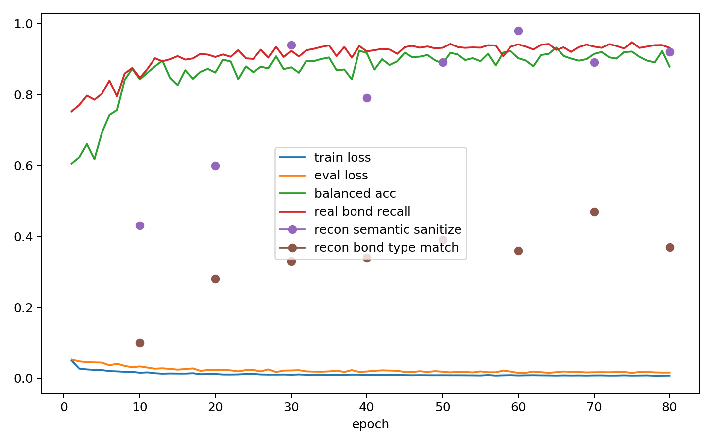

# Edge Denoiser Train/Val Report

- edge_npz: `analysis/edge_data_chain_20260602_n1000/train_edge.npz`
- semantic_npz: `analysis/edge_semantic_bundle_20260602_n1000/train_edge_semantic.npz`
- device: `cuda`
- max_molecules: 1000
- split_mode: `train_val`
- train_molecules: 800
- eval_molecules: 200
- epochs: 80
- batch_size: 16
- model_kind: `node_edge`
- focal_gamma: 1.0
- class_weight_mode: `diffgui`
- no_bond_weight: 0.1
- pos_noise_std: 0.1
- reconstruction_validation: `True`
- reconstruction_timestep: 500
- reconstruction_limit: 100

## Class Counts And Weights

| bond type | count | weight |
|---|---:|---:|
| no_bond | 222488 | 0.100000 |
| single | 10392 | 1.000000 |
| double | 1657 | 1.000000 |
| triple | 49 | 1.000000 |
| aromatic | 8104 | 1.000000 |

## Eval Class Counts

| bond type | count |
|---|---:|
| no_bond | 53929 |
| single | 2574 |
| double | 439 |
| triple | 12 |
| aromatic | 1934 |

## Final Metrics

| metric | value |
|---|---:|
| train_loss | 0.007119 |
| eval_loss | 0.015649 |
| accuracy | 0.994226 |
| balanced_accuracy | 0.878349 |
| macro_precision | 0.928822 |
| macro_f1 | 0.897285 |
| real_bond_precision | 0.931438 |
| real_bond_recall | 0.931438 |
| real_bond_f1 | 0.931438 |
| no_bond_recall | 1.000000 |
| precision_single | 0.928598 |
| recall_single | 0.954934 |
| f1_single | 0.941582 |
| precision_double | 0.948980 |
| recall_double | 0.635535 |
| f1_double | 0.761255 |
| precision_triple | 0.833333 |
| recall_triple | 0.833333 |
| f1_triple | 0.833333 |
| precision_aromatic | 0.933200 |
| recall_aromatic | 0.967942 |
| f1_aromatic | 0.950254 |

## Final Reconstruction Metrics

| metric | value |
|---|---:|
| recon_molecules | 100.000000 |
| recon_exact_halfedge_match_rate | 0.370000 |
| recon_bond_pair_set_match_rate | 1.000000 |
| recon_bond_type_map_match_rate | 0.370000 |
| recon_plain_sanitize_success_rate | 0.930000 |
| recon_semantic_sanitize_success_rate | 0.920000 |
| recon_plain_smiles_no_stereo_match_rate | 0.380000 |
| recon_semantic_smiles_no_stereo_match_rate | 0.450000 |
| recon_mean_bad_bond_length_fraction | 0.000000 |

## Best Balanced Accuracy Epoch

- epoch: 65
- balanced_accuracy: 0.932296
- real_bond_recall: 0.925590

## Files

- [edge_denoiser_overfit_metrics.csv](edge_denoiser_overfit_metrics.csv)
- [edge_denoiser_overfit_summary.json](edge_denoiser_overfit_summary.json)
- [edge_denoiser_overfit.pt](edge_denoiser_overfit.pt)

