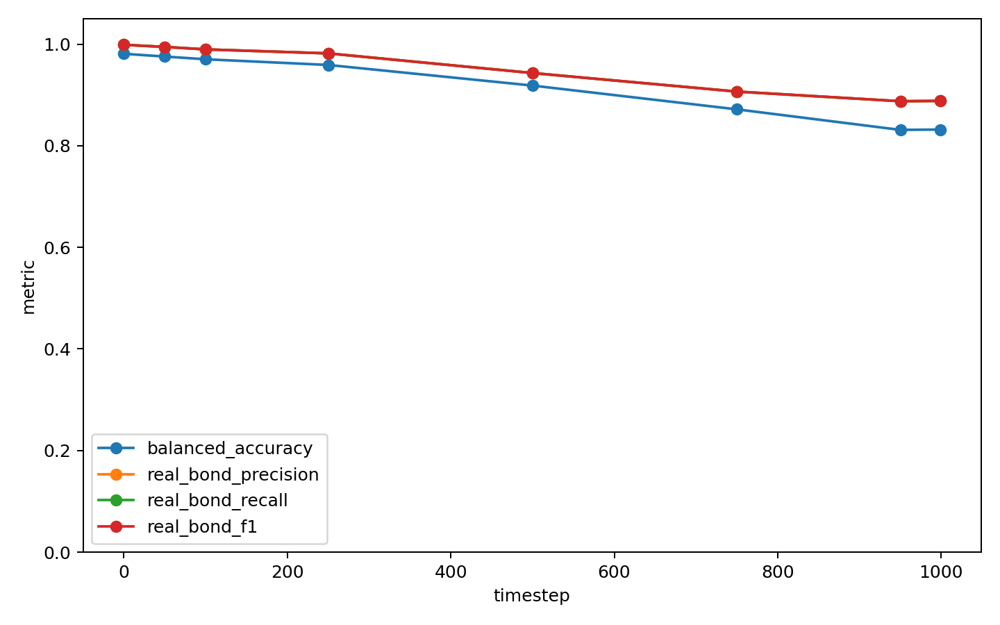
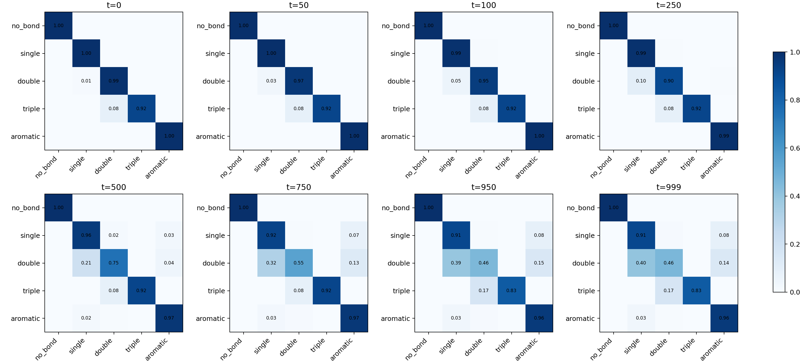

# Edge Denoiser Evaluation Report

- checkpoint: `analysis/edge_denoiser_ablation_20260603_C_diffgui_noise005_focal2_gpu/edge_denoiser_overfit.pt`
- device: `cuda`
- eval_split: `val`
- eval_molecules: 200
- timesteps: [0, 50, 100, 250, 500, 750, 950, 999]
- reconstruct_timestep: 500

## Classification Summary

| metric | value |
|---|---:|
| best_timestep | 0 |
| best_balanced_accuracy | 0.9810554385185242 |
| best_real_bond_recall | 0.9987900853157043 |
| worst_timestep | 950 |
| worst_balanced_accuracy | 0.8312240839004517 |
| worst_real_bond_recall | 0.8876789808273315 |

## Reconstruction Summary

| metric | value |
|---|---:|
| molecules | 200 |
| exact_halfedge_match_rate | 0.485 |
| bond_pair_set_match_rate | 1.0 |
| bond_type_map_match_rate | 0.485 |
| mean_halfedge_accuracy | 0.9923391577601433 |
| mean_bond_pair_precision | 1.0 |
| mean_bond_pair_recall | 1.0 |
| plain_sanitize_success_rate | 0.935 |
| semantic_sanitize_success_rate | 0.935 |
| plain_smiles_no_stereo_match_rate | 0.495 |
| semantic_smiles_no_stereo_match_rate | 0.555 |
| mean_bad_bond_length_fraction | 0.0 |
| total_bad_bond_length_count | 0 |

## Files

- [metrics_by_t.csv](metrics_by_t.csv)
- [per_class_metrics_by_t.csv](per_class_metrics_by_t.csv)
- [confusion_matrix_by_t.csv](confusion_matrix_by_t.csv)
- [reconstruction_rows.csv](reconstruction_rows.csv)
- [edge_denoiser_eval_summary.json](edge_denoiser_eval_summary.json)
- [predicted_bond_plain_t500.sdf](predicted_bond_plain_t500.sdf)
- [predicted_bond_semantic_t500.sdf](predicted_bond_semantic_t500.sdf)
